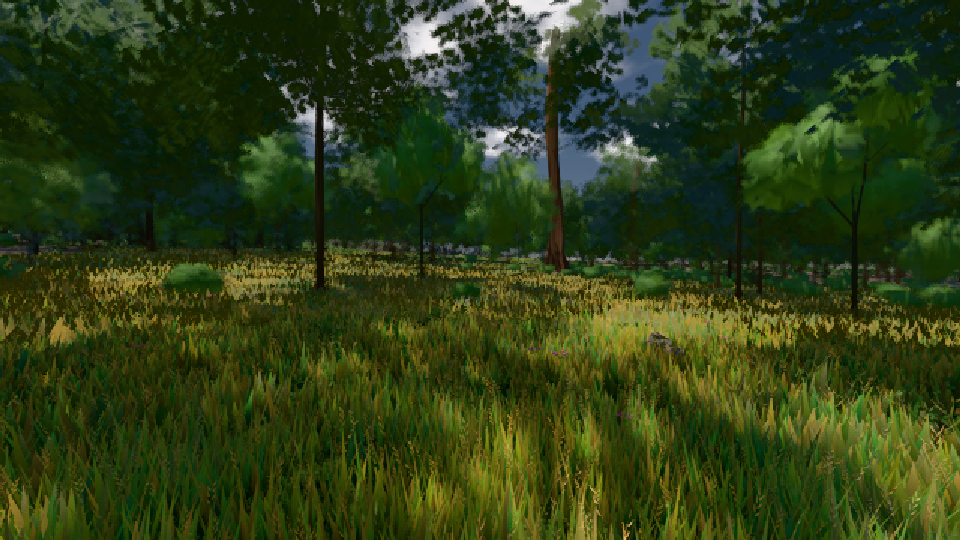

# GPU-PROBE 1f8b19ed — ROT

Zweig `w25-ferne-licht-2` · Kopf 1f8b19ed145a3a6f11cc1e2bf9adfa3492e1338e · Läufer radeon-890m · 08.11. 23:32 · Wanduhr ab Push 2191 s · Lauf https://github.com/MiguellD/AnazhRealm/actions/runs/42527610951

Ruf: `bild:gipfel-blick@0.5 bild:wiese@0.5 bild:gipfel-blick@0.735`

GPU AMD Radeon(TM) 890M Graphics · node_modules bleiben (package-lock 14bd2eb7)
Schloss /c/Users/micha/AppData/Local/Temp/claude/gpu-schloss hält „ci-runner 42527610951/1 probe“
- Hook 2026-11-08 23:09:34 start ci-runner 42527610951/1 probe: Schloss genommen (refs/heads/w25-ferne-licht-2 1f8b19ed145a3a6f11cc1e2bf9adfa3492e1338e ws=C:\actions-runner\_work\AnazhRealm\AnazhRealm)

### bild:gipfel-blick@0.5 — ROT · 622 s

Adapter: [linse-gpu] amd/rdna-3 · DECKEL 480 s

```text
[linse-gpu] amd/rdna-3
```

### bild:wiese@0.5 — GRÜN · 54 s

Adapter: [linse-gpu] amd/rdna-3

```text
Kamera des Spiels → Blick (10.0 m): -280.40 29.71 -1045.60 -289.61 29.71 -1049.50
 "abnahme": "ABNAHME GRÜN · beweis · Sicht 0.0 % · Ziel Blickziel im Bild frei 10 m · Luma 55.3 σ 31.4 schwarz 0.0 % weiß 0.0 % · Stand 18.546.226 · Bühne summer sunny 0.50 · Gerät WebGPU amd rdna-3",
```



### bild:gipfel-blick@0.735 — ROT · 619 s

Adapter: [linse-gpu] amd/rdna-3 · DECKEL 480 s

```text
[linse-gpu] amd/rdna-3
```
