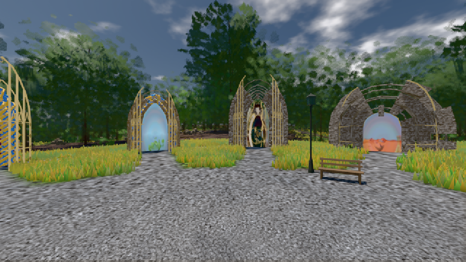
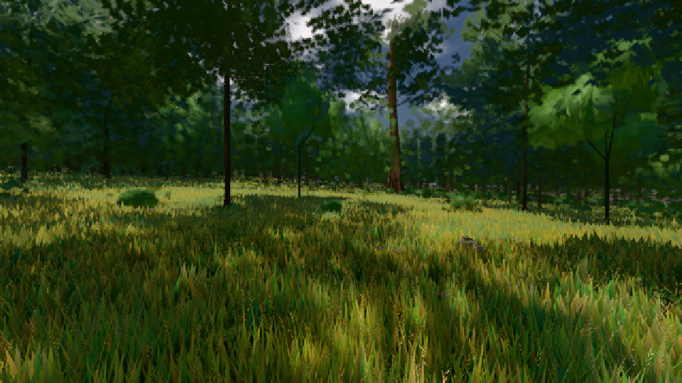

# GPU-PROBE f102e1f5 — ROT

Zweig `w25-ferne-licht-5` · Kopf f102e1f539a76d49a1ca7c3d7fc3b363a7ef34ad · Läufer omen-gtx1060 · 09.11. 04:54 · Wanduhr ab Push 1243 s · Lauf https://github.com/MiguellD/AnazhRealm/actions/runs/42557043284

Ruf: `bild:genesis@0.5 bild:wiese@0.5 bild:gipfel-blick@0.5`

GPU NVIDIA GeForce GTX 1060 · node_modules bleiben (package-lock c278d7b5)
Schloss /c/Users/micha/AppData/Local/Temp/claude/gpu-schloss hält „ci-runner 42557043284/1 probe“
- Hook 2026-11-09 04:43:52 start ci-runner 42557043284/1 probe: Schloss genommen (refs/heads/w25-ferne-licht-5 f102e1f539a76d49a1ca7c3d7fc3b363a7ef34ad ws=C:\actions-runner\_work\AnazhRealm\AnazhRealm)

### bild:genesis@0.5 — GRÜN · 38 s

Adapter: [linse-gpu] nvidia/pascal

```text
Kamera des Spiels → Blick (10.0 m): 0.00 92.40 0.00 -10.00 92.40 0.00
 "abnahme": "ABNAHME GRÜN · beweis · Sicht 0.0 % · Ziel Blickziel im Bild frei 10 m · Luma 105.1 σ 37.7 schwarz 0.0 % weiß 0.0 % · Stand 18.546.232 · Bühne summer sunny 0.50 · Gerät WebGPU nvidia pascal",
```



### bild:wiese@0.5 — GRÜN · 42 s

Adapter: [linse-gpu] nvidia/pascal

```text
Kamera des Spiels → Blick (10.0 m): -280.40 29.71 -1045.60 -289.61 29.71 -1049.50
 "abnahme": "ABNAHME GRÜN · beweis · Sicht 0.0 % · Ziel Blickziel im Bild frei 10 m · Luma 56.7 σ 33.2 schwarz 0.0 % weiß 0.0 % · Stand 18.546.232 · Bühne summer sunny 0.50 · Gerät WebGPU nvidia pascal",
```



### bild:gipfel-blick@0.5 — ROT · 511 s

Adapter: [linse-gpu] nvidia/pascal · DECKEL 480 s

```text
[linse-gpu] nvidia/pascal
```
