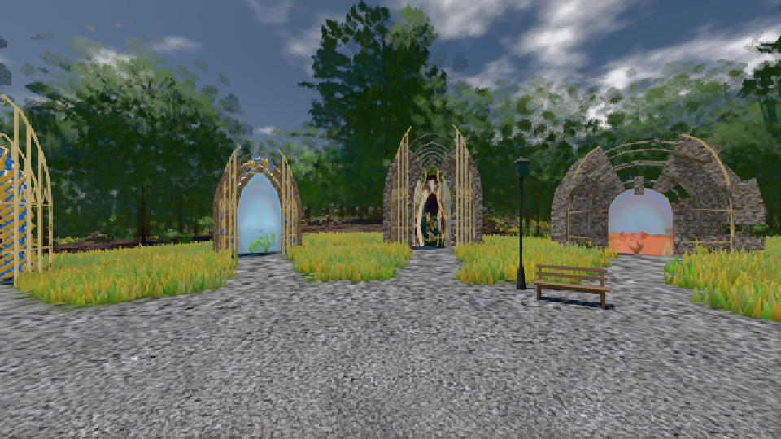
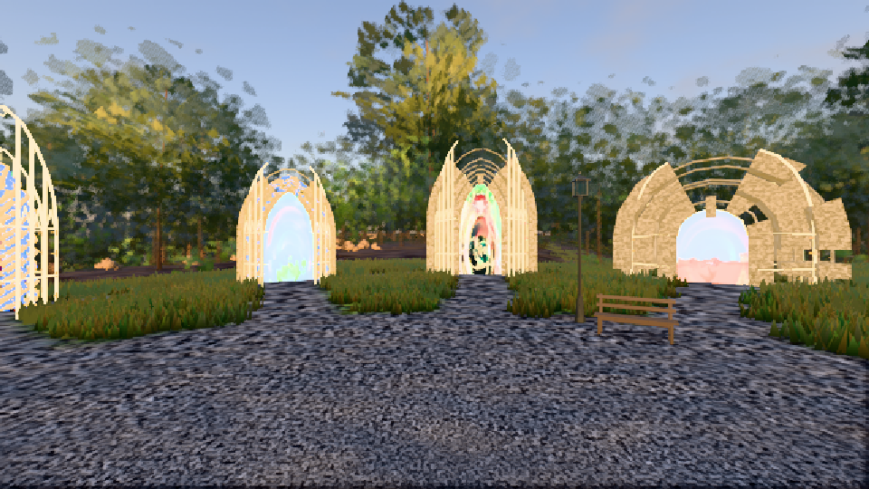

# GPU-PROBE 42f5cb6c — GRÜN

Zweig `w25-ferne-licht-6` · Kopf 42f5cb6c96bb592fb2d02289a1b57c1b83860863 · Läufer omen-gtx1060 · 09.11. 06:21 · Wanduhr ab Push 385 s · Lauf https://github.com/MiguellD/AnazhRealm/actions/runs/42566208803

Ruf: `bild:genesis@0.5 bild:genesis@0.27`

GPU NVIDIA GeForce GTX 1060 · npm ci 33 s (package-lock 0cb87dd6)
Schloss /c/Users/micha/AppData/Local/Temp/claude/gpu-schloss hält „ci-runner 42566208803/1 probe“
- Hook 2026-11-09 06:19:10 start ci-runner 42566208803/1 probe: Schloss genommen (refs/heads/w25-ferne-licht-6 42f5cb6c96bb592fb2d02289a1b57c1b83860863 ws=C:\actions-runner\_work\AnazhRealm\AnazhRealm)

### bild:genesis@0.5 — GRÜN · 44 s

Adapter: [linse-gpu] nvidia/pascal

```text
Kamera des Spiels → Blick (10.0 m): 0.00 92.40 0.00 -10.00 92.40 0.00
 "abnahme": "ABNAHME GRÜN · beweis · Sicht 0.0 % · Ziel Blickziel im Bild frei 10 m · Luma 105.1 σ 37.7 schwarz 0.0 % weiß 0.0 % · Stand 18.546.234 · Bühne summer sunny 0.50 · Gerät WebGPU nvidia pascal",
```



### bild:genesis@0.27 — GRÜN · 47 s

Adapter: [linse-gpu] nvidia/pascal

```text
Kamera des Spiels → Blick (10.0 m): 0.00 92.40 0.00 -10.00 92.40 0.00
 "abnahme": "ABNAHME GRÜN · beweis · Sicht 0.0 % · Ziel Blickziel im Bild frei 10 m · Luma 116 σ 58 schwarz 0.0 % weiß 0.0 % · Stand 18.546.234 · Bühne summer sunny 0.27 · Gerät WebGPU nvidia pascal",
```


