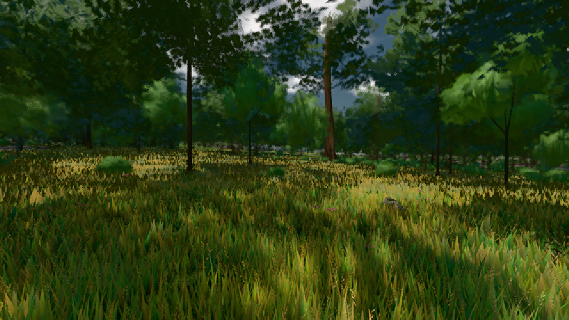

# GPU-PROBE 888b476d — ROT

Zweig `w25-ferne-licht-vorher` · Kopf 888b476d391b9bc2db07d06bf08621c421039494 · Läufer omen-gtx1060 · 08.11. 22:30 · Wanduhr ab Push 1863 s · Lauf https://github.com/MiguellD/AnazhRealm/actions/runs/42522841991

Ruf: `bild:gipfel-blick@0.5 bild:wiese@0.5 bild:gipfel-blick@0.735`

GPU NVIDIA GeForce GTX 1060 · node_modules bleiben (package-lock 14bd2eb7)
Schloss /c/Users/micha/AppData/Local/Temp/claude/gpu-schloss hält „ci-runner 42522841991/1 probe“
- Hook 2026-11-08 22:09:54 start ci-runner 42522841991/1 probe: Schloss genommen (refs/heads/w25-ferne-licht-vorher 888b476d391b9bc2db07d06bf08621c421039494 ws=C:\actions-runner\_work\AnazhRealm\AnazhRealm)

### bild:gipfel-blick@0.5 — ROT · 574 s

Adapter: [linse-gpu] nvidia/pascal · DECKEL 480 s

```text
[linse-gpu] nvidia/pascal
```

### bild:wiese@0.5 — GRÜN · 49 s

Adapter: [linse-gpu] nvidia/pascal

```text
Kamera des Spiels → Blick (10.0 m): -280.40 29.71 -1045.60 -289.61 29.71 -1049.50
 "abnahme": "ABNAHME GRÜN · beweis · Sicht 0.0 % · Ziel Blickziel im Bild frei 10 m · Luma 55.1 σ 31.3 schwarz 0.0 % weiß 0.0 % · Stand 18.546.226 · Bühne summer sunny 0.50 · Gerät WebGPU nvidia pascal",
```



### bild:gipfel-blick@0.735 — ROT · 564 s

Adapter: [linse-gpu] nvidia/pascal · DECKEL 480 s

```text
[linse-gpu] nvidia/pascal
```
