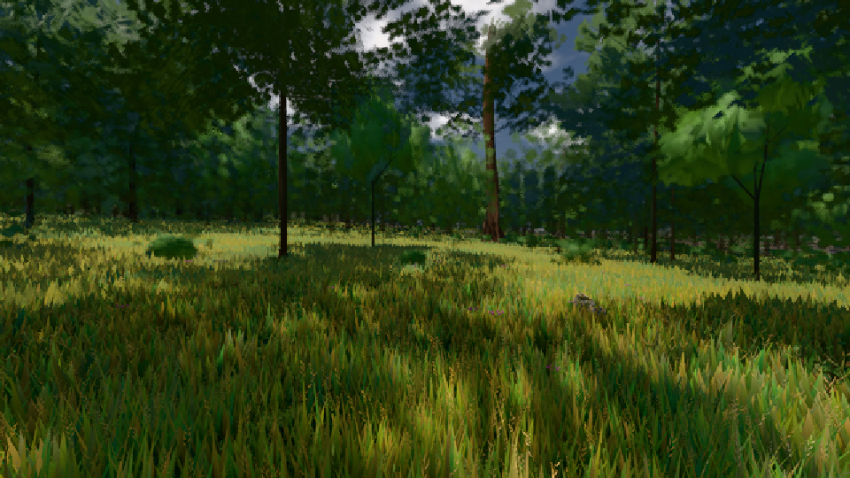

# GPU-PROBE 563ac9c0 — GRÜN

Zweig `w25-gpu-wahl-2` · Kopf 563ac9c0155a33002276eb648871dd8f82e09c04 · Läufer gtx1050-desktop · 09.11. 22:16 · Wanduhr ab Push 696 s · Lauf https://github.com/MiguellD/AnazhRealm/actions/runs/42699127915

Ruf: `gate:schatten-werfer gate:pruefbuehne bild:wiese@0.5`

## Läufer gtx1050-desktop — GRÜN

GPU NVIDIA GeForce GTX 1050 · npm ci 131 s (package-lock affde574)
Schloss /c/Users/User/AppData/Local/Temp/claude/gpu-schloss hält „ci-runner 42699127915/1 probe“
- Hook 2026-11-09 22:05:46 start ci-runner 42699127915/1 probe: Schloss genommen (refs/heads/w25-gpu-wahl-2 563ac9c0155a33002276eb648871dd8f82e09c04 ws=C:\actions-runner\_work\AnazhRealm\AnazhRealm)

### gate:schatten-werfer — GRÜN · 87 s · Läufer gtx1050-desktop

Adapter: ungenannt (die Probe nannte keinen Browser-Adapter)

```text
  ✅ S10 Selbsttest lief für beide Leser
  ✅ S11 Selbsttest: hält die Lage jede Drehung des Lichts (ohne Rand-Prüfung), wählt keine Kaskade über dem Rand neu, und es fehlen Werfer — K8 rot — {"g":[0.01186,0.02552,0.04642],"b":[0.00198,0.00425,0.00774],"l":39,"neu":[false,false,false],"n":["k0: __k8:schwarm","k0: __k8:schwarm","k0: __k8:schwarm"]}
  ✅ S12 Selbsttest: fällt der Licht-Rand aus `_passTrifft`, fehlen in der Folge Werfer — K8 rot — {"g":[0.00198,0.00408,0.00743],"b":[0.00198,0.00425,0.00774],"l":3,"neu":[true,true,true],"n":["k0: __k8:schwarm","k1: __k8:schwarm","k1: __k8:schwarm"]}
  ✅ S13 Selbsttest: fällt die Halb-Regel des Lichts (Halt bis zum ganzen Rand), steht die Grenze beim ganzen Budget — K8 rot — {"g":[0.00387,0.00834,0.01516],"b":[0.00198,0.00425,0.00774],"l":0,"neu":[true,true,true],"n":[]}
  ✅ S14 Selbsttest: die alte Maske der Kaskaden-Kamera (Welt + Zwilling) sieht Nicht-Werfer — W10 rot, beim Namen — Masken 5/5/5 (Soll 4) · 204 gesehen, 47 Werfer, 3 Lichter — 157 falsch: himmel (gesehen) | himmel-sonne (gesehen) | Mesh (gesehen) | SkinnedMesh (gesehen) | vogel (gesehen) | bauSatz (gesehen)
  ✅ S15 Selbsttest: ein Licht ohne Wurf-Ebene sieht die Kaskade nicht — W10 rot, beim Namen — Masken 4/4/4 (Soll 4) · 47 gesehen, 47 Werfer, 4 Lichter — 1 Lichter ohne Wurf-Ebene: __w10:licht
  ✅ S4 Selbsttest: die Absenz-Regel fängt beide alten Frustum-Schreiber der Tiere
  ✅ S5 Selbsttest: das Addon-_updateShadowBounds schreibt die Kaskaden-Kamera
  ✅ S7 Selbsttest: eine zweite Szenen-Tiefe macht Z2 rot — Zeile 156018 `viewportDepthTexture(`
GRÜN schatten-werfer
```

### gate:pruefbuehne — GRÜN · 256 s · Läufer gtx1050-desktop

Adapter: ungenannt (die Probe nannte keinen Browser-Adapter)

```text
✅ SELBSTTEST GRÜN: auf der Bühne wirft das Feld nichts, der Akt setzt, die Wildnis wirft — und der Schein fällt rot beim Namen
```

### bild:wiese@0.5 — GRÜN · 136 s · Läufer gtx1050-desktop

Adapter: [linse-gpu] nvidia/pascal

```text
Kamera des Spiels → Blick (10.0 m): -280.40 29.71 -1045.60 -289.61 29.71 -1049.50
 "abnahme": "ABNAHME GRÜN · beweis · Sicht 0.0 % · Ziel Blickziel im Bild frei 10 m · Luma 56.9 σ 33.3 schwarz 0.0 % weiß 0.0 % · Stand 18.546.238 · Bühne summer sunny 0.50 · Gerät WebGPU nvidia pascal",
```


