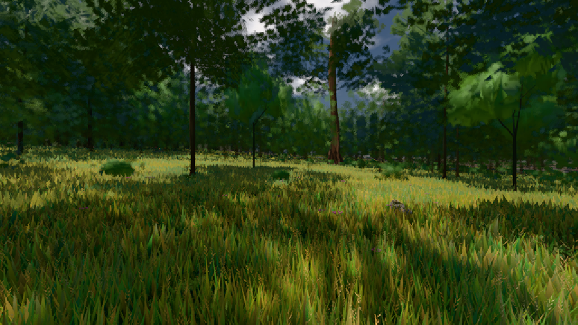

# GPU-PROBE a0a0b0d5 — GRÜN

Zweig `w25-gpu-wahl` · Kopf a0a0b0d5e8d0a6518bc4581867914ff15eb13a94 · Läufer omen-gtx1060 · 09.11. 17:55 · Wanduhr ab Push 805 s · Lauf https://github.com/MiguellD/AnazhRealm/actions/runs/42657367659

Ruf: `gate:pop gate:ego-schatten bild:wiese@0.5`

## Läufer omen-gtx1060 — GRÜN

GPU NVIDIA GeForce GTX 1060 · node_modules bleiben (package-lock 0a1b96a5)
Schloss /c/Users/micha/AppData/Local/Temp/claude/gpu-schloss hält „ci-runner 42657367659/2 probe“
- Hook 2026-11-09 17:51:57 start ci-runner 42657367659/2 probe: Schloss genommen (refs/heads/w25-gpu-wahl a0a0b0d5e8d0a6518bc4581867914ff15eb13a94 ws=C:\actions-runner\_work\AnazhRealm\AnazhRealm)

### gate:pop — GRÜN · 74 s · Läufer omen-gtx1060

Adapter: ungenannt (die Probe nannte keinen Browser-Adapter)

```text
lod.K2#1 GRÜN 0.0311 % Pop-Pixel/s (645 px) · 20*+1@189/27*/263*+2@154/29/37*/69*+2@192/96*+3@155/104*+1@189 · Laub 216 · dc, Dreiecke 80,445206 · GPU 30.54 ms, CPU 3.53 ms je Bild
BLOCK-TREUE GRÜN 179 Blöcke treu · Selbsttest nennt MeshStandardNodeMaterial · nahWiese:L1:0:0 · instanzFarbe: 1/888 Instanzen fremd
```

### gate:ego-schatten — GRÜN · 43 s · Läufer omen-gtx1060

Adapter: [linse-gpu] nvidia/pascal

```text
  ✅ Selbsttest „Zwilling geweckt" → rot: fein: ZWILLING: ein Knoten, der nur in den Kaskaden lebt, trägt nach 1st → 3rd die Maske 5 — die Haupt-Kamera sähe ihn
  ✅ Selbsttest „visible geschaltet" → rot: fein: ZURÜCK: die Regel schaltet visible an 2 Knoten
  ✅ Selbsttest „Haupt-Kamera sieht die Zwillings-Ebene" → rot: fein: VERTRAG: die Haupt-Kamera sieht Ebene 2
  ✅ Selbsttest „Bühne ohne Schatten" → rot: fein: BLIND: die 3rd-Person wirft auf der Bühne 3 px (Soll ≥ 400) — die Linse sähe keinen Schatten
  ✅ Selbsttest „Gegenprobe blind" → rot: fein: GEGENPROBE: die Regel „main: visible" fällt nicht als LEIB WIRFT NICHT (grün) — die Linse ist blind
  ✅ Selbsttest „Grob-Leib liest die Karte des vorigen Schusses (CI Gruppe 17)" → rot: grob: LEIB WIRFT NICHT: in der Ego-Sicht 0 px Schatten des Spielers am Boden (3rd-Person: 1500 px) — die Ego-Regel nimmt dem Leib den Wurf · grob: AUGE: die Haupt-Kamera sieht in der Ego-Sicht Leib — 1075 Bildpunkte vor dem Auge, 0 sichtbare Leib-Meshes auf Ebene 0
  ✅ Selbsttest „Bühne schreitet nicht (Gegenprobe Karte steht blind)" → rot: grob: GEGENPROBE: die Regel „Karte steht" fällt nicht als LEIB WIRFT NICHT (grün) — die Linse ist blind
  ✅ Selbsttest „Bühne am falschen Leib" → rot: STUFE: die Bühne „fein" misst den Leib mit nahStufe 1 statt 0 — nicht den, den der Spieler nach dem Bild trägt
✅ SELBSTTEST GRÜN — jeder injizierte Täter fällt rot und wird beim Namen genannt.
✅ GRÜN — in der Ego-Sicht wirft der Leib Schatten am Boden, grob 776 px (IoU 1) und fein 771 px (IoU 0.9948) gegen dieselbe Pose in der 3rd-Person; die Haupt-Kamera sieht 0 Bildpunkte Leib, kein Leib-Mesh liegt auf Ebene 0; das Gerät bleibt auf Ebene 0, ein Zwilling in den Kaskaden, 3rd gibt jede Maske zurück, visible wechselt nie; je Stufe fallen die 6 Gegenproben beim Namen (LEIB WIRFT NICHT · AUGE · LEIB WIRFT NICHT · GERÄT · ZWILLING · LEIB WIRFT NICHT).
```

### bild:wiese@0.5 — GRÜN · 49 s · Läufer omen-gtx1060

Adapter: [linse-gpu] nvidia/pascal

```text
Kamera des Spiels → Blick (10.0 m): -280.40 29.71 -1045.60 -289.61 29.71 -1049.50
 "abnahme": "ABNAHME GRÜN · beweis · Sicht 0.0 % · Ziel Blickziel im Bild frei 10 m · Luma 56.7 σ 33.2 schwarz 0.0 % weiß 0.0 % · Stand 18.546.236 · Bühne summer sunny 0.50 · Gerät WebGPU nvidia pascal",
```


