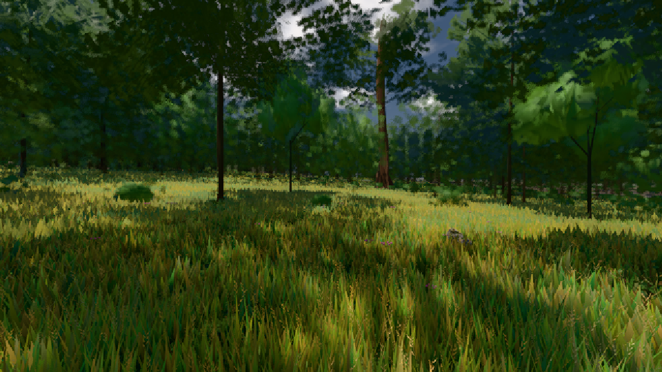

# GPU-PROBE c856a2a6 — ROT

Zweig `w25-gpu-wahl` · Kopf c856a2a6a91ac276424a24e25167252c3ffbd370 · Läufer omen-gtx1060 · 09.11. 03:32 · Wanduhr ab Push 4712 s · Lauf https://github.com/MiguellD/AnazhRealm/actions/runs/42544488286

Ruf: `gate:geh-zerlegung gate:pop bild:wiese@0.5`

GPU NVIDIA GeForce GTX 1060 · npm ci 38 s (package-lock bcc5174f)
Schloss /c/Users/micha/AppData/Local/Temp/claude/gpu-schloss hält „ci-runner 42544488286/2 probe“
- Hook 2026-11-09 03:20:44 start ci-runner 42544488286/2 probe: Schloss genommen (refs/heads/w25-gpu-wahl c856a2a6a91ac276424a24e25167252c3ffbd370 ws=C:\actions-runner\_work\AnazhRealm\AnazhRealm)

### gate:geh-zerlegung — ROT · 569 s

Adapter: ungenannt (die Probe nannte keinen Browser-Adapter) · DECKEL 480 s

```text
GEH ROT wiese-ego Gang 1: Bild 33.4/66.6/91.7/116.7 · Takt 30.7/59.3/84.3/84.6 · GPU ? · Befehle undefined () · Dreiecke undefined · 115 Bilder, 75 > 33 ms je Täter: Rest 49 Zeichnen 14 Streaming 12 · Bau 1× 0.7 ms · Weg 23 m
GEH ROT wiese-ego Gang 1 je Domäne ab p95/Mitte (6 Takte): Streaming 28.2/10.0 · Zeichnen 11.4/7.5 · Sicht 9.1/5.5 · Satz 8.9/1.5 · Bau 5.5/1.7 · Rest 4.6/2.3 · Leib 1.1/0.4 · Tiere 0.5/0.4
GEH GRÜN wiese-ego Gang 2: Bild 24.9/33.3/41.7/41.7 · Takt 21/27.2/41/46.1 · GPU ? · Befehle undefined () · Dreiecke undefined · 180 Bilder, 11 > 33 ms je Täter: Rest 7 Zeichnen 3 Streaming 1 · Bau 0× 0 ms · Weg 21 m
GEH GRÜN wiese-ego Gang 2 je Domäne ab p95/Mitte (8 Takte): Streaming 9.7/6.2 · Zeichnen 8.2/6.0 · Satz 5.3/0.9 · Sicht 4.4/2.9 · Bau 3.7/1.7 · Rest 2.0/1.1 · Tiere 0.3/0.4 · Leib 0.3/0.2
GEH GRÜN wiese-ego Gang 2 Baum 1: renderer._renderScene 15.6/8.6 _passSicht 7.8/3.0 ›_chunkSatzPass 4.4/0.9 ››_hoehlenSicht 3.1/0.3 ›››_hoehlenSichtLicht 2.8/0.1 ››››_passTrifftBox 1.1/0.1 ››_chunkSatzAbschnitt 1.3/0.4 ›_instanzWahlGpu 2.3/1.3 ››_wahlVor 1.6/0.8 ›››_auftraege 1.3/0.5 ››››_block 1.1/0.3 _loopVoxelStreaming 12.0/7.5 _runFrameScheduler 12.0/7.5 ›_dispatchFrameJobs 8.1/5.4 ››run 8.1/5.4 ›››_tickNahWiese 3.2/4.6 ››››_nahWieseFernTakt 1.7/3.6 ›››_tickVoxelChunkStreaming 2.1/0.2 ››››_rebuildVoxelChunk 1.4/
GEH GRÜN wiese-ego Gang 2 Baum 2: ›_tickPendingVegSpawns 1.3/0.3 ››_pflanzGang 1.3/0.3 ›››_naturSetzen 1.2/0.3 ››››spawnArchitecture 1.2/0.3 ›_tickScatterLod 1.0/0.1 ›_tickArchitectureLOD 0.8/1.0 ››_zusagenVon 0.5/0.8 ›››(anonym) 0.5/0.8 tickArchitectureCulling 1.4/0.4 _loopRender 1.3/0.5 tickDayNight 1.1/0.9
```

### gate:pop — ROT · 48 s

Adapter: ungenannt (die Probe nannte keinen Browser-Adapter)

```text
BLOCK-TREUE GRÜN 179 Blöcke treu · Selbsttest nennt MeshStandardNodeMaterial · 578d1a94 · instanzFarbe: 1/7 Instanzen fremd
```

### bild:wiese@0.5 — GRÜN · 50 s

Adapter: [linse-gpu] nvidia/pascal

```text
Kamera des Spiels → Blick (10.0 m): -280.40 29.71 -1045.60 -289.61 29.71 -1049.50
 "abnahme": "ABNAHME GRÜN · beweis · Sicht 0.0 % · Ziel Blickziel im Bild frei 10 m · Luma 57.2 σ 33.7 schwarz 0.0 % weiß 0.0 % · Stand 18.546.229 · Bühne summer sunny 0.50 · Gerät WebGPU nvidia pascal",
```


