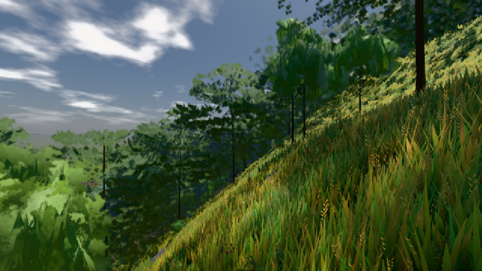

# GPU-PROBE 23145b6e — ROT

Zweig `w25-haar-albedo` · Kopf 23145b6e5b458a72ca60e2cb79e66d6c672be1a4 · Läufer omen-gtx1060 · 09.11. 01:00 · Wanduhr ab Push 1097 s · Lauf https://github.com/MiguellD/AnazhRealm/actions/runs/42536393829

Ruf: `bild:dorf@0.5 bild:stadt-voll@0.5`

GPU NVIDIA GeForce GTX 1060 · npm ci 39 s (package-lock bcc5174f)
Schloss /c/Users/micha/AppData/Local/Temp/claude/gpu-schloss hält „ci-runner 42536393829/1 probe“
- Hook 2026-11-09 00:49:29 start ci-runner 42536393829/1 probe: Schloss genommen (refs/heads/w25-haar-albedo 23145b6e5b458a72ca60e2cb79e66d6c672be1a4 ws=C:\actions-runner\_work\AnazhRealm\AnazhRealm)

### bild:dorf@0.5 — GRÜN · 62 s

Adapter: [linse-gpu] nvidia/pascal

```text
Kamera des Spiels → Blick (10.0 m): -841.00 86.89 -861.00 -834.08 86.89 -853.78
 "abnahme": "ABNAHME GRÜN · beweis · Sicht 0.0 % · Ziel Blickziel im Bild frei 10 m · Luma 85.9 σ 48.2 schwarz 0.0 % weiß 0.0 % · Stand 18.546.229 · Bühne summer sunny 0.50 · Gerät WebGPU nvidia pascal",
```



### bild:stadt-voll@0.5 — ROT · 509 s

Adapter: [linse-gpu] nvidia/pascal · DECKEL 480 s

```text
[linse-gpu] nvidia/pascal
```
