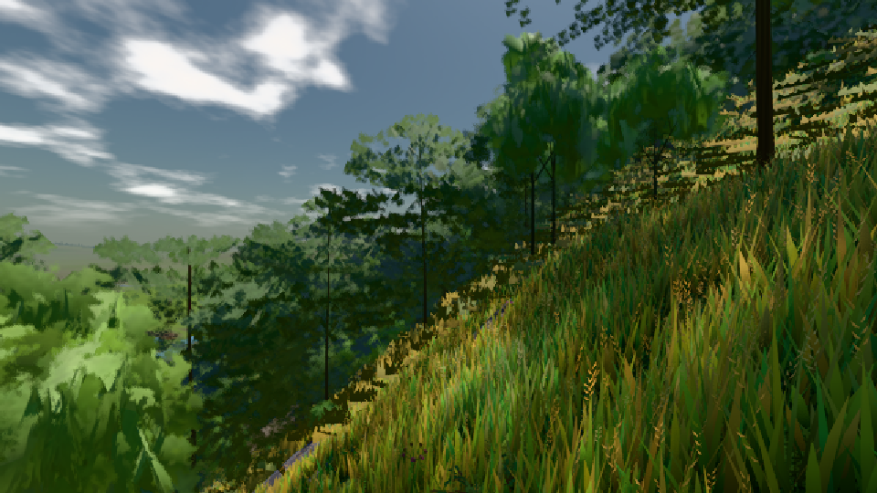

# GPU-PROBE 452dc752 — GRÜN

Zweig `w25-haar-albedo` · Kopf 452dc7520afa7f6f9307a2524f54d860b73639c1 · Läufer radeon-890m · 08.11. 22:10 · Wanduhr ab Push 808 s · Lauf https://github.com/MiguellD/AnazhRealm/actions/runs/42522698883

Ruf: `gate:haar-strich-probe bild:dorf@0.5`

GPU AMD Radeon(TM) 890M Graphics · node_modules bleiben (package-lock 14bd2eb7)
Schloss /c/Users/micha/AppData/Local/Temp/claude/gpu-schloss hält „ci-runner 42522698883/1 probe“
- Hook 2026-11-08 22:07:13 start ci-runner 42522698883/1 probe: Schloss genommen (refs/heads/w25-haar-albedo 452dc7520afa7f6f9307a2524f54d860b73639c1 ws=C:\actions-runner\_work\AnazhRealm\AnazhRealm)

### gate:haar-strich-probe — GRÜN · 99 s

Adapter: [linse-gpu] amd/rdna-3

```text
❌ ROT haar-strich zweig: arm {"strich":0.4528,"si":2037,"luma":70.01} · third {"strich":0.3224,"si":72,"luma":37.84} · Soll [0.3554; 0.533]
❌ ROT haar-strich main-blick: arm {"strich":0.6562,"si":2866,"luma":71.14} · third {"strich":0.2968,"si":67,"luma":37.05} · Soll [0.3554; 0.533]
❌ ROT haar-strich zweig: arm {"strich":0.4528,"si":2037,"luma":70.01} · third {"strich":0.3224,"si":72,"luma":37.84} · Soll [0.3554; 0.533]
❌ ROT haar-strich main-blick: arm {"strich":0.6562,"si":2866,"luma":71.14} · third {"strich":0.2968,"si":67,"luma":37.05} · Soll [0.3554; 0.533]
```

### bild:dorf@0.5 — GRÜN · 56 s

Adapter: [linse-gpu] amd/rdna-3

```text
Kamera des Spiels → Blick (10.0 m): -841.00 86.89 -861.00 -834.08 86.89 -853.78
 "abnahme": "ABNAHME GRÜN · beweis · Sicht 0.0 % · Ziel Blickziel im Bild frei 10 m · Luma 84.4 σ 48 schwarz 0.0 % weiß 0.0 % · Stand 18.546.226 · Bühne summer sunny 0.50 · Gerät WebGPU amd rdna-3",
```


