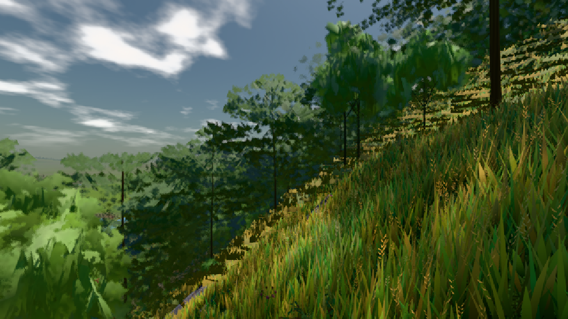
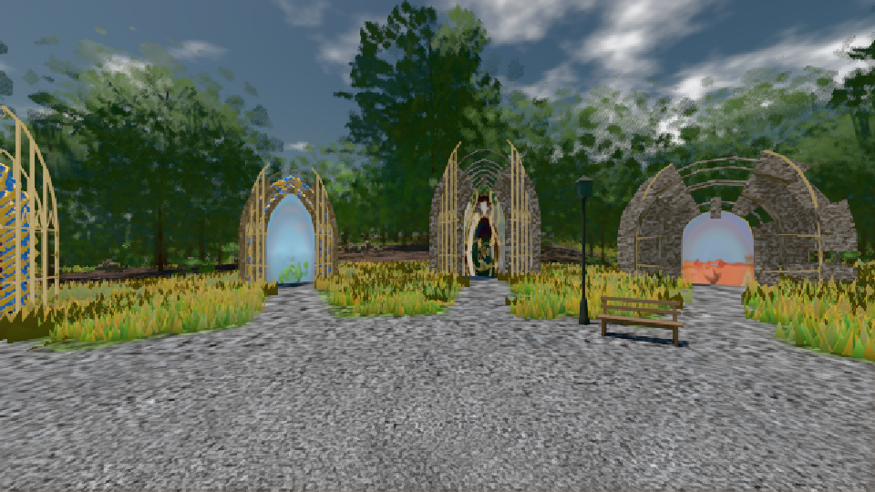

# GPU-PROBE d8e2647f — GRÜN

Zweig `w25-lod-pop-2` · Kopf d8e2647f0e89924e62d472da248a3e7a72f02e52 · Läufer omen-gtx1060 · 08.11. 23:47 · Wanduhr ab Push 1200 s · Lauf https://github.com/MiguellD/AnazhRealm/actions/runs/42530328720

Ruf: `bild:dorf@0.5 bild:genesis@0.5`

GPU NVIDIA GeForce GTX 1060 · npm ci 38 s (package-lock 3d113e1d)
Schloss /c/Users/micha/AppData/Local/Temp/claude/gpu-schloss hält „ci-runner 42530328720/1 probe“
- Hook 2026-11-08 23:44:50 start ci-runner 42530328720/1 probe: Schloss genommen (refs/heads/w25-lod-pop-2 d8e2647f0e89924e62d472da248a3e7a72f02e52 ws=C:\actions-runner\_work\AnazhRealm\AnazhRealm)

### bild:dorf@0.5 — GRÜN · 59 s

Adapter: [linse-gpu] nvidia/pascal

```text
Kamera des Spiels → Blick (10.0 m): -841.00 86.89 -861.00 -834.08 86.89 -853.78
 "abnahme": "ABNAHME GRÜN · beweis · Sicht 0.0 % · Ziel Blickziel im Bild frei 10 m · Luma 84.7 σ 47.8 schwarz 0.0 % weiß 0.0 % · Stand 18.546.227 · Bühne summer sunny 0.50 · Gerät WebGPU nvidia pascal",
```



### bild:genesis@0.5 — GRÜN · 41 s

Adapter: [linse-gpu] nvidia/pascal

```text
Kamera des Spiels → Blick (10.0 m): 0.00 92.40 0.00 -10.00 92.40 0.00
 "abnahme": "ABNAHME GRÜN · beweis · Sicht 0.0 % · Ziel Blickziel im Bild frei 10 m · Luma 103.9 σ 37.5 schwarz 0.0 % weiß 0.0 % · Stand 18.546.227 · Bühne summer sunny 0.50 · Gerät WebGPU nvidia pascal",
```


