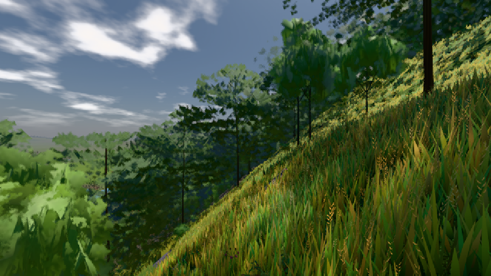
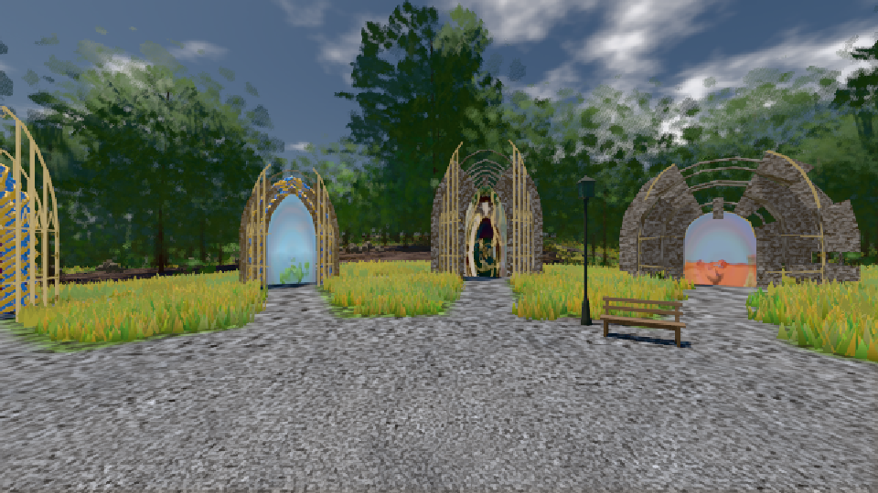

# GPU-PROBE bc18700f — GRÜN

Zweig `w25-lod-pop-3` · Kopf bc18700f32a7eb250a9a68e51ae030c10489bdac · Läufer omen-gtx1060 · 09.11. 00:39 · Wanduhr ab Push 689 s · Lauf https://github.com/MiguellD/AnazhRealm/actions/runs/42535309704

Ruf: `bild:dorf@0.5 bild:genesis@0.5`

GPU NVIDIA GeForce GTX 1060 · npm ci 40 s (package-lock bcc5174f)
Schloss /c/Users/micha/AppData/Local/Temp/claude/gpu-schloss hält „ci-runner 42535309704/1 probe“
- Hook 2026-11-09 00:36:52 start ci-runner 42535309704/1 probe: Schloss genommen (refs/heads/w25-lod-pop-3 bc18700f32a7eb250a9a68e51ae030c10489bdac ws=C:\actions-runner\_work\AnazhRealm\AnazhRealm)

### bild:dorf@0.5 — GRÜN · 62 s

Adapter: [linse-gpu] nvidia/pascal

```text
Kamera des Spiels → Blick (10.0 m): -841.00 86.89 -861.00 -834.08 86.89 -853.78
 "abnahme": "ABNAHME GRÜN · beweis · Sicht 0.0 % · Ziel Blickziel im Bild frei 10 m · Luma 85.9 σ 48.2 schwarz 0.0 % weiß 0.0 % · Stand 18.546.229 · Bühne summer sunny 0.50 · Gerät WebGPU nvidia pascal",
```



### bild:genesis@0.5 — GRÜN · 42 s

Adapter: [linse-gpu] nvidia/pascal

```text
Kamera des Spiels → Blick (10.0 m): 0.00 92.40 0.00 -10.00 92.40 0.00
 "abnahme": "ABNAHME GRÜN · beweis · Sicht 0.0 % · Ziel Blickziel im Bild frei 10 m · Luma 105.4 σ 37.9 schwarz 0.0 % weiß 0.0 % · Stand 18.546.229 · Bühne summer sunny 0.50 · Gerät WebGPU nvidia pascal",
```


