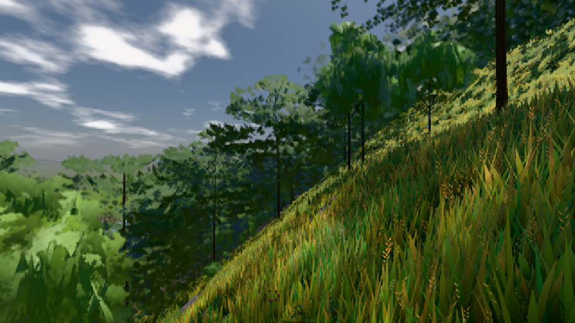

# GPU-PROBE aeb604be — ROT

Zweig `w25-lod-pop-4` · Kopf aeb604bef7d113073529777c2b070e12d1b00e58 · Läufer omen-gtx1060 · 09.11. 03:54 · Wanduhr ab Push 3741 s · Lauf https://github.com/MiguellD/AnazhRealm/actions/runs/42547773766

Ruf: `gate:haus-fern bild:dorf@0.5 bild:stadt@0.5`

GPU NVIDIA GeForce GTX 1060 · npm ci 38 s (package-lock c278d7b5)
Schloss /c/Users/micha/AppData/Local/Temp/claude/gpu-schloss hält „ci-runner 42547773766/1 probe“
- Hook 2026-11-09 03:36:56 start ci-runner 42547773766/1 probe: Schloss genommen (refs/heads/w25-lod-pop-4 aeb604bef7d113073529777c2b070e12d1b00e58 ws=C:\actions-runner\_work\AnazhRealm\AnazhRealm)

### gate:haus-fern — GRÜN · 340 s

Adapter: ungenannt (die Probe nannte keinen Browser-Adapter)

```text
✅ GRÜN — jede Stufe wirft den grundriss-treuen Fernkörper, zeigt sich erst ≤ 1 px von der L0, kein Querfirst, der Körper liegt innen, jedes Türblatt sitzt an seinem Scharnier, jedes Fenster ist Glas in jeder Stufe.
```

### bild:dorf@0.5 — GRÜN · 65 s

Adapter: [linse-gpu] nvidia/pascal

```text
Kamera des Spiels → Blick (10.0 m): -841.00 86.89 -861.00 -834.08 86.89 -853.78
 "abnahme": "ABNAHME GRÜN · beweis · Sicht 0.0 % · Ziel Blickziel im Bild frei 10 m · Luma 85.7 σ 48.1 schwarz 0.0 % weiß 0.0 % · Stand 18.546.232 · Bühne summer sunny 0.50 · Gerät WebGPU nvidia pascal",
```



### bild:stadt@0.5 — ROT · 567 s

Adapter: [linse-gpu] nvidia/pascal · DECKEL 480 s

```text
[linse-gpu] nvidia/pascal
```
