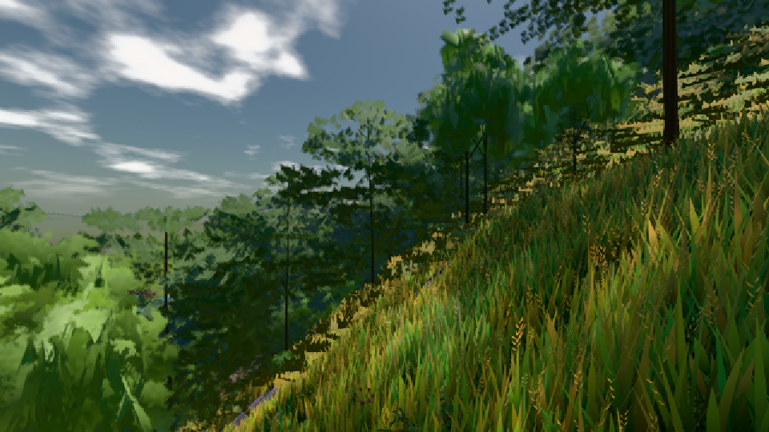
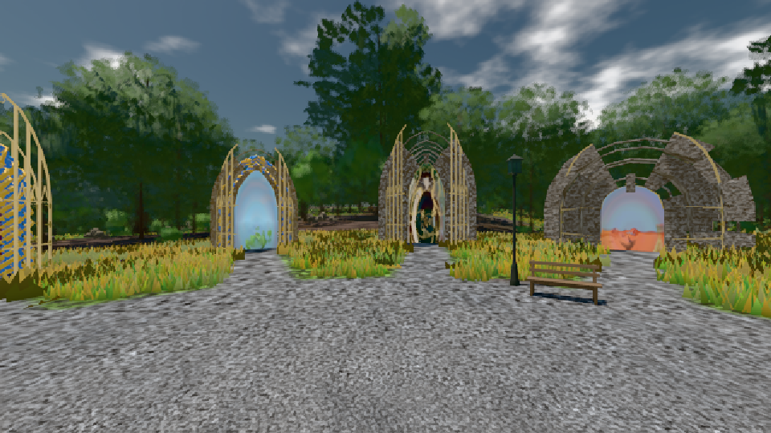

# GPU-PROBE 77dae9b3 — GRÜN

Zweig `w25-lod-pop` · Kopf 77dae9b305497bce0d5b92a9a9a7734b3f80c670 · Läufer radeon-890m · 08.11. 22:35 · Wanduhr ab Push 751 s · Lauf https://github.com/MiguellD/AnazhRealm/actions/runs/42524920979

Ruf: `bild:dorf@0.5 bild:genesis@0.5`

GPU AMD Radeon(TM) 890M Graphics · node_modules bleiben (package-lock 14bd2eb7)
Schloss /c/Users/micha/AppData/Local/Temp/claude/gpu-schloss hält „ci-runner 42524920979/1 probe“
- Hook 2026-11-08 22:31:32 start ci-runner 42524920979/1 probe: Schloss genommen (refs/heads/w25-lod-pop 77dae9b305497bce0d5b92a9a9a7734b3f80c670 ws=C:\actions-runner\_work\AnazhRealm\AnazhRealm)

### bild:dorf@0.5 — GRÜN · 105 s

Adapter: [linse-gpu] amd/rdna-3

```text
Kamera des Spiels → Blick (10.0 m): -841.00 86.89 -861.00 -834.08 86.89 -853.78
 "abnahme": "ABNAHME GRÜN · beweis · Sicht 0.0 % · Ziel Blickziel im Bild frei 10 m · Luma 84.4 σ 48 schwarz 0.0 % weiß 0.0 % · Stand 18.546.226 · Bühne summer sunny 0.50 · Gerät WebGPU amd rdna-3",
```



### bild:genesis@0.5 — GRÜN · 56 s

Adapter: [linse-gpu] amd/rdna-3

```text
Kamera des Spiels → Blick (10.0 m): 0.00 92.40 0.00 -10.00 92.40 0.00
 "abnahme": "ABNAHME GRÜN · beweis · Sicht 0.0 % · Ziel Blickziel im Bild frei 10 m · Luma 104.1 σ 38.8 schwarz 0.0 % weiß 0.0 % · Stand 18.546.226 · Bühne summer sunny 0.50 · Gerät WebGPU amd rdna-3",
```


