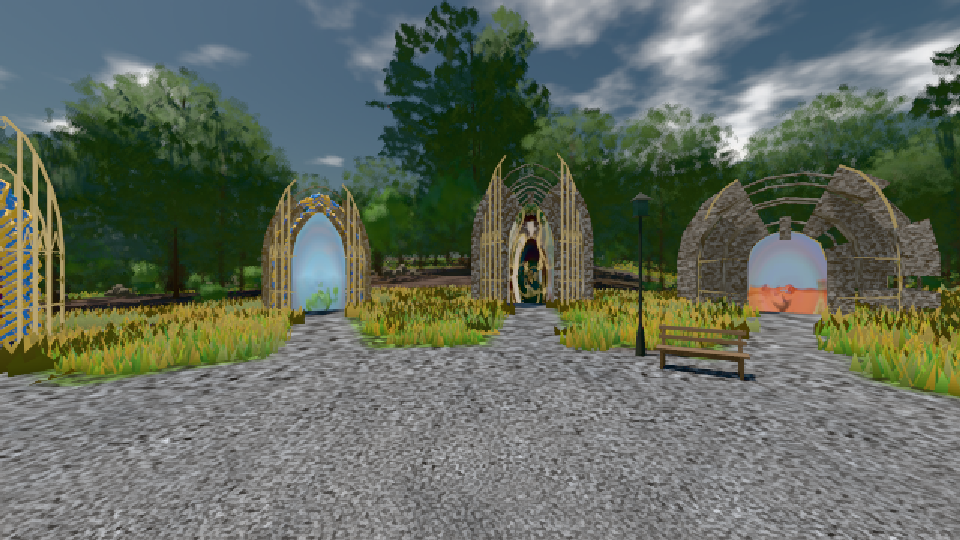

# GPU-PROBE 11188e15 — GRÜN

Zweig `w25-pipeline-vorwaermen` · Kopf 11188e15091e8c95e2273dad75c3cc75e7fd06dc · Läufer radeon-890m · 08.11. 22:41 · Wanduhr ab Push 1067 s · Lauf https://github.com/MiguellD/AnazhRealm/actions/runs/42524990921

Ruf: `bild:genesis@0.5`

GPU AMD Radeon(TM) 890M Graphics · node_modules bleiben (package-lock 14bd2eb7)
Schloss /c/Users/micha/AppData/Local/Temp/claude/gpu-schloss hält „ci-runner 42524990921/1 probe“
- Hook 2026-11-08 22:39:32 start ci-runner 42524990921/1 probe: Schloss genommen (refs/heads/w25-pipeline-vorwaermen 11188e15091e8c95e2273dad75c3cc75e7fd06dc ws=C:\actions-runner\_work\AnazhRealm\AnazhRealm)

### bild:genesis@0.5 — GRÜN · 63 s

Adapter: [linse-gpu] amd/rdna-3

```text
Kamera des Spiels → Blick (10.0 m): 0.00 92.40 0.00 -10.00 92.40 0.00
 "abnahme": "ABNAHME GRÜN · beweis · Sicht 0.0 % · Ziel Blickziel im Bild frei 10 m · Luma 104.2 σ 38.8 schwarz 0.0 % weiß 0.0 % · Stand 18.546.226 · Bühne summer sunny 0.50 · Gerät WebGPU amd rdna-3",
```


