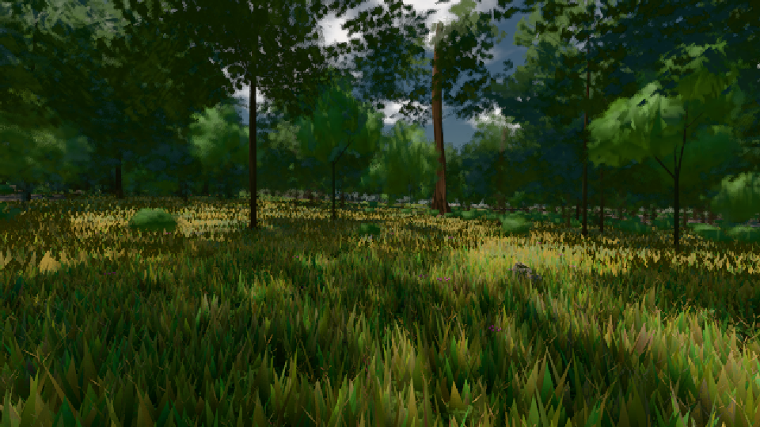

# GPU-PROBE 047129cf — GRÜN

Zweig `w25-spike-gpu-vegetation` · Kopf 047129cfd325ca626427ff63e9faf8d4fd48a676 · Läufer radeon-890m · 08.11. 21:19 · Wanduhr ab Push 428 s · Lauf https://github.com/MiguellD/AnazhRealm/actions/runs/42518928881

Ruf: `gate:pop bild:wiese@0.5`

GPU AMD Radeon(TM) 890M Graphics · node_modules bleiben (package-lock 14bd2eb7)
Schloss /c/Users/micha/AppData/Local/Temp/claude/gpu-schloss hält „ci-runner 42518928881/1 probe“
- Hook 2026-11-08 21:12:43 start ci-runner 42518928881/1 probe: wartet auf Schloss von 'punkte-radeon-sitzungpid=20856'
- Hook 2026-11-08 21:15:33 start ci-runner 42518928881/1 probe: Schloss genommen (refs/heads/w25-spike-gpu-vegetation 047129cfd325ca626427ff63e9faf8d4fd48a676 ws=C:\actions-runner\_work\AnazhRealm\AnazhRealm)

### gate:pop — GRÜN · 138 s

Adapter: ungenannt (die Probe nannte keinen Browser-Adapter)

```text
WAHL A ROT {"pop":0.0352,"bild":[42,75],"gpu":7.81,"tri":409759,"dc":60,"_gameLoopTick":[31.251,56.1],"_passSicht":[12.569,32.9],"_instanzWahlPass":[4.839,14.1],"_instanzWahlGpu":[0.024,0.1],"_nahWieseSicht":[3.615,12.8],"_nahWieseFernSatz":[3.095,12.2],"compute":[0,0],"inst":[0,0],"bilder":342}
WAHL B ROT {"bild":[33.7,58.5],"gpu":4.69,"tri":881926,"dc":53,"_gameLoopTick":[34.006,50.7],"_passSicht":[11.612,24],"_instanzWahlPass":[3.662,9.5],"_instanzWahlGpu":[0.336,0.5],"_nahWieseSicht":[3.88,11.3],"_nahWieseFernSatz":[2.95,10.1],"compute":[0.025,0.029],"inst":[772.598,844],"bilder":256}
WAHL A ROT {"bild":[50.2,75.6],"gpu":8.29,"tri":419976,"dc":59,"_gameLoopTick":[35.276,57],"_passSicht":[12.667,27.2],"_instanzWahlPass":[4.55,11.8],"_instanzWahlGpu":[0.022,0.1],"_nahWieseSicht":[3.53,9.8],"_nahWieseFernSatz":[2.879,9.4],"compute":[0,0],"inst":[0,0],"bilder":214}
WAHL B ROT {"bild":[33.7,50.4],"gpu":4.61,"tri":412275,"dc":51,"_gameLoopTick":[32.529,50.3],"_passSicht":[11.1,24.8],"_instanzWahlPass":[3.622,9.4],"_instanzWahlGpu":[0.322,0.4],"_nahWieseSicht":[3.572,8.5],"_nahWieseFernSatz":[2.787,8.4],"compute":[0.026,0.015],"inst":[784.142,846],"bilder":266}
lod.K2#1 GRÜN 0.0352 % Pop-Pixel/s (730 px) · 22*+1@189/25*/50*+2@154/370/90*/59*+2@192/54*+1@155/60*+3@189 · Laub 216 · dc, Dreiecke 33,358936 · GPU 21.02 ms, CPU 3.91 ms je Bild
```

### bild:wiese@0.5 — GRÜN · 56 s

Adapter: [linse-gpu] amd/rdna-3

```text
Kamera des Spiels → Blick (10.0 m): -280.40 29.71 -1045.60 -289.61 29.71 -1049.50
 "abnahme": "ABNAHME GRÜN · beweis · Sicht 0.0 % · Ziel Blickziel im Bild frei 10 m · Luma 52.3 σ 30.9 schwarz 0.0 % weiß 0.0 % · Stand 18.546.226 · Bühne summer sunny 0.50 · Gerät WebGPU amd rdna-3",
```


