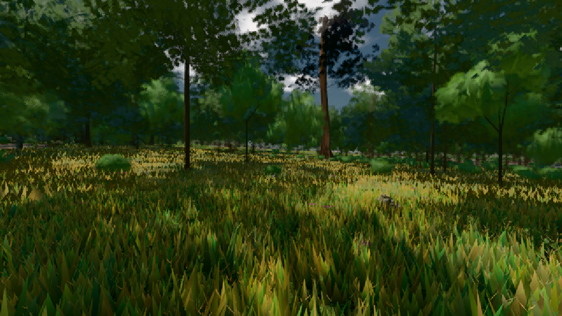

# GPU-PROBE 4e918922 — ROT

Zweig `w25-spike-gpu-vegetation` · Kopf 4e9189222b99ad6c533e1bb16b2ed33a859ab33c · Läufer radeon-890m · 08.11. 21:40 · Wanduhr ab Push 424 s · Lauf https://github.com/MiguellD/AnazhRealm/actions/runs/42520751649

Ruf: `gate:pop bild:wiese@0.5`

GPU AMD Radeon(TM) 890M Graphics · node_modules bleiben (package-lock 14bd2eb7)
Schloss /c/Users/micha/AppData/Local/Temp/claude/gpu-schloss hält „ci-runner 42520751649/1 probe“
- Hook 2026-11-08 21:35:38 start ci-runner 42520751649/1 probe: Schloss genommen (refs/heads/w25-spike-gpu-vegetation 4e9189222b99ad6c533e1bb16b2ed33a859ab33c ws=C:\actions-runner\_work\AnazhRealm\AnazhRealm)

### gate:pop — ROT · 161 s

Adapter: ungenannt (die Probe nannte keinen Browser-Adapter)

```text
WAHL A ROT {"bild":[59,75.7],"gpu":11.78,"tri":377536,"dc":64,"_gameLoopTick":[42.13,72.7],"_passSicht":[15.03,35.4],"_instanzWahlPass":[6.099,14.4],"_instanzWahlGpu":[0.017,0.1],"_nahWieseSicht":[3.94,14.2],"_nahWieseFernSatz":[3.267,12.9],"compute":[0,0],"inst":[0,0],"bilder":179}
WAHL A ROT die Treue: zwei Aufnahmen derselben Szene weichen in 406 Bytes ab · [konsole] [AnazhRealm V18.546.226] [INFO] WebGPU-Renderer instantiiert — init() läuft asynchron … · [konsole] [AnazhRealm V18.546.226] [INFO] WebGPU-Renderer init() abgeschlossen — die Welt rendert jetzt auf der GPU. · [konsole] THREE.[Buffer (unlabeled)] used in submit while destroyed. |  - While calling [Queue].Submit([[CommandBuffer from CommandEncoder "renderContext_5"]]) |  · [konsole] THREE.[Buffer (unlabeled)] used in sub
WAHL B ROT {"bild":[58.3,75.3],"gpu":9.1,"tri":1839007,"dc":121,"_gameLoopTick":[29.842,44.9],"_passSicht":[10.115,17.6],"_instanzWahlPass":[0.62,0.8],"_instanzWahlGpu":[1.39,1.9],"_nahWieseSicht":[3.643,10.9],"_nahWieseFernSatz":[2.697,9.2],"compute":[0.06,0.076],"inst":[3254.287,3324],"bilder":188}
WAHL B ROT die Treue: zwei Aufnahmen derselben Szene weichen in 3964483 Bytes ab · [konsole] [AnazhRealm V18.546.226] [INFO] WebGPU-Renderer instantiiert — init() läuft asynchron … · [konsole] [AnazhRealm V18.546.226] [INFO] WebGPU-Renderer init() abgeschlossen — die Welt rendert jetzt auf der GPU. · [konsole] THREE.[Buffer (unlabeled)] used in submit while destroyed. |  - While calling [Queue].Submit([[CommandBuffer from CommandEncoder "renderContext_5"]]) |  · [konsole] THREE.[Buffer (unlabeled)] used in
WAHL A ROT {"bild":[67,83.9],"gpu":8.7,"tri":379687,"dc":62,"_gameLoopTick":[44.411,71.7],"_passSicht":[16.027,34.4],"_instanzWahlPass":[5.911,14.4],"_instanzWahlGpu":[0.019,0.1],"_nahWieseSicht":[4.36,12.1],"_nahWieseFernSatz":[3.517,11.2],"compute":[0,0],"inst":[0,0],"bilder":166}
WAHL A ROT die Treue: zwei Aufnahmen derselben Szene weichen in 19 Bytes ab · [konsole] [AnazhRealm V18.546.226] [INFO] WebGPU-Renderer instantiiert — init() läuft asynchron … · [konsole] [AnazhRealm V18.546.226] [INFO] WebGPU-Renderer init() abgeschlossen — die Welt rendert jetzt auf der GPU. · [konsole] THREE.[Buffer (unlabeled)] used in submit while destroyed. |  - While calling [Queue].Submit([[CommandBuffer from CommandEncoder "renderContext_5"]]) |  · [konsole] THREE.[Buffer (unlabeled)] used in subm
WAHL B ROT {"bild":[58.7,75.5],"gpu":10.45,"tri":1851735,"dc":121,"_gameLoopTick":[33.283,51],"_passSicht":[10.987,21.8],"_instanzWahlPass":[0.644,0.9],"_instanzWahlGpu":[1.521,2.1],"_nahWieseSicht":[3.996,12.2],"_nahWieseFernSatz":[3,10.7],"compute":[0.088,0.104],"inst":[3253.399,3329],"bilder":174}
WAHL B ROT die Treue: zwei Aufnahmen derselben Szene weichen in 118 Bytes ab · [konsole] [AnazhRealm V18.546.226] [INFO] WebGPU-Renderer instantiiert — init() läuft asynchron … · [konsole] [AnazhRealm V18.546.226] [INFO] WebGPU-Renderer init() abgeschlossen — die Welt rendert jetzt auf der GPU. · [konsole] THREE.[Buffer (unlabeled)] used in submit while destroyed. |  - While calling [Queue].Submit([[CommandBuffer from CommandEncoder "renderContext_5"]]) |  · [konsole] THREE.[Buffer (unlabeled)] used in sub
```

### bild:wiese@0.5 — GRÜN · 69 s

Adapter: [linse-gpu] amd/rdna-3

```text
Kamera des Spiels → Blick (10.0 m): -280.40 29.71 -1045.60 -289.61 29.71 -1049.50
 "abnahme": "ABNAHME GRÜN · beweis · Sicht 0.0 % · Ziel Blickziel im Bild frei 10 m · Luma 53.7 σ 32 schwarz 0.0 % weiß 0.0 % · Stand 18.546.226 · Bühne summer sunny 0.50 · Gerät WebGPU amd rdna-3",
```


