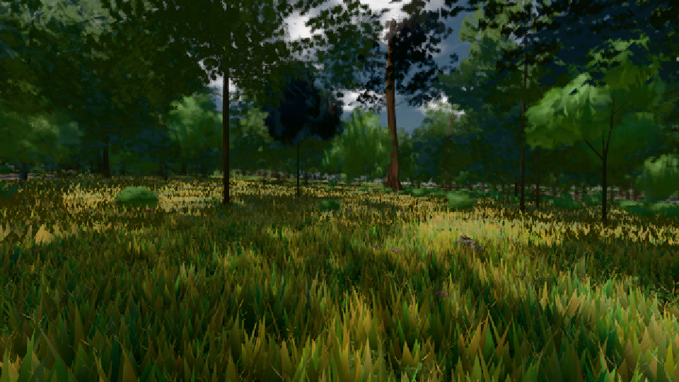

# GPU-PROBE a8bf76c8 — GRÜN

Zweig `w25-spike-gpu-vegetation` · Kopf a8bf76c8131845f0765b01cfd2316a819eae9bbb · Läufer radeon-890m · 08.11. 22:20 · Wanduhr ab Push 932 s · Lauf https://github.com/MiguellD/AnazhRealm/actions/runs/42523327450

Ruf: `gate:pop bild:wiese@0.5`

GPU AMD Radeon(TM) 890M Graphics · node_modules bleiben (package-lock 14bd2eb7)
Schloss /c/Users/micha/AppData/Local/Temp/claude/gpu-schloss hält „ci-runner 42523327450/1 probe“
- Hook 2026-11-08 22:10:45 start ci-runner 42523327450/1 probe: wartet auf Schloss von 'punkte-radeon-sitzungpid=29996'
- Hook 2026-11-08 22:14:29 start ci-runner 42523327450/1 probe: Schloss genommen (refs/heads/w25-spike-gpu-vegetation a8bf76c8131845f0765b01cfd2316a819eae9bbb ws=C:\actions-runner\_work\AnazhRealm\AnazhRealm)

### gate:pop — GRÜN · 196 s

Adapter: ungenannt (die Probe nannte keinen Browser-Adapter)

```text
WAHL A ROT {"gegenA":{"fehler":"kein Ergebnis"},"pop":0.0455,"bild":[33.7,50.3],"gpu":4.91,"dc":55,"_gameLoopTick":[27.722,46.5],"_passSicht":[10.131,26.4],"_instanzWahlPass":[3.814,11.2],"_instanzWahlGpu":[0.019,0.1],"_nahWieseSicht":[3.111,11.5],"_nahWieseFernSatz":[2.743,11],"compute":[0,0],"inst":[0,0],"bilder":387}
WAHL A ROT [konsole] THREE.[Buffer (unlabeled)] used in submit while destroyed. |  - While calling [Queue].Submit([[CommandBuffer from CommandEncoder "renderContext_5"]]) |  · [konsole] THREE.[Buffer (unlabeled)] used in submit while destroyed. |  - While calling [Queue].Submit([[CommandBuffer from CommandEncoder "renderContext_5"]]) | 
WAHL B ROT {"gegenA":42266,"bild":[33.7,67],"gpu":6.17,"dc":113,"_gameLoopTick":[26.894,39.9],"_passSicht":[8.359,15.3],"_instanzWahlPass":[0.443,0.6],"_instanzWahlGpu":[1.048,1.6],"_nahWieseSicht":[3.178,7.5],"_nahWieseFernSatz":[2.541,6.9],"compute":[0.045,0.062],"inst":[3262.06,3328],"bilder":263}
WAHL B ROT die Treue: zwei Aufnahmen derselben Szene weichen in 109 Bytes ab
WAHL A GRÜN {"gegenA":477,"pop":0.042,"bild":[33.5,50.2],"gpu":4.59,"dc":54,"_gameLoopTick":[25.649,43],"_passSicht":[9.951,27.2],"_instanzWahlPass":[3.601,11.6],"_instanzWahlGpu":[0.015,0.1],"_nahWieseSicht":[2.817,9.6],"_nahWieseFernSatz":[2.429,9.1],"compute":[0,0],"inst":[0,0],"bilder":393}
WAHL B ROT {"gegenA":40592,"bild":[33.5,41.9],"gpu":4.83,"dc":113,"_gameLoopTick":[26.453,40.1],"_passSicht":[7.959,14.9],"_instanzWahlPass":[0.434,0.6],"_instanzWahlGpu":[1.056,1.7],"_nahWieseSicht":[2.952,5.4],"_nahWieseFernSatz":[2.431,5.4],"compute":[0.046,0.054],"inst":[3262.026,3330],"bilder":305}
WAHL B ROT die Treue: zwei Aufnahmen derselben Szene weichen in 128 Bytes ab
lod.K2#1 GRÜN 0.0455 % Pop-Pixel/s (943 px) · 26*+1@189/31*/388*+2@154/108*/51*/42*+2@192/116*+1@155/181*+3@189 · Laub 216 · dc, Dreiecke 34,380286 · GPU 22.21 ms, CPU 3.01 ms je Bild
```

### bild:wiese@0.5 — GRÜN · 74 s

Adapter: [linse-gpu] amd/rdna-3

```text
Kamera des Spiels → Blick (10.0 m): -280.40 29.71 -1045.60 -289.61 29.71 -1049.50
 "abnahme": "ABNAHME GRÜN · beweis · Sicht 0.0 % · Ziel Blickziel im Bild frei 10 m · Luma 52.1 σ 31.8 schwarz 0.1 % weiß 0.0 % · Stand 18.546.226 · Bühne summer sunny 0.50 · Gerät WebGPU amd rdna-3",
```


