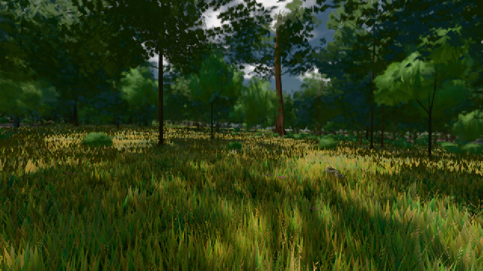

# GPU-PROBE d9546d27 — ROT

Zweig `w25-stadt-takt` · Kopf d9546d2769a5637f57fe8437c4167406a3f33b37 · Läufer omen-gtx1060 · 08.11. 22:53 · Wanduhr ab Push 1500 s · Lauf https://github.com/MiguellD/AnazhRealm/actions/runs/42525360535

Ruf: `bild:stadt@0.5 bild:wiese@0.5`

GPU NVIDIA GeForce GTX 1060 · node_modules bleiben (package-lock 14bd2eb7)
Schloss /c/Users/micha/AppData/Local/Temp/claude/gpu-schloss hält „ci-runner 42525360535/1 probe“
- Hook 2026-11-08 22:49:56 start ci-runner 42525360535/1 probe: Schloss genommen (refs/heads/w25-stadt-takt d9546d2769a5637f57fe8437c4167406a3f33b37 ws=C:\actions-runner\_work\AnazhRealm\AnazhRealm)

### bild:stadt@0.5 — ROT · 119 s

Adapter: [linse-gpu] nvidia/pascal

```text
Kamera des Spiels → Blick (53.9 m): 400.00 44.24 400.00 453.51 44.24 406.46
```

### bild:wiese@0.5 — GRÜN · 50 s

Adapter: [linse-gpu] nvidia/pascal

```text
Kamera des Spiels → Blick (10.0 m): -280.40 29.71 -1045.60 -289.61 29.71 -1049.50
 "abnahme": "ABNAHME GRÜN · beweis · Sicht 0.0 % · Ziel Blickziel im Bild frei 10 m · Luma 55.1 σ 31.3 schwarz 0.0 % weiß 0.0 % · Stand 18.546.226 · Bühne summer sunny 0.50 · Gerät WebGPU nvidia pascal",
```


