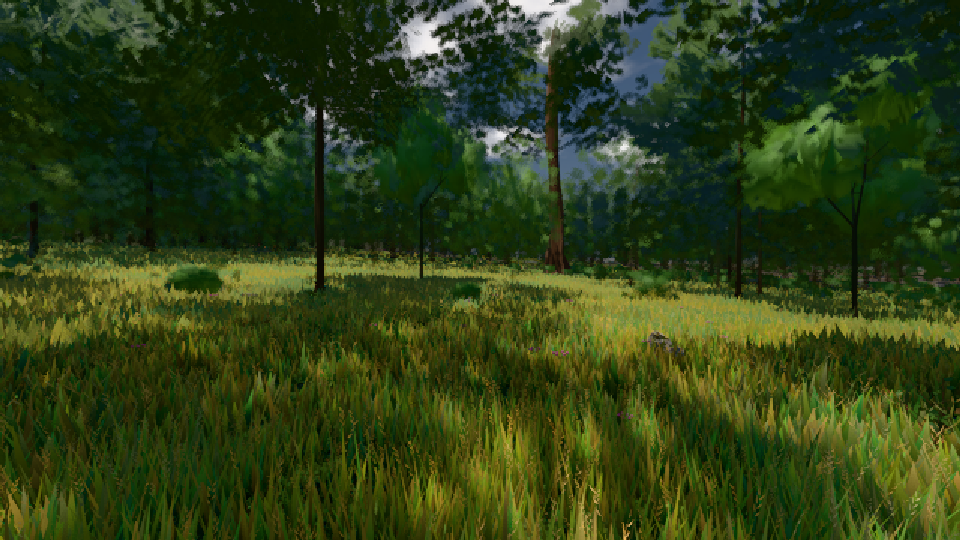
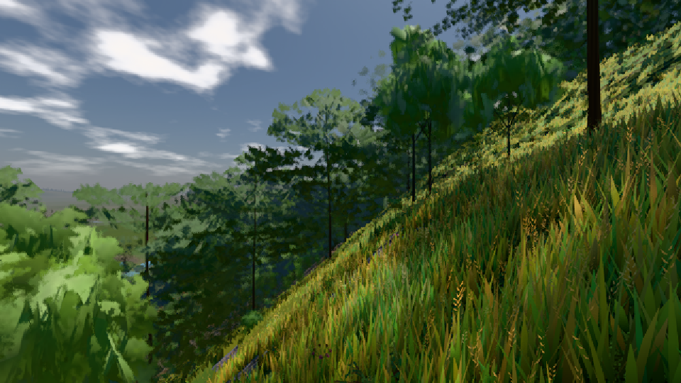

# GPU-PROBE ced5cd09 — GRÜN

Zweig `w26-boden-nah` · Kopf ced5cd09660bfd266389323145b4f45d5f6bf03f · Läufer gtx1050-desktop · 09.11. 15:40 · Wanduhr ab Push 3629 s · Lauf https://github.com/MiguellD/AnazhRealm/actions/runs/42627513457

Ruf: `bild:wiese@0.5 bild:dorf@0.5`

GPU NVIDIA GeForce GTX 1050 · node_modules bleiben (package-lock 0a1b96a5)
Schloss /c/Users/User/AppData/Local/Temp/claude/gpu-schloss hält „ci-runner 42627513457/1 probe“
- Hook 2026-11-09 15:31:51 start ci-runner 42627513457/1 probe: Schloss genommen (refs/heads/w26-boden-nah ced5cd09660bfd266389323145b4f45d5f6bf03f ws=C:\actions-runner\_work\AnazhRealm\AnazhRealm)

### bild:wiese@0.5 — GRÜN · 187 s

Adapter: [linse-gpu] nvidia/pascal

```text
Kamera des Spiels → Blick (10.0 m): -280.40 29.71 -1045.60 -289.61 29.71 -1049.50
 "abnahme": "ABNAHME GRÜN · beweis · Sicht 0.0 % · Ziel Blickziel im Bild frei 10 m · Luma 56.7 σ 33.2 schwarz 0.0 % weiß 0.0 % · Stand 18.546.236 · Bühne summer sunny 0.50 · Gerät WebGPU nvidia pascal",
```



### bild:dorf@0.5 — GRÜN · 244 s

Adapter: [linse-gpu] nvidia/pascal

```text
Kamera des Spiels → Blick (10.0 m): -841.00 86.89 -861.00 -834.08 86.89 -853.78
 "abnahme": "ABNAHME GRÜN · beweis · Sicht 0.0 % · Ziel Blickziel im Bild frei 10 m · Luma 85.2 σ 48.2 schwarz 0.0 % weiß 0.0 % · Stand 18.546.236 · Bühne summer sunny 0.50 · Gerät WebGPU nvidia pascal",
```


