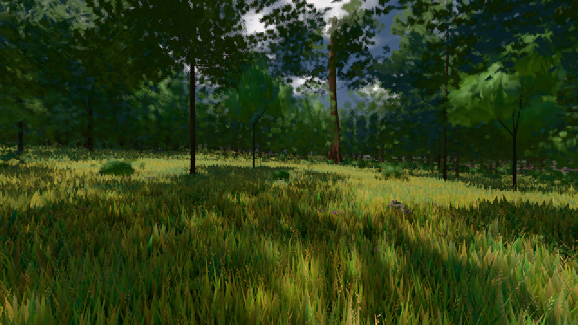

# GPU-PROBE a1cbffe8 — GRÜN

Zweig `w26-eiche-kante-vorher` · Kopf a1cbffe86a846ee98d1839d005fa38ea50ee2888 · Läufer radeon-890m · 09.11. 17:58 · Wanduhr ab Push 277 s · Lauf https://github.com/MiguellD/AnazhRealm/actions/runs/42659351505

Ruf: `gate:laub-kante bild:wiese@0.5`

## Läufer radeon-890m — GRÜN

GPU AMD Radeon(TM) 890M Graphics · node_modules bleiben (package-lock 0a1b96a5)
Schloss /c/Users/micha/AppData/Local/Temp/claude/gpu-schloss hält „ci-runner 42659351505/1 probe“
- Hook 2026-11-09 17:54:39 start ci-runner 42659351505/1 probe: Schloss genommen (refs/heads/w26-eiche-kante-vorher a1cbffe86a846ee98d1839d005fa38ea50ee2888 ws=C:\actions-runner\_work\AnazhRealm\AnazhRealm)

### gate:laub-kante — GRÜN · 134 s · Läufer radeon-890m

Adapter: ungenannt (die Probe nannte keinen Browser-Adapter)

```text
lod.K1#1 Tafel-Pose GRÜN [["f:fichte:L1",0.1688,340060,0],["f:tanne:L0",0.1647,96462,0],["f:tanne:L1",0.1607,269572,0],["fimp:birke:L2",0.1544,25594,0],["fimp:eiche:L2",0.1373,54613,0],["fimp:fichte:L2",0.147,41803,0],["fimp:strauch:L2",0.2115,22832,0],["fimp:tanne:L2",0.1537,114122,0]]
lod.K1#1 Spielgang GRÜN [["f:eiche:L1",0.1853,6888,0],["f:fichte:L1",0.1608,298491,0],["f:tanne:L0",0.1495,124068,0],["f:tanne:L1",0.1528,160186,0],["fimp:birke:L2",0.1276,23803,0],["fimp:eiche:L2",0.1503,53765,0],["fimp:fichte:L2",0.1406,34418,0],["fimp:strauch:L2",0.2085,30113,0],["fimp:tanne:L2",0.1449,83793,0]]
ABNAHME GRÜN · beweis · Sicht 0.0 % · Ziel Blickziel im Bild frei 12 m · Luma 45.9 σ 32.1 schwarz 0.0 % weiß 0.0 % · Stand 18.546.236 · Bühne summer sunny 0.50 Tiere gehalten · Gerät WebGPU amd rdna-3
```

### bild:wiese@0.5 — GRÜN · 51 s · Läufer radeon-890m

Adapter: [linse-gpu] amd/rdna-3

```text
Kamera des Spiels → Blick (10.0 m): -280.40 29.71 -1045.60 -289.61 29.71 -1049.50
 "abnahme": "ABNAHME GRÜN · beweis · Sicht 0.0 % · Ziel Blickziel im Bild frei 10 m · Luma 57.2 σ 33.2 schwarz 0.0 % weiß 0.0 % · Stand 18.546.236 · Bühne summer sunny 0.50 · Gerät WebGPU amd rdna-3",
```


