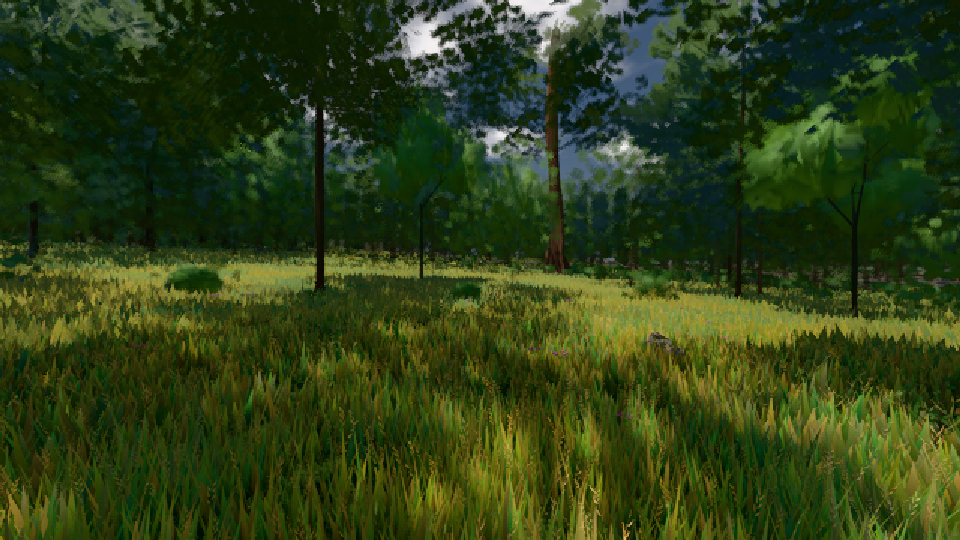

# GPU-PROBE dcc7c449 — GRÜN

Zweig `w26-eiche-kante-vorher` · Kopf dcc7c449a829ecfd92bb603c0f135fa2859de5a6 · Läufer gtx1050-desktop · 09.11. 17:44 · Wanduhr ab Push 384 s · Lauf https://github.com/MiguellD/AnazhRealm/actions/runs/42656718383

Ruf: `gate:laub-kante bild:wiese@0.5`

## Läufer gtx1050-desktop — GRÜN

GPU NVIDIA GeForce GTX 1050 · node_modules bleiben (package-lock 0a1b96a5)
Schloss /c/Users/User/AppData/Local/Temp/claude/gpu-schloss hält „ci-runner 42656718383/1 probe“
- Hook 2026-11-09 17:38:06 start ci-runner 42656718383/1 probe: Schloss genommen (refs/heads/w26-eiche-kante-vorher dcc7c449a829ecfd92bb603c0f135fa2859de5a6 ws=C:\actions-runner\_work\AnazhRealm\AnazhRealm)

### gate:laub-kante — GRÜN · 246 s · Läufer gtx1050-desktop

Adapter: ungenannt (die Probe nannte keinen Browser-Adapter)

```text
lod.K1#1 Tafel-Pose GRÜN [["f:fichte:L1",0.1821,367582,0],["f:tanne:L0",0.1781,119642,0],["f:tanne:L1",0.1689,290153,0],["fimp:birke:L2",0.1609,29463,0],["fimp:eiche:L2",0.14,65293,0],["fimp:fichte:L2",0.1425,50138,0],["fimp:strauch:L2",0.2155,22739,0],["fimp:tanne:L2",0.1572,134463,0]]
lod.K1#1 Spielgang ROT [["f:eiche:L1",0.3297,10672,0],["f:fichte:L1",0.1753,332701,0],["f:tanne:L0",0.1394,141491,0],["f:tanne:L1",0.1675,178380,0],["fimp:birke:L2",0.134,26755,0],["fimp:eiche:L2",0.1527,64071,0],["fimp:fichte:L2",0.1309,40506,0],["fimp:strauch:L2",0.2026,30090,0],["fimp:tanne:L2",0.1468,98220,0]]
ABNAHME GRÜN · beweis · Sicht 0.0 % · Ziel Blickziel im Bild frei 12 m · Luma 48 σ 32.8 schwarz 0.0 % weiß 0.0 % · Stand 18.546.236 · Bühne summer sunny 0.50 Tiere gehalten · Gerät WebGPU nvidia pascal
```

### bild:wiese@0.5 — GRÜN · 86 s · Läufer gtx1050-desktop

Adapter: [linse-gpu] nvidia/pascal

```text
Kamera des Spiels → Blick (10.0 m): -280.40 29.71 -1045.60 -289.61 29.71 -1049.50
 "abnahme": "ABNAHME GRÜN · beweis · Sicht 0.0 % · Ziel Blickziel im Bild frei 10 m · Luma 56.7 σ 33.2 schwarz 0.0 % weiß 0.0 % · Stand 18.546.236 · Bühne summer sunny 0.50 · Gerät WebGPU nvidia pascal",
```


