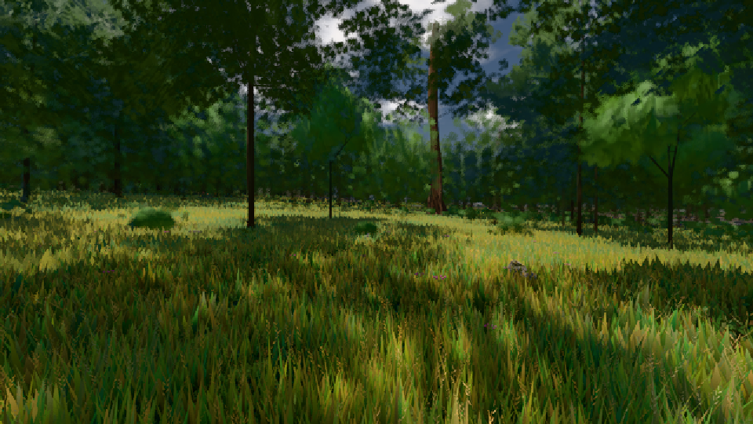

# GPU-PROBE 23e9d215 — GRÜN

Zweig `w26-eiche-kante` · Kopf 23e9d21511c0746621f0cf1a27e4aeece83bab15 · Läufer radeon-890m · 09.11. 20:58 · Wanduhr ab Push 290 s · Lauf https://github.com/MiguellD/AnazhRealm/actions/runs/42687613889

Ruf: `gate:laub-kante bild:wiese@0.5`

## Läufer radeon-890m — GRÜN

GPU AMD Radeon(TM) 890M Graphics · node_modules bleiben (package-lock 8047953b)
Schloss /c/Users/micha/AppData/Local/Temp/claude/gpu-schloss hält „ci-runner 42687613889/1 probe“
- Hook 2026-11-09 20:54:22 start ci-runner 42687613889/1 probe: Schloss genommen (refs/heads/w26-eiche-kante 23e9d21511c0746621f0cf1a27e4aeece83bab15 ws=C:\actions-runner\_work\AnazhRealm\AnazhRealm)

### gate:laub-kante — GRÜN · 128 s · Läufer radeon-890m

Adapter: ungenannt (die Probe nannte keinen Browser-Adapter)

```text
lod.K1#1 Tafel-Pose GRÜN [["f:fichte:L1",0.1676,346086,0],["f:tanne:L0",0.167,98772,0],["f:tanne:L1",0.1597,271160,0],["fimp:birke:L2",0.1562,27476,0],["fimp:eiche:L2",0.1367,57572,0],["fimp:fichte:L2",0.1476,40037,0],["fimp:strauch:L2",0.2059,22858,0],["fimp:tanne:L2",0.157,109193,0]]
lod.K1#1 Spielgang GRÜN [["f:eiche:L1",0.1777,6215,0],["f:fichte:L1",0.1685,301857,0],["f:tanne:L0",0.1335,128845,0],["f:tanne:L1",0.1349,155266,0],["fimp:birke:L2",0.1358,25150,0],["fimp:eiche:L2",0.1477,56619,0],["fimp:fichte:L2",0.143,32345,0],["fimp:strauch:L2",0.2078,30058,0],["fimp:tanne:L2",0.1446,80243,0]]
ABNAHME GRÜN · beweis · Sicht 0.0 % · Ziel Blickziel im Bild frei 12 m · Luma 45.7 σ 31.9 schwarz 0.0 % weiß 0.0 % · Stand 18.546.237 · Bühne summer sunny 0.50 Tiere gehalten · Gerät WebGPU amd rdna-3
```

### bild:wiese@0.5 — GRÜN · 45 s · Läufer radeon-890m

Adapter: [linse-gpu] amd/rdna-3

```text
Kamera des Spiels → Blick (10.0 m): -280.40 29.71 -1045.60 -289.61 29.71 -1049.50
 "abnahme": "ABNAHME GRÜN · beweis · Sicht 0.0 % · Ziel Blickziel im Bild frei 10 m · Luma 57 σ 32.9 schwarz 0.0 % weiß 0.0 % · Stand 18.546.237 · Bühne summer sunny 0.50 · Gerät WebGPU amd rdna-3",
```


