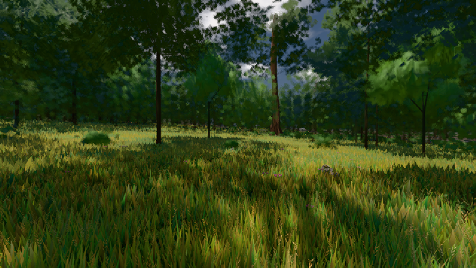

# GPU-PROBE 507bfd1b — GRÜN

Zweig `w26-eiche-kante` · Kopf 507bfd1b3ffd0701222ba872b16893f217a9140b · Läufer radeon-890m · 09.11. 17:43 · Wanduhr ab Push 348 s · Lauf https://github.com/MiguellD/AnazhRealm/actions/runs/42656713629

Ruf: `gate:laub-kante bild:wiese@0.5`

## Läufer radeon-890m — GRÜN

GPU AMD Radeon(TM) 890M Graphics · node_modules bleiben (package-lock 0a1b96a5)
Schloss /c/Users/micha/AppData/Local/Temp/claude/gpu-schloss hält „ci-runner 42656713629/1 probe“
- Hook 2026-11-09 17:38:23 start ci-runner 42656713629/1 probe: Schloss genommen (refs/heads/w26-eiche-kante 507bfd1b3ffd0701222ba872b16893f217a9140b ws=C:\actions-runner\_work\AnazhRealm\AnazhRealm)

### gate:laub-kante — GRÜN · 194 s · Läufer radeon-890m

Adapter: ungenannt (die Probe nannte keinen Browser-Adapter)

```text
lod.K1#1 Tafel-Pose GRÜN [["f:fichte:L1",0.1814,358064,0],["f:tanne:L0",0.1703,120658,0],["f:tanne:L1",0.1747,279077,0],["fimp:birke:L2",0.1549,27436,0],["fimp:eiche:L2",0.1366,57526,0],["fimp:fichte:L2",0.1444,39724,0],["fimp:strauch:L2",0.2079,22731,0],["fimp:tanne:L2",0.1573,109029,0]]
lod.K1#1 Spielgang ROT [["f:eiche:L1",0.3061,9045,0],["f:fichte:L1",0.1846,311006,0],["f:tanne:L0",0.1204,134267,0],["f:tanne:L1",0.1467,160338,0],["fimp:birke:L2",0.1331,25117,0],["fimp:eiche:L2",0.1472,56579,0],["fimp:fichte:L2",0.1429,32282,0],["fimp:strauch:L2",0.2093,30000,0],["fimp:tanne:L2",0.1443,80107,0]]
ABNAHME GRÜN · beweis · Sicht 0.0 % · Ziel Blickziel im Bild frei 12 m · Luma 45.7 σ 31.9 schwarz 0.0 % weiß 0.0 % · Stand 18.546.236 · Bühne summer sunny 0.50 Tiere gehalten · Gerät WebGPU amd rdna-3
```

### bild:wiese@0.5 — GRÜN · 57 s · Läufer radeon-890m

Adapter: [linse-gpu] amd/rdna-3

```text
Kamera des Spiels → Blick (10.0 m): -280.40 29.71 -1045.60 -289.61 29.71 -1049.50
 "abnahme": "ABNAHME GRÜN · beweis · Sicht 0.0 % · Ziel Blickziel im Bild frei 10 m · Luma 57 σ 32.9 schwarz 0.0 % weiß 0.0 % · Stand 18.546.236 · Bühne summer sunny 0.50 · Gerät WebGPU amd rdna-3",
```


