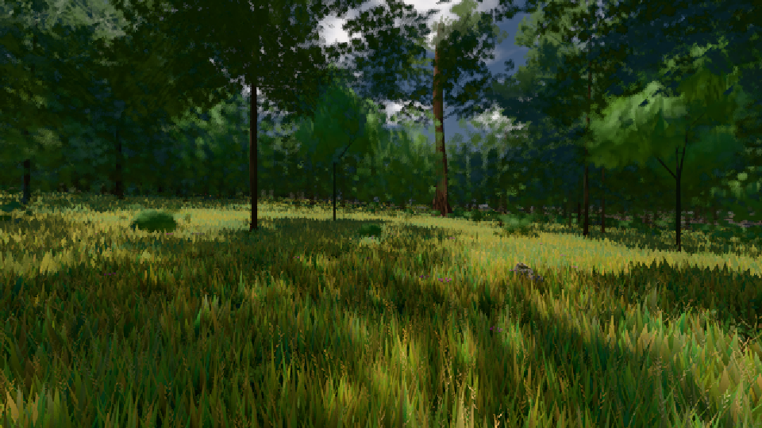

# GPU-PROBE d57566f9 — GRÜN

Zweig `w26-eiche-kante` · Kopf d57566f9915fa4eecde7a5cd614bfdd40217bcd4 · Läufer gtx1050-desktop · 09.11. 23:38 · Wanduhr ab Push 920 s · Lauf https://github.com/MiguellD/AnazhRealm/actions/runs/42711403778

Ruf: `gate:laub-kante bild:wiese@0.5`

## Läufer gtx1050-desktop — GRÜN

GPU NVIDIA GeForce GTX 1050 · node_modules bleiben (package-lock affde574)
Schloss /c/Users/User/AppData/Local/Temp/claude/gpu-schloss hält „ci-runner 42711403778/1 probe“
- Hook 2026-11-09 23:23:38 start ci-runner 42711403778/1 probe: wartet auf Schloss von 'hand w27-stadt-bild (Claude, bild:dorf)'
- Hook 2026-11-09 23:31:36 start ci-runner 42711403778/1 probe: Schloss genommen (refs/heads/w26-eiche-kante d57566f9915fa4eecde7a5cd614bfdd40217bcd4 ws=C:\actions-runner\_work\AnazhRealm\AnazhRealm)

### gate:laub-kante — GRÜN · 255 s · Läufer gtx1050-desktop

Adapter: ungenannt (die Probe nannte keinen Browser-Adapter)

```text
lod.K1#1 Tafel-Pose ROT [["f:fichte:L1",0.1728,361474,0],["f:tanne:L0",0.1736,99793,0],["f:tanne:L1",0.1603,283391,0],["fimp:birke:L2",0.1633,31204,0],["fimp:eiche:L2",0.1439,68408,0],["fimp:fichte:L2",0.1429,48502,0],["fimp:strauch:L2",0.2137,22973,0.002],["fimp:tanne:L2",0.1623,129366,0]]
lod.K1#1 Spielgang GRÜN [["f:eiche:L1",0.17,6694,0],["f:fichte:L1",0.163,327201,0],["f:tanne:L0",0.1504,140544,0],["f:tanne:L1",0.1397,168432,0],["fimp:birke:L2",0.1454,27899,0],["fimp:eiche:L2",0.1554,67340,0],["fimp:fichte:L2",0.1319,38030,0],["fimp:strauch:L2",0.2011,30108,0],["fimp:tanne:L2",0.1454,94484,0]]
ABNAHME GRÜN · beweis · Sicht 0.0 % · Ziel Blickziel im Bild frei 12 m · Luma 47.7 σ 32.7 schwarz 0.0 % weiß 0.0 % · Stand 18.546.238 · Bühne summer sunny 0.50 Tiere gehalten · Gerät WebGPU nvidia pascal
```

### bild:wiese@0.5 — GRÜN · 117 s · Läufer gtx1050-desktop

Adapter: [linse-gpu] nvidia/pascal

```text
Kamera des Spiels → Blick (10.0 m): -280.40 29.71 -1045.60 -289.61 29.71 -1049.50
 "abnahme": "ABNAHME GRÜN · beweis · Sicht 0.0 % · Ziel Blickziel im Bild frei 10 m · Luma 56.5 σ 32.9 schwarz 0.0 % weiß 0.0 % · Stand 18.546.238 · Bühne summer sunny 0.50 · Gerät WebGPU nvidia pascal",
```


