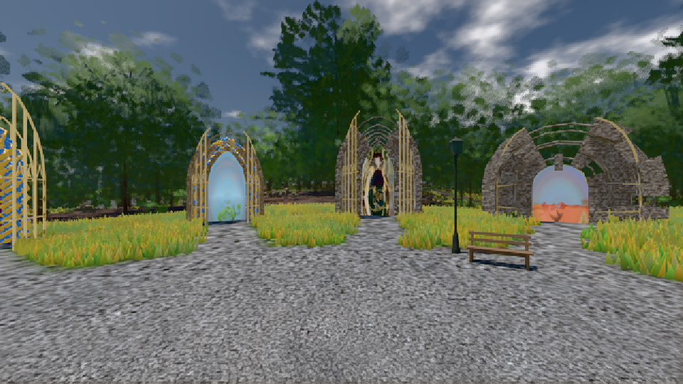
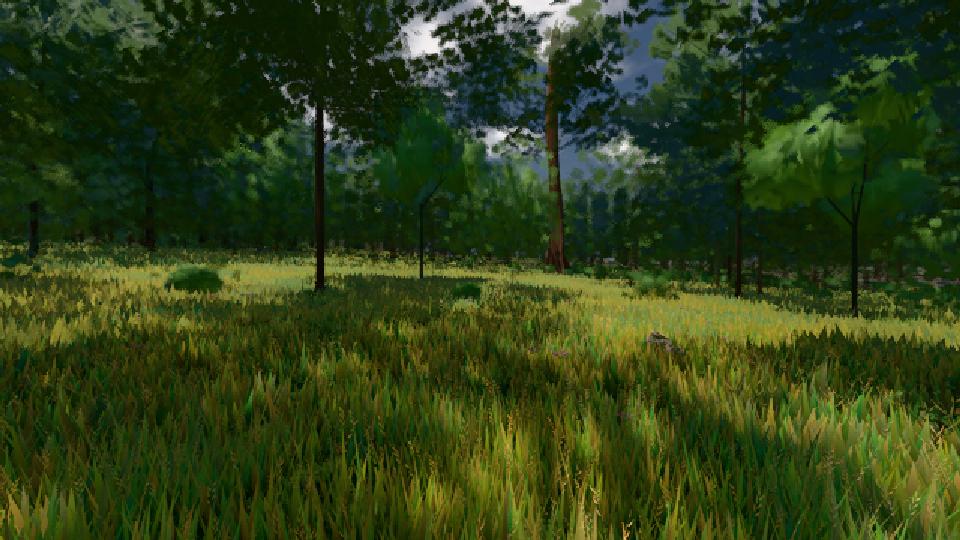

# GPU-PROBE c44b70e9 — GRÜN

Zweig `w26-fahrt-planer` · Kopf c44b70e93abb8a808693b7dddeeaf44d1aa2bbf5 · Läufer gtx1050-desktop · 09.11. 15:53 · Wanduhr ab Push 544 s · Lauf https://github.com/MiguellD/AnazhRealm/actions/runs/42637569346

Ruf: `bild:genesis@0.5 bild:wiese@0.5`

## Läufer gtx1050-desktop — GRÜN

GPU NVIDIA GeForce GTX 1050 · node_modules bleiben (package-lock 0a1b96a5)
Schloss /c/Users/User/AppData/Local/Temp/claude/gpu-schloss hält „ci-runner 42637569346/1 probe“
- Hook 2026-11-09 15:46:10 start ci-runner 42637569346/1 probe: Schloss genommen (refs/heads/w26-fahrt-planer c44b70e93abb8a808693b7dddeeaf44d1aa2bbf5 ws=C:\actions-runner\_work\AnazhRealm\AnazhRealm)

### bild:genesis@0.5 — GRÜN · 173 s · Läufer gtx1050-desktop

Adapter: [linse-gpu] nvidia/pascal

```text
Kamera des Spiels → Blick (10.0 m): 0.00 92.40 0.00 -10.00 92.40 0.00
 "abnahme": "ABNAHME GRÜN · beweis · Sicht 0.0 % · Ziel Blickziel im Bild frei 10 m · Luma 105.1 σ 37.7 schwarz 0.0 % weiß 0.0 % · Stand 18.546.236 · Bühne summer sunny 0.50 · Gerät WebGPU nvidia pascal",
```



### bild:wiese@0.5 — GRÜN · 160 s · Läufer gtx1050-desktop

Adapter: [linse-gpu] nvidia/pascal

```text
Kamera des Spiels → Blick (10.0 m): -280.40 29.71 -1045.60 -289.61 29.71 -1049.50
 "abnahme": "ABNAHME GRÜN · beweis · Sicht 0.0 % · Ziel Blickziel im Bild frei 10 m · Luma 56.8 σ 33.2 schwarz 0.0 % weiß 0.0 % · Stand 18.546.236 · Bühne summer sunny 0.50 · Gerät WebGPU nvidia pascal",
```


