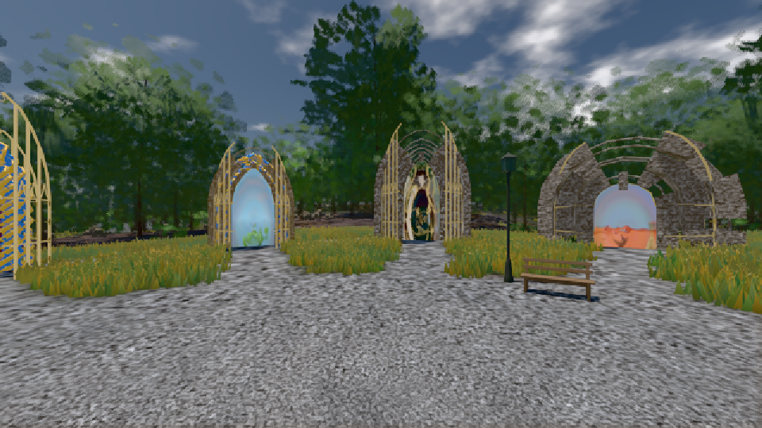
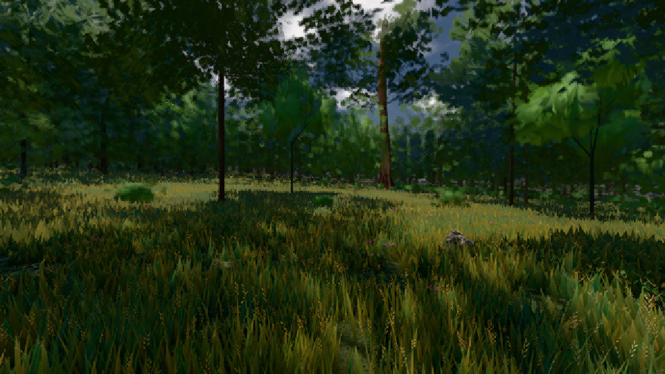

# GPU-PROBE 58b780c4 — GRÜN

Zweig `w26-ferne-ton-2` · Kopf 58b780c46c5d7934226801c3d551f8e5ddd0484f · Läufer gtx1050-desktop · 09.11. 15:33 · Wanduhr ab Push 1726 s · Lauf https://github.com/MiguellD/AnazhRealm/actions/runs/42631108914

Ruf: `gate:luft-tiefe:echt bild:genesis@0.5 bild:wiese@0.5`

GPU NVIDIA GeForce GTX 1050 · node_modules bleiben (package-lock 0a1b96a5)
Schloss /c/Users/User/AppData/Local/Temp/claude/gpu-schloss hält „ci-runner 42631108914/1 probe“
- Hook 2026-11-09 15:20:24 start ci-runner 42631108914/1 probe: Schloss genommen (refs/heads/w26-ferne-ton-2 58b780c46c5d7934226801c3d551f8e5ddd0484f ws=C:\actions-runner\_work\AnazhRealm\AnazhRealm)

### gate:luft-tiefe:echt — GRÜN · 237 s

Adapter: ungenannt (die Probe nannte keinen Browser-Adapter)

```text
✅ SELBSTTEST GRÜN — grauer β, Kante 21 %, Linie, leere Messung, Sicht 1800 m, Sprung 0,5 EV/s und der Ton je Pixel beim Namen ROT
  FARBTON 8 km K1-2 GRUEN je Uhr/Azimut 0.5/0 2.75° 0.5/90 2.22° 0.5/180 1.83° 0.5/270 1.33° 0.27/0 0.43° 0.27/90 0.17° 0.27/180 3° 0.27/270 0.2°
LUFT GRUEN · K1-1 GRUEN · K1-2 GRUEN · K2-1 GRUEN · K2-2 GRUEN
```

### bild:genesis@0.5 — GRÜN · 160 s

Adapter: [linse-gpu] nvidia/pascal

```text
Kamera des Spiels → Blick (10.0 m): 0.00 92.40 0.00 -10.00 92.40 0.00
 "abnahme": "ABNAHME GRÜN · beweis · Sicht 0.0 % · Ziel Blickziel im Bild frei 10 m · Luma 102.5 σ 37 schwarz 0.0 % weiß 0.0 % · Stand 18.546.236 · Bühne summer sunny 0.50 · Gerät WebGPU nvidia pascal",
```



### bild:wiese@0.5 — GRÜN · 165 s

Adapter: [linse-gpu] nvidia/pascal

```text
Kamera des Spiels → Blick (10.0 m): -280.40 29.71 -1045.60 -289.61 29.71 -1049.50
 "abnahme": "ABNAHME GRÜN · beweis · Sicht 0.0 % · Ziel Blickziel im Bild frei 10 m · Luma 44.2 σ 28.9 schwarz 0.0 % weiß 0.0 % · Stand 18.546.236 · Bühne summer sunny 0.50 · Gerät WebGPU nvidia pascal",
```


