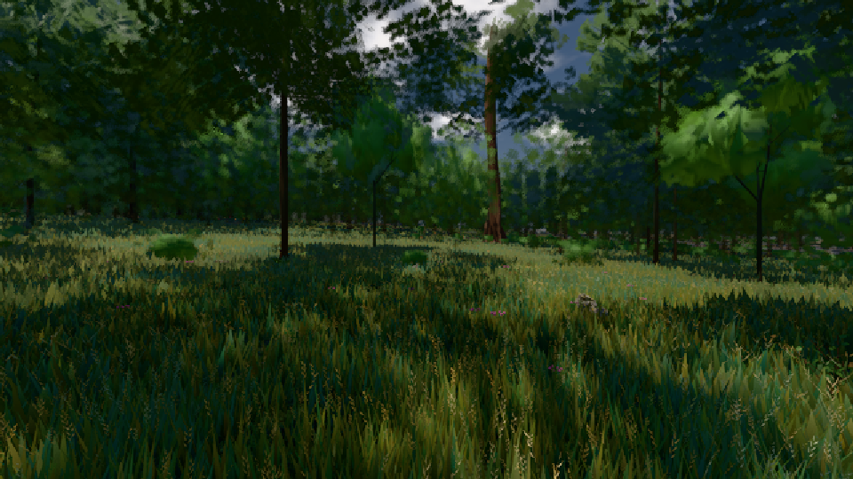

# GPU-PROBE 3503f6e6 — ROT

Zweig `w26-ferne-ton-4` · Kopf 3503f6e6ef2303249bbd2b6a7e234f09726eac95 · Läufer omen-gtx1060 + radeon-890m (Band-Gerät) · 09.11. 20:28 · Wanduhr ab Push 358 s · Lauf https://github.com/MiguellD/AnazhRealm/actions/runs/42682669998

Ruf: `bild:wiese@0.5 gate:pruefbuehne zeit:gate:luft-tiefe:echt`

## Läufer omen-gtx1060 — GRÜN

GPU NVIDIA GeForce GTX 1060 · npm ci 39 s (package-lock 8047953b)
Schloss /c/Users/micha/AppData/Local/Temp/claude/gpu-schloss hält „ci-runner 42682669998/1 probe“
- Hook 2026-11-09 20:22:34 start ci-runner 42682669998/1 probe: wartet auf Schloss von 'omen-punkte-gtx-sitzung'
- Hook 2026-11-09 20:22:49 start ci-runner 42682669998/1 probe: Schloss genommen (refs/heads/w26-ferne-ton-4 3503f6e6ef2303249bbd2b6a7e234f09726eac95 ws=C:\actions-runner\_work\AnazhRealm\AnazhRealm)

### bild:wiese@0.5 — GRÜN · 51 s · Läufer omen-gtx1060

Adapter: [linse-gpu] nvidia/pascal

```text
Kamera des Spiels → Blick (10.0 m): -280.40 29.71 -1045.60 -289.61 29.71 -1049.50
 "abnahme": "ABNAHME GRÜN · beweis · Sicht 0.0 % · Ziel Blickziel im Bild frei 10 m · Luma 43.9 σ 28.6 schwarz 0.0 % weiß 0.0 % · Stand 18.546.237 · Bühne summer sunny 0.50 · Gerät WebGPU nvidia pascal",
```



### gate:pruefbuehne — GRÜN · 189 s · Läufer omen-gtx1060

Adapter: ungenannt (die Probe nannte keinen Browser-Adapter)

```text
✅ SELBSTTEST GRÜN: auf der Bühne wirft das Feld nichts, der Akt setzt, die Wildnis wirft — und der Schein fällt rot beim Namen
```

## Läufer radeon-890m (Band-Gerät) — ROT

GPU AMD Radeon(TM) 890M Graphics · npm ci 75 s (package-lock 8047953b)
Schloss /c/Users/micha/AppData/Local/Temp/claude/gpu-schloss hält „ci-runner 42682669998/1 probe“
- Hook 2026-11-09 20:22:32 start ci-runner 42682669998/1 probe: Schloss genommen (refs/heads/w26-ferne-ton-4 3503f6e6ef2303249bbd2b6a7e234f09726eac95 ws=C:\actions-runner\_work\AnazhRealm\AnazhRealm)

### zeit:gate:luft-tiefe:echt — ROT · 92 s · Läufer radeon-890m (Band-Gerät)

Adapter: ungenannt (die Probe nannte keinen Browser-Adapter)

```text
  ROT K2-1 KANTE Uhr 0.5 (Sonne 74.21°) Azimut 180°: Restkontrast 0.02149 am Rand 35.6 km > 0.02
  ROT K1-2 FARBTON Uhr 0.5 (Sonne 74.21°) Azimut 270° 8 km: 166.28° von der Luft der Entfernung > 10°
  ROT K1-2 JE KANAL Uhr 0.27 (Sonne 7.2°) Azimut 90° ab 2 km: ungemessen (1 Paare < 30)
  ROT K1-2 JE KANAL Uhr 0.27 (Sonne 7.2°) Azimut 180° ab 2 km: ungemessen (0 Paare < 30)
  ROT K1-2 JE KANAL Uhr 0.27 (Sonne 7.2°) Azimut 270° ab 2 km: ungemessen (0 Paare < 30)
  ROT K1-2 HIMMEL Azimut 0°: Ton der In-Streuung nicht blau 0.1287,0.1182,0.1066 statt 222° ±15 (Duv -0.0008)
  ROT K1-2 HIMMEL Azimut 90°: Ton der In-Streuung nicht blau 0.08497,0.0807,0.07412 statt 222° ±15 (Duv 0)
  ROT K1-2 HIMMEL Azimut 180°: Ton der In-Streuung nicht blau 0.06503,0.0629,0.06086 statt 222° ±15 (Duv -0.0005)
  ROT K1-2 HIMMEL Azimut 270°: Ton der In-Streuung nicht blau 0.08645,0.0807,0.07412 statt 222° ±15 (Duv -0.0006)
LUFT ROT · K1-1 ROT · K1-2 ROT · K2-1 ROT · K2-2 GRUEN
```
