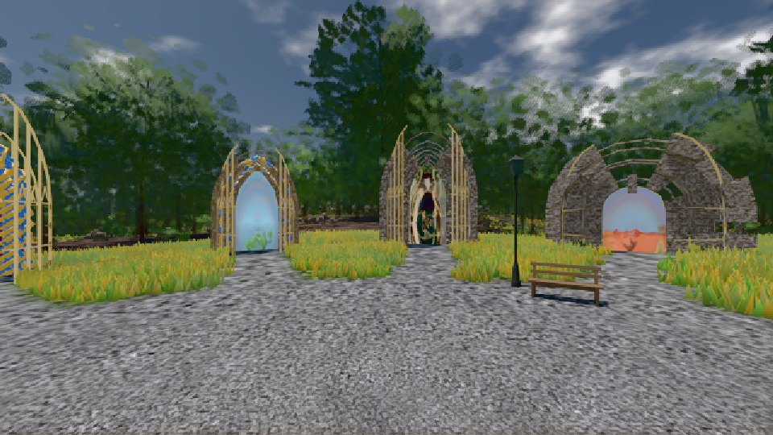
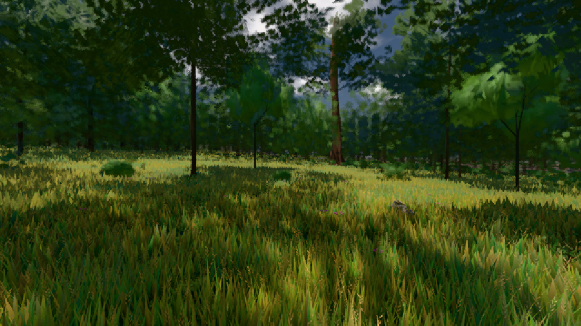

# GPU-PROBE bb75c460 — GRÜN

Zweig `w26-ferne-ton` · Kopf bb75c460c67293f3a524e11c6bed015786017294 · Läufer gtx1050-desktop · 09.11. 14:26 · Wanduhr ab Push 2341 s · Lauf https://github.com/MiguellD/AnazhRealm/actions/runs/42619956335

Ruf: `gate:luft-tiefe:echt bild:genesis@0.5 bild:wiese@0.5`

GPU NVIDIA GeForce GTX 1050 · node_modules bleiben (package-lock 0a1b96a5)
Schloss /c/Users/User/AppData/Local/Temp/claude/gpu-schloss hält „ci-runner 42619956335/1 probe“
- Hook 2026-11-09 14:19:34 start ci-runner 42619956335/1 probe: Schloss genommen (refs/heads/w26-ferne-ton bb75c460c67293f3a524e11c6bed015786017294 ws=C:\actions-runner\_work\AnazhRealm\AnazhRealm)

### gate:luft-tiefe:echt — GRÜN · 148 s

Adapter: ungenannt (die Probe nannte keinen Browser-Adapter)

```text
✅ SELBSTTEST GRÜN — grauer β, Kante 21 %, Linie, leere Messung, Sicht 1800 m, Sprung 0,5 EV/s und der Ton je Pixel beim Namen ROT
  FARBTON 8 km K1-2 GRUEN je Uhr/Azimut 0.5/0 5.22° 0.5/90 5.72° 0.5/180 3.88° 0.5/270 3.48° 0.27/0 0.36° 0.27/90 0.4° 0.27/180 3.36° 0.27/270 0.38°
LUFT GRUEN · K1-1 GRUEN · K1-2 GRUEN · K2-1 GRUEN · K2-2 GRUEN
```

### bild:genesis@0.5 — GRÜN · 117 s

Adapter: [linse-gpu] nvidia/pascal

```text
Kamera des Spiels → Blick (10.0 m): 0.00 92.40 0.00 -10.00 92.40 0.00
 "abnahme": "ABNAHME GRÜN · beweis · Sicht 0.0 % · Ziel Blickziel im Bild frei 10 m · Luma 105.1 σ 37.7 schwarz 0.0 % weiß 0.0 % · Stand 18.546.236 · Bühne summer sunny 0.50 · Gerät WebGPU nvidia pascal",
```



### bild:wiese@0.5 — GRÜN · 107 s

Adapter: [linse-gpu] nvidia/pascal

```text
Kamera des Spiels → Blick (10.0 m): -280.40 29.71 -1045.60 -289.61 29.71 -1049.50
 "abnahme": "ABNAHME GRÜN · beweis · Sicht 0.0 % · Ziel Blickziel im Bild frei 10 m · Luma 56.8 σ 33.3 schwarz 0.0 % weiß 0.0 % · Stand 18.546.236 · Bühne summer sunny 0.50 · Gerät WebGPU nvidia pascal",
```


