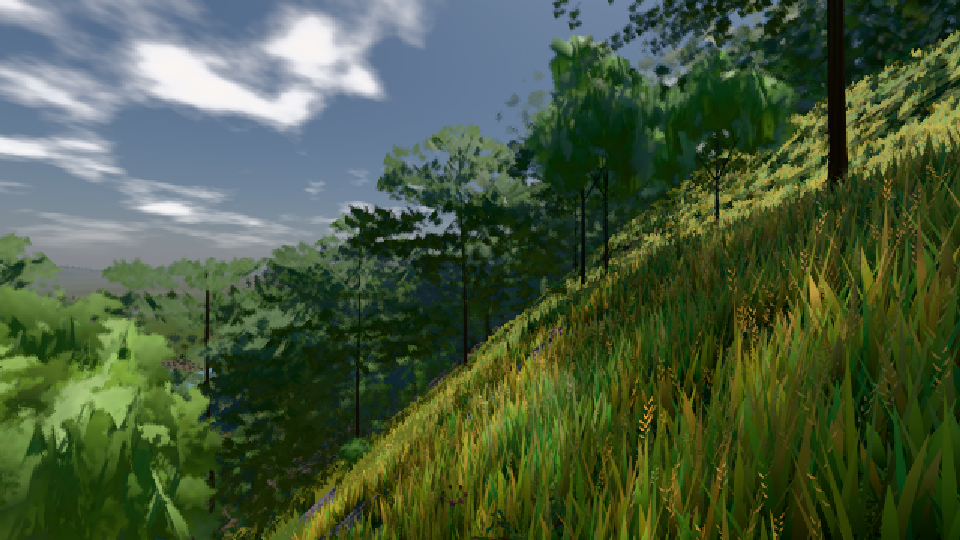

# GPU-PROBE 774ff9ac — GRÜN

Zweig `w26-haar-arm` · Kopf 774ff9acf16f2f40a36de2cb97280bb6a4d19943 · Läufer omen-gtx1060 · 09.11. 16:14 · Wanduhr ab Push 105 s · Lauf https://github.com/MiguellD/AnazhRealm/actions/runs/42642403099

Ruf: `bild:dorf@0.5`

## Läufer omen-gtx1060 — GRÜN

GPU NVIDIA GeForce GTX 1060 · node_modules bleiben (package-lock 0a1b96a5)
Schloss /c/Users/micha/AppData/Local/Temp/claude/gpu-schloss hält „ci-runner 42642403099/1 probe“
- Hook 2026-11-09 16:13:18 start ci-runner 42642403099/1 probe: Schloss genommen (refs/heads/w26-haar-arm 774ff9acf16f2f40a36de2cb97280bb6a4d19943 ws=C:\actions-runner\_work\AnazhRealm\AnazhRealm)

### bild:dorf@0.5 — GRÜN · 67 s · Läufer omen-gtx1060

Adapter: [linse-gpu] nvidia/pascal

```text
Kamera des Spiels → Blick (10.0 m): -841.00 86.89 -861.00 -834.08 86.89 -853.78
 "abnahme": "ABNAHME GRÜN · beweis · Sicht 0.0 % · Ziel Blickziel im Bild frei 10 m · Luma 85.2 σ 48.2 schwarz 0.0 % weiß 0.0 % · Stand 18.546.236 · Bühne summer sunny 0.50 · Gerät WebGPU nvidia pascal",
```


