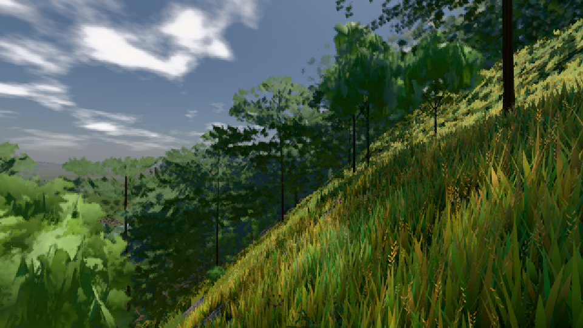

# GPU-PROBE 8b35056b — ROT

Zweig `w26-haar-arm` · Kopf 8b35056b55f48eca7b5d280c377f2311861e0623 · Läufer gtx1050-desktop + radeon-890m (Band-Gerät) · 09.11. 15:45 · Wanduhr ab Push 1157 s · Lauf https://github.com/MiguellD/AnazhRealm/actions/runs/42634710157

Ruf: `bild:dorf@0.5 zeit:gate:haar-strich-probe zeit:gate:haar-albedo-probe`

## Läufer gtx1050-desktop — GRÜN

GPU NVIDIA GeForce GTX 1050 · node_modules bleiben (package-lock 0a1b96a5)
Schloss /c/Users/User/AppData/Local/Temp/claude/gpu-schloss hält „ci-runner 42634710157/1 probe“
- Hook 2026-11-09 15:41:03 start ci-runner 42634710157/1 probe: Schloss genommen (refs/heads/w26-haar-arm 8b35056b55f48eca7b5d280c377f2311861e0623 ws=C:\actions-runner\_work\AnazhRealm\AnazhRealm)

### bild:dorf@0.5 — GRÜN · 201 s · Läufer gtx1050-desktop

Adapter: [linse-gpu] nvidia/pascal

```text
Kamera des Spiels → Blick (10.0 m): -841.00 86.89 -861.00 -834.08 86.89 -853.78
 "abnahme": "ABNAHME GRÜN · beweis · Sicht 0.0 % · Ziel Blickziel im Bild frei 10 m · Luma 85.2 σ 48.2 schwarz 0.0 % weiß 0.0 % · Stand 18.546.236 · Bühne summer sunny 0.50 · Gerät WebGPU nvidia pascal",
```



## Läufer radeon-890m (Band-Gerät) — ROT

GPU AMD Radeon(TM) 890M Graphics · node_modules bleiben (package-lock 0a1b96a5)
Schloss /c/Users/micha/AppData/Local/Temp/claude/gpu-schloss hält „ci-runner 42634710157/1 probe“
- Hook 2026-11-09 15:35:21 start ci-runner 42634710157/1 probe: Schloss genommen (refs/heads/w26-haar-arm 8b35056b55f48eca7b5d280c377f2311861e0623 ws=C:\actions-runner\_work\AnazhRealm\AnazhRealm)

### zeit:gate:haar-strich-probe — GRÜN · 139 s · Läufer radeon-890m (Band-Gerät)

Adapter: [linse-gpu] amd/rdna-3

```text
✅ MESSUNG sanft-streu: arm {"strich":0.4829,"si":2314,"luma":9.47,"weiss":0} · third {"strich":0.5058,"si":96,"luma":6.41,"weiss":0} · Pose Δ 0.0e+0
✅ MESSUNG sanft-trt: arm {"strich":0.4829,"si":2314,"luma":9.47,"weiss":0} · third {"strich":0.5058,"si":96,"luma":6.41,"weiss":0} · Pose Δ 0.0e+0
✅ MESSUNG sanft-rund-weg: arm {"strich":0.4965,"si":2341,"luma":8.41,"weiss":0} · third {"strich":0.5896,"si":96,"luma":5.27,"weiss":0} · Pose Δ 0.0e+0
✅ MESSUNG zweig#2: arm {"strich":0.4299,"si":2270,"luma":17.23,"weiss":0} · third {"strich":0.4637,"si":93,"luma":10.28,"weiss":0} · Pose Δ 0.0e+0
✅ GRÜN zweig#1: arm 0.4299 im Band · third 0.4637 im Band [0,3554; 0,533]
✅ GRÜN sanft: arm 0.4829 im Band · third 0.5058 im Band [0,3554; 0,533]
✅ GRÜN sanft-streu: arm 0.4829 im Band · third 0.5058 im Band [0,3554; 0,533]
✅ GRÜN sanft-trt: arm 0.4829 im Band · third 0.5058 im Band [0,3554; 0,533]
❌ ROT sanft-rund-weg: arm 0.4965 im Band · third 0.5896 außer Band [0,3554; 0,533]
✅ GRÜN zweig#2: arm 0.4299 im Band · third 0.4637 im Band [0,3554; 0,533]
```

### zeit:gate:haar-albedo-probe — ROT · 17 s · Läufer radeon-890m (Band-Gerät)

Adapter: ungenannt (die Probe nannte keinen Browser-Adapter)

```text
❌ ROT haar-strich: die Werkbank endete 2: werkbank.cjs ABSTURZ: Error: --echt braucht den save-server auf http://localhost:4312 (npm start) — 
```
