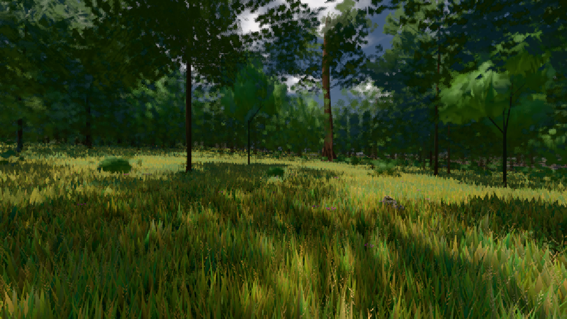

# GPU-PROBE 01e90bbf — GRÜN

Zweig `w26-laub-kante` · Kopf 01e90bbf4f5051f203ab59c0eb1f45893d9a5e3b · Läufer gtx1050-desktop · 09.11. 13:32 · Wanduhr ab Push 2291 s · Lauf https://github.com/MiguellD/AnazhRealm/actions/runs/42612615388

Ruf: `gate:laub-kante bild:wiese@0.5`

GPU NVIDIA GeForce GTX 1050 · node_modules bleiben (package-lock 0a1b96a5)
Schloss /c/Users/User/AppData/Local/Temp/claude/gpu-schloss hält „ci-runner 42612615388/1 probe“
- Hook 2026-11-09 13:22:51 start ci-runner 42612615388/1 probe: Schloss genommen (refs/heads/w26-laub-kante 01e90bbf4f5051f203ab59c0eb1f45893d9a5e3b ws=C:\actions-runner\_work\AnazhRealm\AnazhRealm)

### gate:laub-kante — GRÜN · 257 s

Adapter: ungenannt (die Probe nannte keinen Browser-Adapter)

```text
lod.K1#1 GRÜN [["f:fichte:L1",0.1825,367421,0],["f:tanne:L0",0.1786,119550,0],["f:tanne:L1",0.1686,290467,0],["fimp:birke:L2",0.1606,30429,0],["fimp:eiche:L2",0.14,65486,0],["fimp:fichte:L2",0.14,49740,0],["fimp:strauch:L2",0.212,22595,0],["fimp:tanne:L2",0.1581,134985,0]]
ABNAHME GRÜN · beweis · Sicht 0.0 % · Ziel tanne im Bild frei 16.81 m · Luma 55.8 σ 39.1 schwarz 0.0 % weiß 0.0 % · Stand 18.546.236 · Bühne summer sunny 0.50 · Gerät WebGPU nvidia pascal · Blick-Wahl 1 Posen
```

### bild:wiese@0.5 — GRÜN · 203 s

Adapter: [linse-gpu] nvidia/pascal

```text
Kamera des Spiels → Blick (10.0 m): -280.40 29.71 -1045.60 -289.61 29.71 -1049.50
 "abnahme": "ABNAHME GRÜN · beweis · Sicht 0.0 % · Ziel Blickziel im Bild frei 10 m · Luma 56.7 σ 33.2 schwarz 0.0 % weiß 0.0 % · Stand 18.546.236 · Bühne summer sunny 0.50 · Gerät WebGPU nvidia pascal",
```


