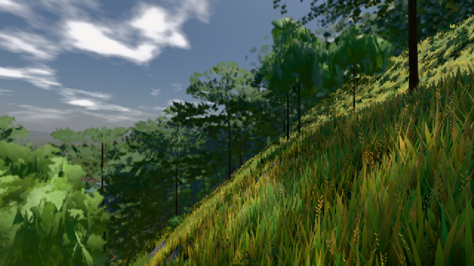

# GPU-PROBE f30cbe8c — ROT

Zweig `w26-leib-raum-vorher` · Kopf f30cbe8c07e70c3600e4511d4bb33ff6c57ccf53 · Läufer gtx1050-desktop · 09.11. 15:20 · Wanduhr ab Push 5379 s · Lauf https://github.com/MiguellD/AnazhRealm/actions/runs/42620411041

Ruf: `bild:dorf@0.5 bild:stadt@0.5 bild:stadt-voll@0.5`

GPU NVIDIA GeForce GTX 1050 · node_modules bleiben (package-lock 0a1b96a5)
Schloss /c/Users/User/AppData/Local/Temp/claude/gpu-schloss hält „ci-runner 42620411041/1 probe“
- Hook 2026-11-09 14:56:57 start ci-runner 42620411041/1 probe: Schloss genommen (refs/heads/w26-leib-raum-vorher f30cbe8c07e70c3600e4511d4bb33ff6c57ccf53 ws=C:\actions-runner\_work\AnazhRealm\AnazhRealm)

### bild:dorf@0.5 — GRÜN · 157 s

Adapter: [linse-gpu] nvidia/pascal

```text
Kamera des Spiels → Blick (10.0 m): -841.00 86.89 -861.00 -834.08 86.89 -853.78
 "abnahme": "ABNAHME GRÜN · beweis · Sicht 0.0 % · Ziel Blickziel im Bild frei 10 m · Luma 85.2 σ 48.2 schwarz 0.0 % weiß 0.0 % · Stand 18.546.236 · Bühne summer sunny 0.50 · Gerät WebGPU nvidia pascal",
```



### bild:stadt@0.5 — ROT · 616 s

Adapter: [linse-gpu] nvidia/pascal · DECKEL 480 s

```text
[linse-gpu] nvidia/pascal
```

### bild:stadt-voll@0.5 — ROT · 552 s

Adapter: [linse-gpu] nvidia/pascal · DECKEL 480 s

```text
[linse-gpu] nvidia/pascal
```
