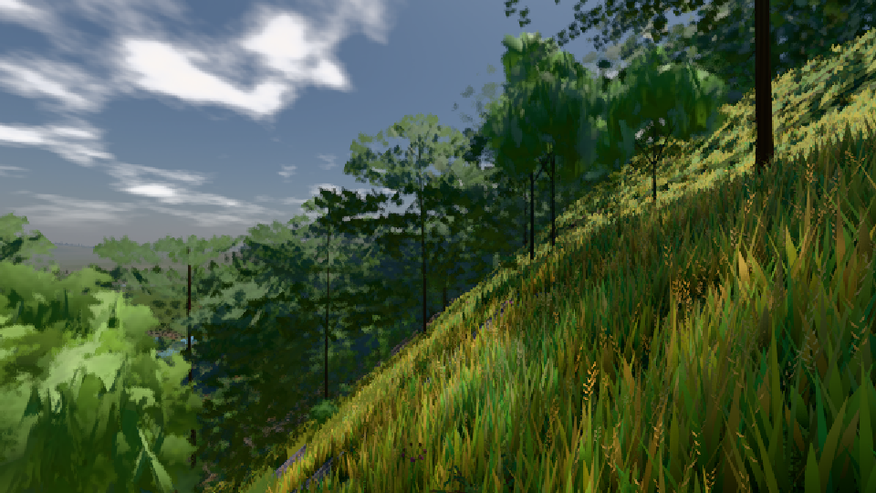

# GPU-PROBE 13caf1f5 — ROT

Zweig `w26-leib-raum` · Kopf 13caf1f53fbb69235db77d12e1fdffbb665224b7 · Läufer radeon-890m · 09.11. 14:56 · Wanduhr ab Push 3935 s · Lauf https://github.com/MiguellD/AnazhRealm/actions/runs/42620391750

Ruf: `bild:dorf@0.5 bild:stadt@0.5 bild:stadt-voll@0.5`

GPU AMD Radeon(TM) 890M Graphics · node_modules bleiben (package-lock 0a1b96a5)
Schloss /c/Users/micha/AppData/Local/Temp/claude/gpu-schloss hält „ci-runner 42620391750/1 probe“
- Hook 2026-11-09 14:34:22 start ci-runner 42620391750/1 probe: Schloss genommen (refs/heads/w26-leib-raum 13caf1f53fbb69235db77d12e1fdffbb665224b7 ws=C:\actions-runner\_work\AnazhRealm\AnazhRealm)

### bild:dorf@0.5 — GRÜN · 57 s

Adapter: [linse-gpu] amd/rdna-3

```text
Kamera des Spiels → Blick (10.0 m): -841.00 86.89 -861.00 -834.08 86.89 -853.78
 "abnahme": "ABNAHME GRÜN · beweis · Sicht 0.0 % · Ziel Blickziel im Bild frei 10 m · Luma 85.4 σ 48.1 schwarz 0.0 % weiß 0.0 % · Stand 18.546.236 · Bühne summer sunny 0.50 · Gerät WebGPU amd rdna-3",
```



### bild:stadt@0.5 — ROT · 616 s

Adapter: [linse-gpu] amd/rdna-3 · DECKEL 480 s

```text
[linse-gpu] amd/rdna-3
```

### bild:stadt-voll@0.5 — ROT · 599 s

Adapter: [linse-gpu] amd/rdna-3 · DECKEL 480 s

```text
[linse-gpu] amd/rdna-3
```
