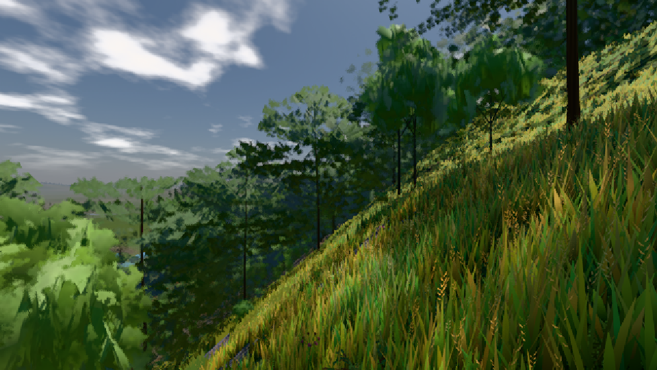

# GPU-PROBE 52b38779 — ROT

Zweig `w26-leib-raum` · Kopf 52b387797e138883008a7ceef1e718bfc2160db5 · Läufer gtx1050-desktop · 09.11. 16:10 · Wanduhr ab Push 525 s · Lauf https://github.com/MiguellD/AnazhRealm/actions/runs/42640485702

Ruf: `bild:dorf@0.5 bild:stadt@0.5`

## Läufer gtx1050-desktop — ROT

GPU NVIDIA GeForce GTX 1050 · node_modules bleiben (package-lock 0a1b96a5)
Schloss /c/Users/User/AppData/Local/Temp/claude/gpu-schloss hält „ci-runner 42640485702/1 probe“
- Hook 2026-11-09 16:02:14 start ci-runner 42640485702/1 probe: Schloss genommen (refs/heads/w26-leib-raum 52b387797e138883008a7ceef1e718bfc2160db5 ws=C:\actions-runner\_work\AnazhRealm\AnazhRealm)

### bild:dorf@0.5 — GRÜN · 198 s · Läufer gtx1050-desktop

Adapter: [linse-gpu] nvidia/pascal

```text
Kamera des Spiels → Blick (10.0 m): -841.00 86.89 -861.00 -834.08 86.89 -853.78
 "abnahme": "ABNAHME GRÜN · beweis · Sicht 0.0 % · Ziel Blickziel im Bild frei 10 m · Luma 85.2 σ 48.2 schwarz 0.0 % weiß 0.0 % · Stand 18.546.236 · Bühne summer sunny 0.50 · Gerät WebGPU nvidia pascal",
```



### bild:stadt@0.5 — ROT · 239 s · Läufer gtx1050-desktop

Adapter: [linse-gpu] nvidia/pascal

```text
Kamera des Spiels → Blick (53.9 m): ungelesen
```
