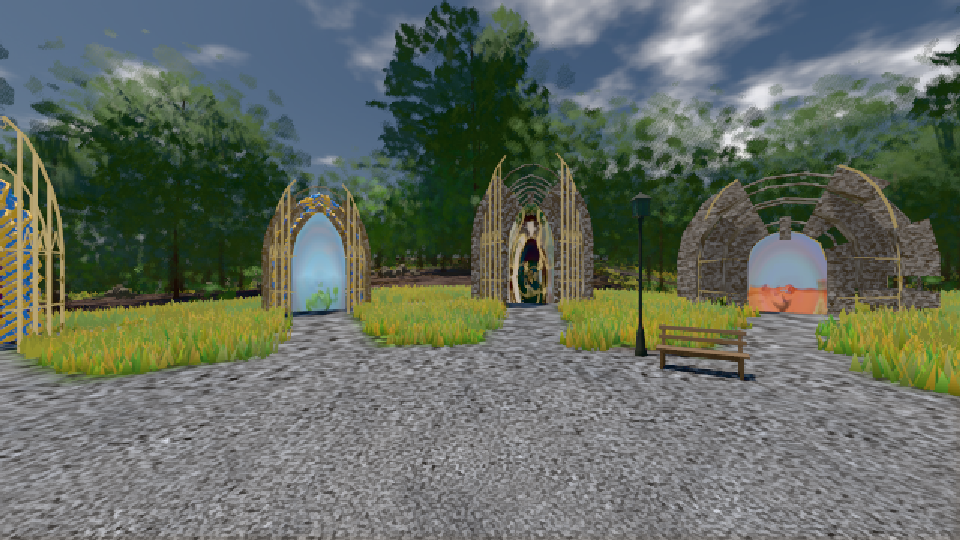

# GPU-PROBE 18098398 — GRÜN

Zweig `w26-programm-katalog` · Kopf 180983988401ac81328ffd59bcc3d2e1ee5b233b · Läufer omen-gtx1060 · 09.11. 15:46 · Wanduhr ab Push 289 s · Lauf https://github.com/MiguellD/AnazhRealm/actions/runs/42637145676

Ruf: `gate:kamera-treue bild:genesis@0.5`

## Läufer omen-gtx1060 — GRÜN

GPU NVIDIA GeForce GTX 1060 · node_modules bleiben (package-lock 0a1b96a5)
Schloss /c/Users/micha/AppData/Local/Temp/claude/gpu-schloss hält „ci-runner 42637145676/1 probe“
- Hook 2026-11-09 15:44:19 start ci-runner 42637145676/1 probe: Schloss genommen (refs/heads/w26-programm-katalog 180983988401ac81328ffd59bcc3d2e1ee5b233b ws=C:\actions-runner\_work\AnazhRealm\AnazhRealm)

### gate:kamera-treue — GRÜN · 38 s · Läufer omen-gtx1060

Adapter: [linse-gpu] nvidia/pascal

```text
  ✅ Selbsttest „alphaTest-0,5-Werfer verliert discard" → rot: WURF: wurf:schnitt — Hauptpass verwirft true, Wurf verwirft false
  ✅ Selbsttest „Farb-Graph im Wurf" → rot: WURF: wurf:voll — ohne Ausschnitt trägt der Wurf den Farb-Graphen
  ✅ Selbsttest „Stand blind" → rot: STAND direkt: DIÄT: keine Diät-Prüfung gezählt — die Linse ist blind
  ✅ Selbsttest „Stempel überlebt den verschachtelten Render" → rot: VERSCHACHTELT replay: nach einem verschachtelten Render über die Vendor-Bahn (Werfer ohne Diät) zeichnet die Diät 0.1099 gleich mit dem vollen Refresh (Soll ≥ 0.999) — ein Stempel überlebte den verschachtelten Render, die nächste geteilte Gruppe trug dessen Kamera
  ✅ Selbsttest „Verschachtelt blind (Täter)" → rot: VERSCHACHTELT direkt: ein Stempel nur aus der Render-Id zeichnet 1 gleich (Soll < 0.98) — die Probe ist blind (oder der Gang liest seinen Render-Abschnitt nicht aus `rend.info.calls`)
  ✅ Selbsttest „kein verschachtelter Render" → rot: VERSCHACHTELT replay: kein verschachtelter Render im Bild der Diät — die Probe ist blind
  ✅ Selbsttest „Spiel-Frame in der Bühne" → rot: LAUF: 2 Spiel-Bilder während der Bühne, der GPU-Kehraus nahm 51 Geometrie-Puffer — der Spiel-Loop lief hinein, der Lauf ist ungültig
  ✅ Selbsttest „Kehraus ohne Spiel-Bild" → rot: LAUF: 0 Spiel-Bilder während der Bühne, der GPU-Kehraus nahm 3 Geometrie-Puffer — der Spiel-Loop lief hinein, der Lauf ist ungültig
✅ SELBSTTEST GRÜN — jeder injizierte Täter fällt rot und wird beim Namen genannt.
✅ GRÜN — LAUF: 0 Spiel-Bilder, 0 Kehraus-Puffer in der Bühne; die Aufnahme verfolgt 14 von 14 Draws trotz Schatten-Render, kein Bundle unter dem Override-Stoff; der Replay zeichnet Blick Y wie der direkte Pfad (1, mit fremdem Schatten-Stoff 1); ohne den Chokepoint 0.7898, ein Schatten-Bundle 0.7898. SCHLÜSSEL · WURF halten. SENKE: zwei Senken EINER Gestalt zeichnen aus EINEM Knoten-Zustand (zwei r184-InstancedMesh: zwei), bild-gleich mit r184s InstancedMesh (1; ohne die Senke 0.9563). STAND: 8 Karten-Programme tragen 1 geteilte Gruppe(n); je Render 27 Prüfungen, 0 Voll-Refreshs (auch 
```

### bild:genesis@0.5 — GRÜN · 57 s · Läufer omen-gtx1060

Adapter: [linse-gpu] nvidia/pascal

```text
Kamera des Spiels → Blick (10.0 m): 0.00 92.40 0.00 -10.00 92.40 0.00
 "abnahme": "ABNAHME GRÜN · beweis · Sicht 0.0 % · Ziel Blickziel im Bild frei 10 m · Luma 105.1 σ 37.7 schwarz 0.0 % weiß 0.0 % · Stand 18.546.236 · Bühne summer sunny 0.50 · Gerät WebGPU nvidia pascal",
```


