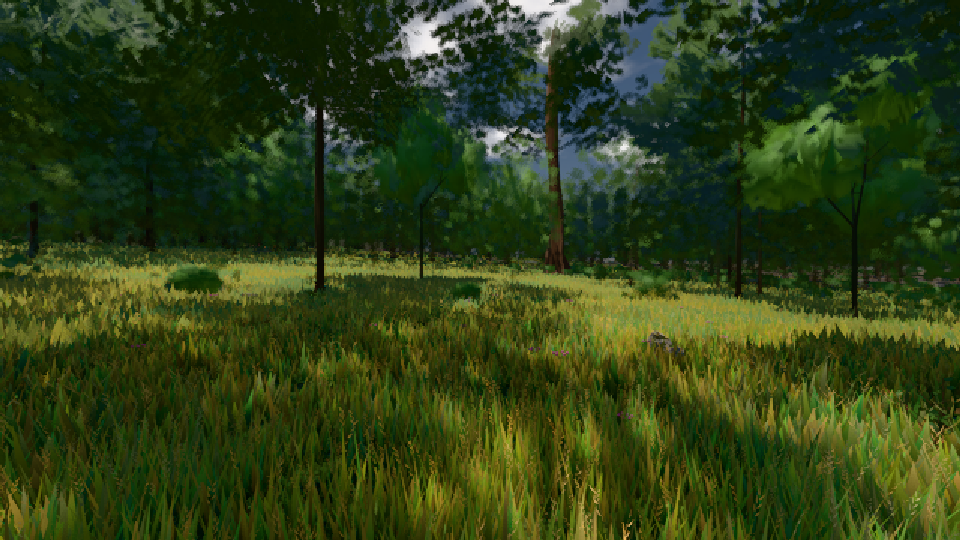

# GPU-PROBE 829014ec — GRÜN

Zweig `w26-winter-fichte-2` · Kopf 829014ec9d3186e1127f34fd51d00a8b853ab275 · Läufer gtx1050-desktop · 09.11. 20:57 · Wanduhr ab Push 276 s · Lauf https://github.com/MiguellD/AnazhRealm/actions/runs/42687557788

Ruf: `bild:wiese@0.5 gate:welt-boot`

## Läufer gtx1050-desktop — GRÜN

GPU NVIDIA GeForce GTX 1050 · node_modules bleiben (package-lock 8047953b)
Schloss /c/Users/User/AppData/Local/Temp/claude/gpu-schloss hält „ci-runner 42687557788/1 probe“
- Hook 2026-11-09 20:54:13 start ci-runner 42687557788/1 probe: Schloss genommen (refs/heads/w26-winter-fichte-2 829014ec9d3186e1127f34fd51d00a8b853ab275 ws=C:\actions-runner\_work\AnazhRealm\AnazhRealm)

### bild:wiese@0.5 — GRÜN · 106 s · Läufer gtx1050-desktop

Adapter: [linse-gpu] nvidia/pascal

```text
Kamera des Spiels → Blick (10.0 m): -280.40 29.71 -1045.60 -289.61 29.71 -1049.50
 "abnahme": "ABNAHME GRÜN · beweis · Sicht 0.0 % · Ziel Blickziel im Bild frei 10 m · Luma 56.7 σ 33.2 schwarz 0.0 % weiß 0.0 % · Stand 18.546.237 · Bühne summer sunny 0.50 · Gerät WebGPU nvidia pascal",
```



### gate:welt-boot — GRÜN · 57 s · Läufer gtx1050-desktop

Adapter: ungenannt (die Probe nannte keinen Browser-Adapter)

```text
  ✅ Schleife: JS-SCHLEIFE — der Haupt-Thread rechnet in __stallSchleife schleife.html:1 · Stapel __stallSchleife schleife.html:1 · Pausen der Seite 0 (Soll 0)
  ✅ Versprechen: AWAIT — der Haupt-Thread lebt (Puls vor 0.0 s), ein Versprechen der Seite kehrt nie zurück; zuletzt kein Stempel
  ✅ Bau LANGSAM (3,2 s, eine Karte offen): steht nach 159 Takten, 3213 ms
  ✅ Bau TOT (nichts offen): DER BAU STEHT NICHT: tot#2 nach 5 Takten — die Welt hat nichts mehr offen · dem Weltbild fehlt: das Licht des Orts wird gemessen
  ✅ Bau HÄNGT: DIE WELT HÄNGT: haenger nach 3601 Takten — offen {"foundry":0,"chunks":0,"wald":0,"karten":1} ohne Bau-Ereignis · 
  ✅ Regler atmet (echter Renderer): steht nach 30 Takten, danach frei
  ✅ Weiche: welt-boot.cjs startet „echt" und zeichnet nie (keine seiner 1 Seiten arbeitet auf der GPU): das Rezept ist „null" · nach einem Draw trägt
  ✅ Start auf belegtem Port: save-server.js endete vor seiner Bereitschaft (Code 1): Error: listen EADDRINUSE: address already in use 127.0.0.1:52140 (224 ms)
  ✅ eigene Ports 52140, 52141
GRÜN — die Akte nennt Schleife und Versprechen beim Namen, ein kurzer Block bleibt still; das Warten auf den Bau und der Start eines Servers urteilen am Ereignis
```
