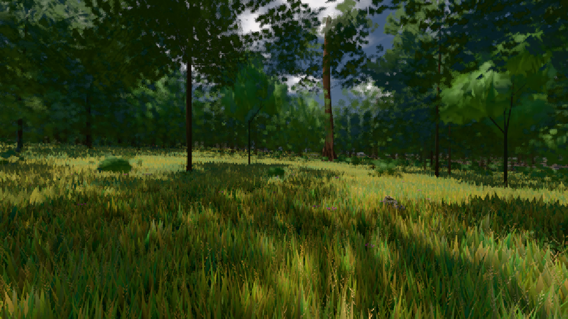
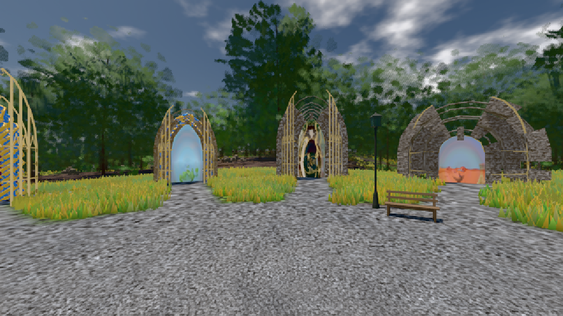

# GPU-PROBE 3456571a — GRÜN

Zweig `w26-winter-fichte` · Kopf 3456571a5251e61ea858aded21bfb37cb89e9168 · Läufer radeon-890m · 09.11. 15:33 · Wanduhr ab Push 1617 s · Lauf https://github.com/MiguellD/AnazhRealm/actions/runs/42631427497

Ruf: `bild:wiese@0.5 bild:genesis@0.5`

GPU AMD Radeon(TM) 890M Graphics · node_modules bleiben (package-lock 0a1b96a5)
Schloss /c/Users/micha/AppData/Local/Temp/claude/gpu-schloss hält „ci-runner 42631427497/1 probe“
- Hook 2026-11-09 15:30:27 start ci-runner 42631427497/1 probe: Schloss genommen (refs/heads/w26-winter-fichte 3456571a5251e61ea858aded21bfb37cb89e9168 ws=C:\actions-runner\_work\AnazhRealm\AnazhRealm)

### bild:wiese@0.5 — GRÜN · 49 s

Adapter: [linse-gpu] amd/rdna-3

```text
Kamera des Spiels → Blick (10.0 m): -280.40 29.71 -1045.60 -289.61 29.71 -1049.50
 "abnahme": "ABNAHME GRÜN · beweis · Sicht 0.0 % · Ziel Blickziel im Bild frei 10 m · Luma 57.2 σ 33.1 schwarz 0.0 % weiß 0.0 % · Stand 18.546.236 · Bühne summer sunny 0.50 · Gerät WebGPU amd rdna-3",
```



### bild:genesis@0.5 — GRÜN · 50 s

Adapter: [linse-gpu] amd/rdna-3

```text
Kamera des Spiels → Blick (10.0 m): 0.00 92.40 0.00 -10.00 92.40 0.00
 "abnahme": "ABNAHME GRÜN · beweis · Sicht 0.0 % · Ziel Blickziel im Bild frei 10 m · Luma 105.4 σ 37.6 schwarz 0.0 % weiß 0.0 % · Stand 18.546.236 · Bühne summer sunny 0.50 · Gerät WebGPU amd rdna-3",
```


