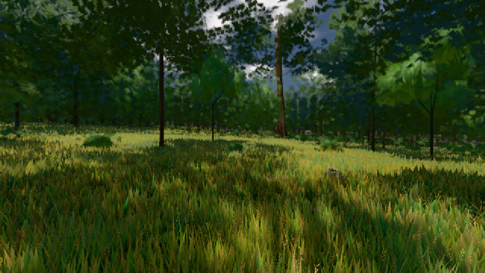
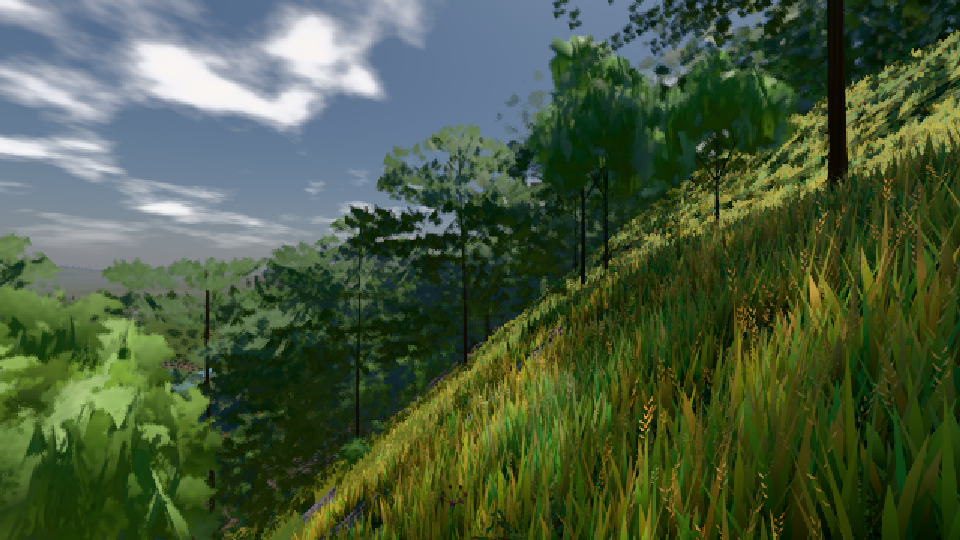

# GPU-PROBE cbc51aab — GRÜN

Zweig `w27-boden-nah-2` · Kopf cbc51aab2e49d18155e2e83a3775370ad4ea359c · Läufer radeon-890m · 10.11. 00:58 · Wanduhr ab Push 773 s · Lauf https://github.com/MiguellD/AnazhRealm/actions/runs/42723063667

Ruf: `gate:pruefbuehne-licht bild:wiese@0.5 bild:dorf@0.5`

## Läufer radeon-890m — GRÜN

GPU AMD Radeon(TM) 890M Graphics · npm ci 53 s (package-lock affde574)
Schloss /c/Users/micha/AppData/Local/Temp/claude/gpu-schloss hält „ci-runner 42723063667/1 probe“
- Hook 2026-11-10 00:53:50 start ci-runner 42723063667/1 probe: Schloss genommen (refs/heads/w27-boden-nah-2 cbc51aab2e49d18155e2e83a3775370ad4ea359c ws=C:\actions-runner\_work\AnazhRealm\AnazhRealm)

### gate:pruefbuehne-licht — GRÜN · 52 s · Läufer radeon-890m

Adapter: [linse-gpu] amd/rdna-3

```text
  S0 BODEN-PROGRAMM 1/1: 100236 Zeichen WGSL · Pipeline asynchron · kalt 715 · 701 · 705 · 693 · 699 · 702 · 706 · 662 · 650 ms → GRÜN
  S0 K17-FALL (Selbsttest): 192672 Zeichen WGSL · Pipeline synchron · kalt 851 · 874 · 824 · 849 · 779 · 813 · 792 · 811 · 799 ms → ROT
✅ S0 BILD GRÜN: die Feuerstelle trägt den Feuerkreis aus 2 m in der Ausgabe · Nacht {"luma":24.1,"schwarz":0.007} (31 s, amd/rdna-3 · Holz kienspan)
```

### bild:wiese@0.5 — GRÜN · 53 s · Läufer radeon-890m

Adapter: [linse-gpu] amd/rdna-3

```text
Kamera des Spiels → Blick (10.0 m): -280.40 29.71 -1045.60 -289.61 29.71 -1049.50
 "abnahme": "ABNAHME GRÜN · beweis · Sicht 0.0 % · Ziel Blickziel im Bild frei 10 m · Luma 57.2 σ 33.1 schwarz 0.0 % weiß 0.0 % · Stand 18.546.238 · Bühne summer sunny 0.50 · Gerät WebGPU amd rdna-3",
```



### bild:dorf@0.5 — GRÜN · 62 s · Läufer radeon-890m

Adapter: [linse-gpu] amd/rdna-3

```text
Kamera des Spiels → Blick (10.0 m): -841.00 86.89 -861.00 -834.08 86.89 -853.78
 "abnahme": "ABNAHME GRÜN · beweis · Sicht 0.0 % · Ziel Blickziel im Bild frei 10 m · Luma 85.4 σ 48.1 schwarz 0.0 % weiß 0.0 % · Stand 18.546.238 · Bühne summer sunny 0.50 · Gerät WebGPU amd rdna-3",
```


