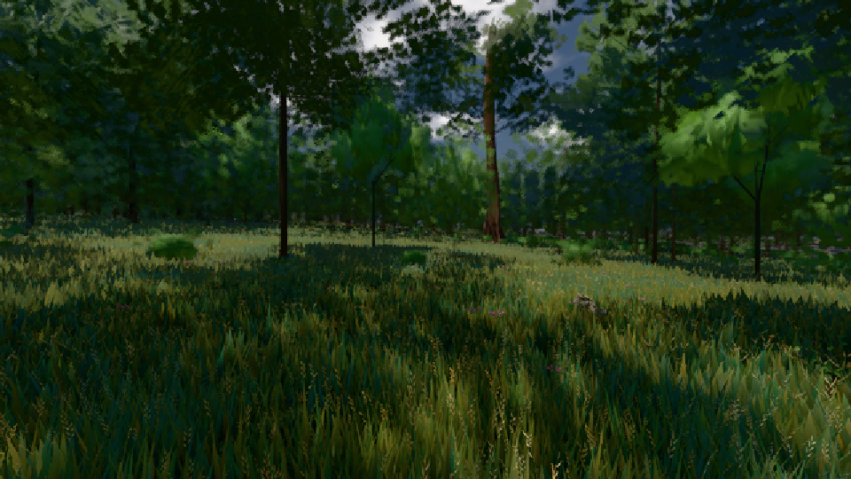

# GPU-PROBE 00fdd106 — GRÜN

Zweig `w27-ferne-ton-5` · Kopf 00fdd106e51d6e085292d85889c9f505aefba7ea · Läufer gtx1050-desktop + radeon-890m (Band-Gerät) · 10.11. 00:26 · Wanduhr ab Push 577 s · Lauf https://github.com/MiguellD/AnazhRealm/actions/runs/42719181994

Ruf: `bild:wiese@0.5 gate:pruefbuehne zeit:gate:tag-achse:echt`

## Läufer gtx1050-desktop — GRÜN

GPU NVIDIA GeForce GTX 1050 · npm ci 38 s (package-lock affde574)
Schloss /c/Users/User/AppData/Local/Temp/claude/gpu-schloss hält „ci-runner 42719181994/1 probe“
- Hook 2026-11-10 00:19:35 start ci-runner 42719181994/1 probe: Schloss genommen (refs/heads/w27-ferne-ton-5 00fdd106e51d6e085292d85889c9f505aefba7ea ws=C:\actions-runner\_work\AnazhRealm\AnazhRealm)

### bild:wiese@0.5 — GRÜN · 114 s · Läufer gtx1050-desktop

Adapter: [linse-gpu] nvidia/pascal

```text
Kamera des Spiels → Blick (10.0 m): -280.40 29.71 -1045.60 -289.61 29.71 -1049.50
 "abnahme": "ABNAHME GRÜN · beweis · Sicht 0.0 % · Ziel Blickziel im Bild frei 10 m · Luma 43.9 σ 28.5 schwarz 0.0 % weiß 0.0 % · Stand 18.546.238 · Bühne summer sunny 0.50 · Gerät WebGPU nvidia pascal",
```



### gate:pruefbuehne — GRÜN · 249 s · Läufer gtx1050-desktop

Adapter: ungenannt (die Probe nannte keinen Browser-Adapter)

```text
✅ SELBSTTEST GRÜN: auf der Bühne wirft das Feld nichts, der Akt setzt, die Wildnis wirft — und der Schein fällt rot beim Namen
```

## Läufer radeon-890m (Band-Gerät) — GRÜN

GPU AMD Radeon(TM) 890M Graphics · node_modules bleiben (package-lock affde574)
Schloss /c/Users/micha/AppData/Local/Temp/claude/gpu-schloss hält „ci-runner 42719181994/1 probe“
- Hook 2026-11-10 00:21:07 start ci-runner 42719181994/1 probe: Schloss genommen (refs/heads/w27-ferne-ton-5 00fdd106e51d6e085292d85889c9f505aefba7ea ws=C:\actions-runner\_work\AnazhRealm\AnazhRealm)

### zeit:gate:tag-achse:echt — GRÜN · 114 s · Läufer radeon-890m (Band-Gerät)

Adapter: ungenannt (die Probe nannte keinen Browser-Adapter)

```text
TAG-ACHSE GRUEN
```
