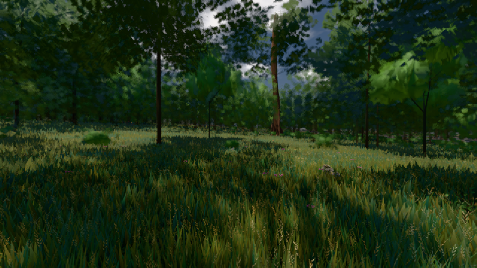

# GPU-PROBE 53e59239 — ROT

Zweig `w27-ferne-ton-5` · Kopf 53e592396bac34f5c94f9bc32da1fca966fb1ac4 · Läufer radeon-890m + radeon-890m (Band-Gerät) · 10.11. 00:12 · Wanduhr ab Push 759 s · Lauf https://github.com/MiguellD/AnazhRealm/actions/runs/42716702824

Ruf: `gate:luft-tiefe:echt bild:wiese@0.5 zeit:gate:luft-tiefe:echt`

## Läufer radeon-890m — ROT

GPU AMD Radeon(TM) 890M Graphics · node_modules bleiben (package-lock affde574)
Schloss /c/Users/micha/AppData/Local/Temp/claude/gpu-schloss hält „ci-runner 42716702824/1 probe“
- Hook 2026-11-10 00:03:51 start ci-runner 42716702824/1 probe: Schloss genommen (refs/heads/w27-ferne-ton-5 53e592396bac34f5c94f9bc32da1fca966fb1ac4 ws=C:\actions-runner\_work\AnazhRealm\AnazhRealm)
- Hook 2026-11-10 00:07:13 ende  ci-runner 42716702824/1 probe: Schloss geloest
- Hook 2026-11-10 00:07:16 ende  ci-runner 42716702824/1 probe: Arbeitsordner geraeumt (C:\actions-runner\_work\AnazhRealm\AnazhRealm)
- Hook 2026-11-10 00:07:36 start ci-runner 42716702824/1 probe: Schloss genommen (refs/heads/w27-ferne-ton-5 53e592396bac34f5c94f9bc32da1fca966fb1ac4 ws=C:\actions-runner\_work\AnazhRealm\AnazhRealm)

### gate:luft-tiefe:echt — ROT · 87 s · Läufer radeon-890m

Adapter: ungenannt (die Probe nannte keinen Browser-Adapter)

```text
  ROT K2-1 KANTE Uhr 0.5 (Sonne 74.21°) Azimut 180°: Restkontrast 0.02149 am Rand 35.6 km > 0.02
  ROT K1-2 FARBTON Uhr 0.5 (Sonne 74.21°) Azimut 270° 8 km: 166.47° von der Luft der Entfernung > 10°
  ROT K1-2 JE KANAL Uhr 0.27 (Sonne 7.2°) Azimut 90° ab 2 km: ungemessen (1 Paare < 30)
  ROT K1-2 JE KANAL Uhr 0.27 (Sonne 7.2°) Azimut 180° ab 2 km: ungemessen (0 Paare < 30)
  ROT K1-2 JE KANAL Uhr 0.27 (Sonne 7.2°) Azimut 270° ab 2 km: ungemessen (0 Paare < 30)
  ROT K1-2 HIMMEL Azimut 0°: Ton der In-Streuung nicht blau 0.1287,0.1182,0.1066 statt 222° ±15 (Duv -0.0008)
  ROT K1-2 HIMMEL Azimut 90°: Ton der In-Streuung nicht blau 0.08497,0.0807,0.07412 statt 222° ±15 (Duv 0)
  ROT K1-2 HIMMEL Azimut 180°: Ton der In-Streuung nicht blau 0.06503,0.0629,0.06086 statt 222° ±15 (Duv -0.0005)
  ROT K1-2 HIMMEL Azimut 270°: Ton der In-Streuung nicht blau 0.08645,0.0807,0.07412 statt 222° ±15 (Duv -0.0006)
LUFT ROT · K1-1 ROT · K1-2 ROT · K2-1 ROT · K2-2 GRUEN
```

### bild:wiese@0.5 — GRÜN · 62 s · Läufer radeon-890m

Adapter: [linse-gpu] amd/rdna-3

```text
Kamera des Spiels → Blick (10.0 m): -280.40 29.71 -1045.60 -289.61 29.71 -1049.50
 "abnahme": "ABNAHME GRÜN · beweis · Sicht 0.0 % · Ziel Blickziel im Bild frei 10 m · Luma 44.3 σ 28.8 schwarz 0.0 % weiß 0.0 % · Stand 18.546.238 · Bühne summer sunny 0.50 · Gerät WebGPU amd rdna-3",
```



## Läufer radeon-890m (Band-Gerät) — ROT

GPU AMD Radeon(TM) 890M Graphics · node_modules bleiben (package-lock affde574)
Schloss /c/Users/micha/AppData/Local/Temp/claude/gpu-schloss hält „ci-runner 42716702824/1 probe“
- Hook 2026-11-10 00:03:51 start ci-runner 42716702824/1 probe: Schloss genommen (refs/heads/w27-ferne-ton-5 53e592396bac34f5c94f9bc32da1fca966fb1ac4 ws=C:\actions-runner\_work\AnazhRealm\AnazhRealm)

### zeit:gate:luft-tiefe:echt — ROT · 106 s · Läufer radeon-890m (Band-Gerät)

Adapter: ungenannt (die Probe nannte keinen Browser-Adapter)

```text
  ROT K2-1 KANTE Uhr 0.5 (Sonne 74.21°) Azimut 180°: Restkontrast 0.02149 am Rand 35.6 km > 0.02
  ROT K1-2 FARBTON Uhr 0.5 (Sonne 74.21°) Azimut 270° 8 km: 166.47° von der Luft der Entfernung > 10°
  ROT K1-2 JE KANAL Uhr 0.27 (Sonne 7.2°) Azimut 90° ab 2 km: ungemessen (1 Paare < 30)
  ROT K1-2 JE KANAL Uhr 0.27 (Sonne 7.2°) Azimut 180° ab 2 km: ungemessen (0 Paare < 30)
  ROT K1-2 JE KANAL Uhr 0.27 (Sonne 7.2°) Azimut 270° ab 2 km: ungemessen (0 Paare < 30)
  ROT K1-2 HIMMEL Azimut 0°: Ton der In-Streuung nicht blau 0.1287,0.1182,0.1066 statt 222° ±15 (Duv -0.0008)
  ROT K1-2 HIMMEL Azimut 90°: Ton der In-Streuung nicht blau 0.08497,0.0807,0.07412 statt 222° ±15 (Duv 0)
  ROT K1-2 HIMMEL Azimut 180°: Ton der In-Streuung nicht blau 0.06503,0.0629,0.06086 statt 222° ±15 (Duv -0.0005)
  ROT K1-2 HIMMEL Azimut 270°: Ton der In-Streuung nicht blau 0.08645,0.0807,0.07412 statt 222° ±15 (Duv -0.0006)
LUFT ROT · K1-1 ROT · K1-2 ROT · K2-1 ROT · K2-2 GRUEN
```
