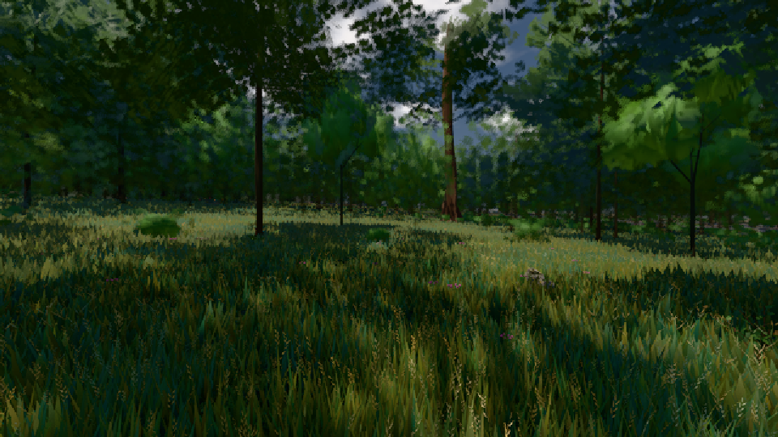

# GPU-PROBE 5f49c06a — ROT

Zweig `w27-ferne-ton-5` · Kopf 5f49c06a3237a23631ec9fb34fbf284c8311db08 · Läufer gtx1050-desktop + radeon-890m (Band-Gerät) · 10.11. 01:15 · Wanduhr ab Push 545 s · Lauf https://github.com/MiguellD/AnazhRealm/actions/runs/42725773503

Ruf: `gate:luft-tiefe:echt bild:wiese@0.5 zeit:gate:luft-tiefe:echt`

## Läufer gtx1050-desktop — ROT

GPU NVIDIA GeForce GTX 1050 · node_modules bleiben (package-lock affde574)
Schloss /c/Users/User/AppData/Local/Temp/claude/gpu-schloss hält „ci-runner 42725773503/1 probe“
- Hook 2026-11-10 01:10:04 start ci-runner 42725773503/1 probe: wartet auf Schloss von 'hand w27-stadt-bild (Claude, bild:dorf)'
- Hook 2026-11-10 01:10:50 start ci-runner 42725773503/1 probe: Schloss genommen (refs/heads/w27-ferne-ton-5 5f49c06a3237a23631ec9fb34fbf284c8311db08 ws=C:\actions-runner\_work\AnazhRealm\AnazhRealm)

### gate:luft-tiefe:echt — ROT · 164 s · Läufer gtx1050-desktop

Adapter: ungenannt (die Probe nannte keinen Browser-Adapter)

```text
✅ SELBSTTEST GRÜN — jeder injizierte Täter fällt rot und wird beim Namen genannt.
werkbank.cjs ABSTURZ: Error: LUFT: Cannot read properties of undefined (reading 'elements')
```

### bild:wiese@0.5 — GRÜN · 110 s · Läufer gtx1050-desktop

Adapter: [linse-gpu] nvidia/pascal

```text
Kamera des Spiels → Blick (10.0 m): -280.40 29.71 -1045.60 -289.61 29.71 -1049.50
 "abnahme": "ABNAHME GRÜN · beweis · Sicht 0.0 % · Ziel Blickziel im Bild frei 10 m · Luma 43.9 σ 28.5 schwarz 0.0 % weiß 0.0 % · Stand 18.546.238 · Bühne summer sunny 0.50 · Gerät WebGPU nvidia pascal",
```



## Läufer radeon-890m (Band-Gerät) — ROT

GPU AMD Radeon(TM) 890M Graphics · node_modules bleiben (package-lock affde574)
Schloss /c/Users/micha/AppData/Local/Temp/claude/gpu-schloss hält „ci-runner 42725773503/1 probe“
- Hook 2026-11-10 01:07:16 start ci-runner 42725773503/1 probe: wartet auf Schloss von 'punkte-radeon-sitzungpid=36744'
- Hook 2026-11-10 01:08:17 start ci-runner 42725773503/1 probe: Schloss genommen (refs/heads/w27-ferne-ton-5 5f49c06a3237a23631ec9fb34fbf284c8311db08 ws=C:\actions-runner\_work\AnazhRealm\AnazhRealm)

### zeit:gate:luft-tiefe:echt — ROT · 65 s · Läufer radeon-890m (Band-Gerät)

Adapter: ungenannt (die Probe nannte keinen Browser-Adapter)

```text
✅ SELBSTTEST GRÜN — jeder injizierte Täter fällt rot und wird beim Namen genannt.
werkbank.cjs ABSTURZ: Error: LUFT: Cannot read properties of undefined (reading 'elements')
```
