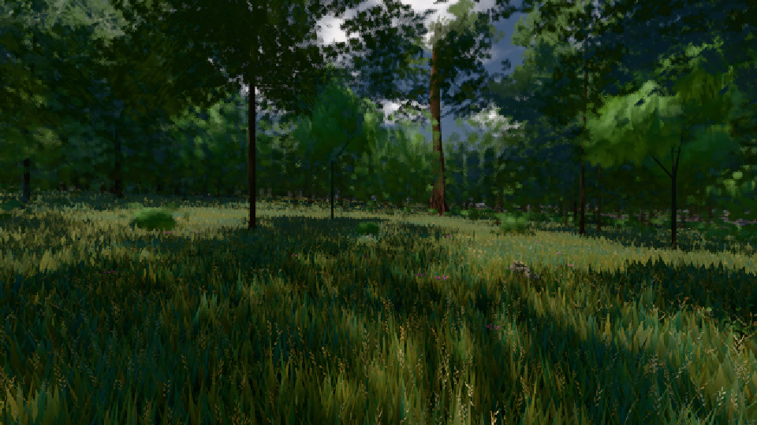

# GPU-PROBE 790ed766 — GRÜN

Zweig `w27-ferne-ton-5` · Kopf 790ed7660709ff8543de205fa71686e2b26438d9 · Läufer omen-gtx1060 + radeon-890m (Band-Gerät) · 10.11. 09:15 · Wanduhr ab Push 333 s · Lauf https://github.com/MiguellD/AnazhRealm/actions/runs/42780529841

Ruf: `gate:luft-tiefe:echt bild:wiese@0.5 zeit:gate:luft-tiefe:echt`

## Läufer omen-gtx1060 — GRÜN

GPU NVIDIA GeForce GTX 1060 · npm ci 37 s (package-lock a8738d68)
Schloss /c/Users/micha/AppData/Local/Temp/claude/gpu-schloss hält „ci-runner 42780529841/1 probe“
- Hook 2026-11-10 09:10:33 start ci-runner 42780529841/1 probe: Schloss genommen (refs/heads/w27-ferne-ton-5 790ed7660709ff8543de205fa71686e2b26438d9 ws=C:\actions-runner\_work\AnazhRealm\AnazhRealm)

### gate:luft-tiefe:echt — GRÜN · 79 s · Läufer omen-gtx1060

Adapter: ungenannt (die Probe nannte keinen Browser-Adapter)

```text
✅ SELBSTTEST GRÜN — jeder injizierte Täter fällt rot und wird beim Namen genannt.
  FARBTON 8 km K1-2 GRUEN je Uhr/Azimut 0.5/0 2.57° 0.5/90 2.51° 0.5/180 2.06° 0.5/270 1.23° 0.27/0 0.24° 0.27/90 0.14° 0.27/180 2.71° 0.27/270 0.03°
LUFT GRUEN · K1-1 GRUEN · K1-2 GRUEN · K2-1 GRUEN · K2-2 GRUEN
```

### bild:wiese@0.5 — GRÜN · 47 s · Läufer omen-gtx1060

Adapter: [linse-gpu] nvidia/pascal

```text
Kamera des Spiels → Blick (10.0 m): -280.40 29.71 -1045.60 -289.61 29.71 -1049.50
 "abnahme": "ABNAHME GRÜN · beweis · Sicht 0.0 % · Ziel Blickziel im Bild frei 10 m · Luma 43.8 σ 28.2 schwarz 0.0 % weiß 0.0 % · Stand 18.546.244 · Bühne summer sunny 0.50 · Gerät WebGPU nvidia pascal",
```



## Läufer radeon-890m (Band-Gerät) — GRÜN

GPU AMD Radeon(TM) 890M Graphics · node_modules bleiben (package-lock a8738d68)
Schloss /c/Users/micha/AppData/Local/Temp/claude/gpu-schloss hält „ci-runner 42780529841/1 probe“
- Hook 2026-11-10 09:11:04 start ci-runner 42780529841/1 probe: wartet auf Schloss von 'punkte-radeon-sitzungpid=42972'
- Hook 2026-11-10 09:12:51 start ci-runner 42780529841/1 probe: verwaistes Schloss 'punkte-radeon-sitzungpid=42972' geloest - Halter pid=42972 lebt nicht
- Hook 2026-11-10 09:12:58 start ci-runner 42780529841/1 probe: Schloss genommen (refs/heads/w27-ferne-ton-5 790ed7660709ff8543de205fa71686e2b26438d9 ws=C:\actions-runner\_work\AnazhRealm\AnazhRealm)

### zeit:gate:luft-tiefe:echt — GRÜN · 84 s · Läufer radeon-890m (Band-Gerät)

Adapter: ungenannt (die Probe nannte keinen Browser-Adapter)

```text
✅ SELBSTTEST GRÜN — jeder injizierte Täter fällt rot und wird beim Namen genannt.
  FARBTON 8 km K1-2 GRUEN je Uhr/Azimut 0.5/0 2.36° 0.5/90 2.47° 0.5/180 2.08° 0.5/270 1.25° 0.27/0 0.39° 0.27/90 0.05° 0.27/180 2.75° 0.27/270 0.06°
LUFT GRUEN · K1-1 GRUEN · K1-2 GRUEN · K2-1 GRUEN · K2-2 GRUEN
```
