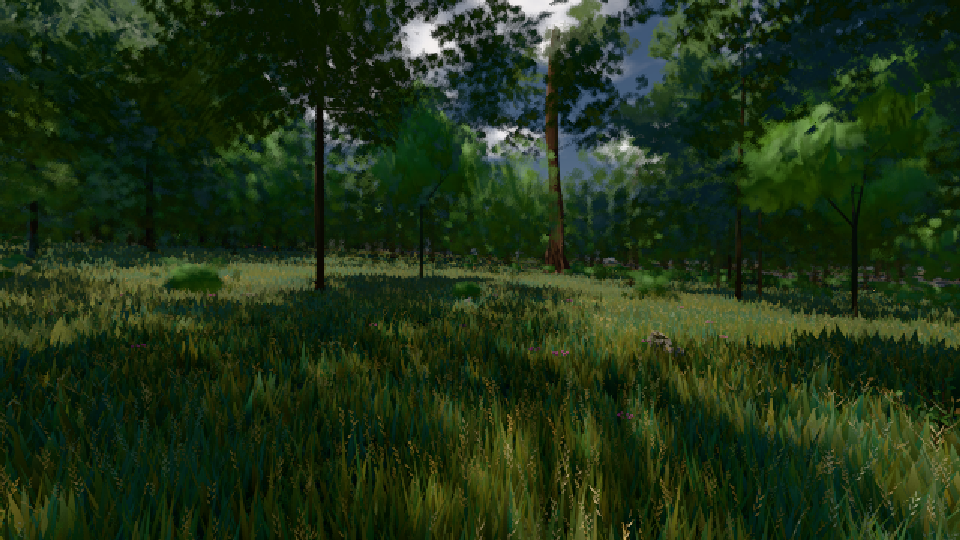

# GPU-PROBE 80bcd308 — ROT

Zweig `w27-ferne-ton-5` · Kopf 80bcd3089d038480f1988b8794799c473ae94f36 · Läufer radeon-890m · 10.11. 02:28 · Wanduhr ab Push 367 s · Lauf https://github.com/MiguellD/AnazhRealm/actions/runs/42735325826

Ruf: `gate:luft-tiefe:echt bild:wiese@0.5`

## Läufer radeon-890m — ROT

GPU AMD Radeon(TM) 890M Graphics · npm ci 69 s (package-lock 818c194e)
Schloss /c/Users/micha/AppData/Local/Temp/claude/gpu-schloss hält „ci-runner 42735325826/1 probe“
- Hook 2026-11-10 02:23:01 start ci-runner 42735325826/1 probe: wartet auf Schloss von 'fenster-wandpid=44996'
- Hook 2026-11-10 02:23:18 start ci-runner 42735325826/1 probe: Schloss genommen (refs/heads/w27-ferne-ton-5 80bcd3089d038480f1988b8794799c473ae94f36 ws=C:\actions-runner\_work\AnazhRealm\AnazhRealm)

### gate:luft-tiefe:echt — ROT · 85 s · Läufer radeon-890m

Adapter: ungenannt (die Probe nannte keinen Browser-Adapter)

```text
  ROT K2-1 KANTE Uhr 0.5 (Sonne 74.21°) Azimut 180°: Restkontrast 0.02149 am Rand 35.6 km > 0.02
  ROT K1-2 FARBTON Uhr 0.5 (Sonne 74.21°) Azimut 270° 8 km: 166.33° von der Luft der Entfernung > 10°
  ROT K1-2 JE KANAL Uhr 0.27 (Sonne 7.2°) Azimut 90° ab 2 km: ungemessen (1 Paare < 30)
  ROT K1-2 JE KANAL Uhr 0.27 (Sonne 7.2°) Azimut 180° ab 2 km: ungemessen (0 Paare < 30)
  ROT K1-2 JE KANAL Uhr 0.27 (Sonne 7.2°) Azimut 270° ab 2 km: ungemessen (0 Paare < 30)
  ROT K1-2 HIMMEL Azimut 0°: Ton der In-Streuung nicht blau 0.1287,0.1182,0.1066 statt 222° ±15 (Duv -0.0008)
  ROT K1-2 HIMMEL Azimut 90°: Ton der In-Streuung nicht blau 0.08497,0.0807,0.07412 statt 222° ±15 (Duv 0)
  ROT K1-2 HIMMEL Azimut 180°: Ton der In-Streuung nicht blau 0.06503,0.0629,0.06086 statt 222° ±15 (Duv -0.0005)
  ROT K1-2 HIMMEL Azimut 270°: Ton der In-Streuung nicht blau 0.08645,0.0807,0.07412 statt 222° ±15 (Duv -0.0006)
LUFT ROT · K1-1 ROT · K1-2 ROT · K2-1 ROT · K2-2 GRUEN
```

### bild:wiese@0.5 — GRÜN · 67 s · Läufer radeon-890m

Adapter: [linse-gpu] amd/rdna-3

```text
Kamera des Spiels → Blick (10.0 m): -280.40 29.71 -1045.60 -289.61 29.71 -1049.50
 "abnahme": "ABNAHME GRÜN · beweis · Sicht 0.0 % · Ziel Blickziel im Bild frei 10 m · Luma 44.1 σ 28.4 schwarz 0.0 % weiß 0.0 % · Stand 18.546.241 · Bühne summer sunny 0.50 · Gerät WebGPU amd rdna-3",
```


