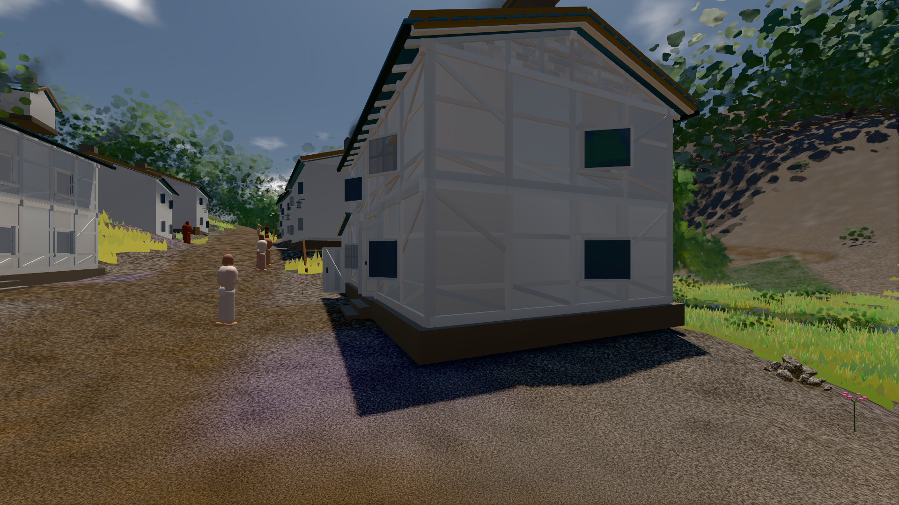

# GPU-PROBE 3ba719d6 — GRÜN

Zweig `w27-foundry-halter` · Kopf 3ba719d657117f57467a6c1f5d51567f87aadf71 · Läufer omen-gtx1060 · 11.11. 02:26 · Wanduhr ab Push 178 s · Lauf https://github.com/MiguellD/AnazhRealm/actions/runs/42938644740

Ruf: `gate:boot-stage bild:dorf@0.5`

## Läufer omen-gtx1060 — GRÜN

GPU NVIDIA GeForce GTX 1060 · npm ci 35 s (package-lock df29564e)
Schloss /c/Users/micha/AppData/Local/Temp/claude/gpu-schloss hält „ci-runner 42938644740/1 probe“
- Hook 2026-11-11 02:24:05 start ci-runner 42938644740/1 probe: Schloss genommen (refs/heads/w27-foundry-halter 3ba719d657117f57467a6c1f5d51567f87aadf71 ws=C:\actions-runner\_work\AnazhRealm\AnazhRealm)

### gate:boot-stage — GRÜN · 16 s · Läufer omen-gtx1060

Adapter: ungenannt (die Probe nannte keinen Browser-Adapter)

```text
  ✅ BIBLIOTHEK warm (true) · IMPOSTOREN idle (true) · das Buch kam 0.0 s nach dem ersten Weltbild
  ✅ die BÜHNE wurde erreicht (das Prädikat schloss)
  ✅ DER INIT BAUT NICHTS VERBORGENES 
  ✅ SELBST-TEST: die Bühnen-Wahrheit der Welt (`_buehneSteht`) liest dieselbe Streu — ohne Regionen-Karte steht sie nicht, mit ihr steht sie
  ✅ SELBST-TEST: der Deckel der Bühne öffnet laut — ohne Regionen-Karte hinter BUEHNE_SETTLE_CAP_MS steht sie, das Log nennt die Lücke (WARN)
  ✅ SELBST-TEST: das Buch, das sich noch öffnet, hält die Welt offen (`_weltOffen`) — ohne Rezepte ein Offenes mehr, mit ihnen wie zuvor
  ✅ SELBST-TEST: die verschluckte Lieferung ist ROT — LIEFERUNG kalt: 0 von 131 von der Platte (0.0 %) · Werk 115 · Haupt-Faden 6 · leer 10 · verschluckt 1
  ✅ SELBST-TEST: der Kern-Wechsel urteilt (fremder Neubau, alter Leser ROT)
  ✅ SELBST-TEST: synchron nach dem Bild ROT
✅ „Volle Bühne" ist ein Prädikat — Kriterium 2 ist messbar.
```

### bild:dorf@0.5 — GRÜN · 77 s · Läufer omen-gtx1060

Adapter: [linse-gpu] nvidia/pascal

```text
Kamera des Spiels → Blick (5.2 m): -704.22 39.69 -880.02 -703.03 39.69 -874.96
 "abnahme": "ABNAHME GRÜN · beweis · Sicht 0.0 % · Ziel Blickziel im Bild frei 5.2 m · Luma 78.9 σ 30.7 schwarz 0.2 % weiß 0.0 % · Stand 18.546.249 · Bühne summer sunny 0.50 · Gerät WebGPU nvidia pascal",
```


