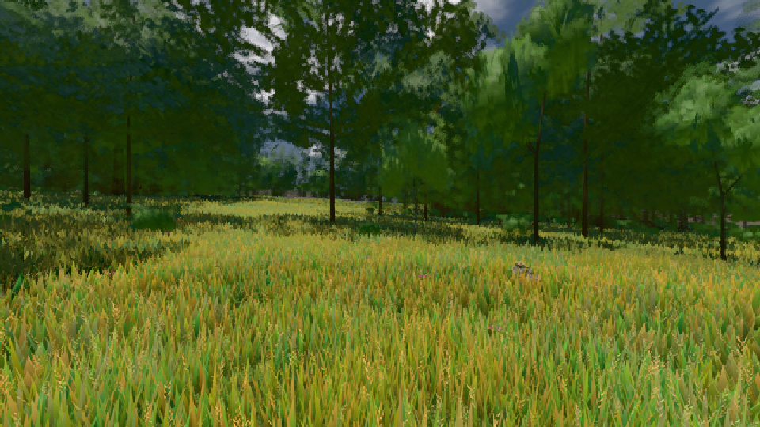
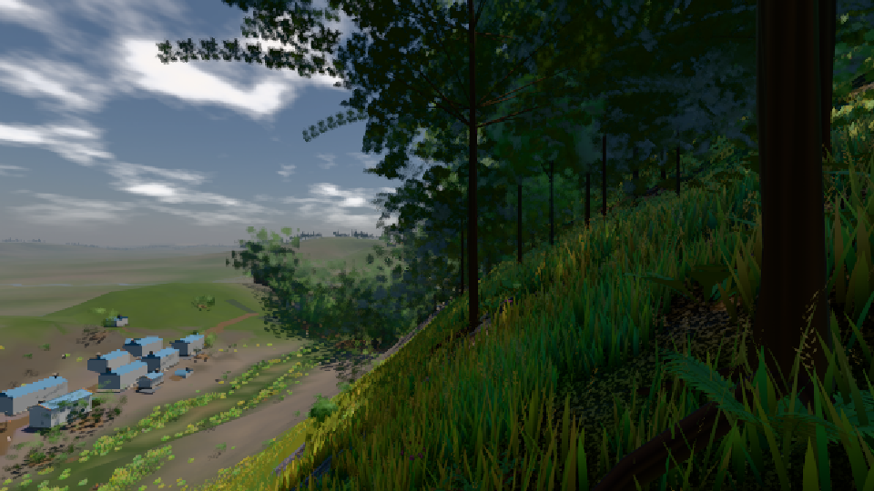

# GPU-PROBE 067d6f18 — GRÜN

Zweig `w27-gpu-wahl-heil` · Kopf 067d6f185a806a912dc22b1b28adb5786e513203 · Läufer radeon-890m · 10.11. 14:07 · Wanduhr ab Push 585 s · Lauf https://github.com/MiguellD/AnazhRealm/actions/runs/42820163754

Ruf: `bild:wiese@0.5 bild:dorf@0.5 gate:pop`

## Läufer radeon-890m — GRÜN

GPU AMD Radeon(TM) 890M Graphics · node_modules bleiben (package-lock 252110b9)
Schloss /c/Users/micha/AppData/Local/Temp/claude/gpu-schloss hält „ci-runner 42820163754/1 probe“
- Hook 2026-11-10 13:58:30 start ci-runner 42820163754/1 probe: wartet auf Schloss von 'punkte-radeon-sitzungpid=36620'
- Hook 2026-11-10 14:00:13 start ci-runner 42820163754/1 probe: Schloss genommen (refs/heads/w27-gpu-wahl-heil 067d6f185a806a912dc22b1b28adb5786e513203 ws=C:\actions-runner\_work\AnazhRealm\AnazhRealm)

### bild:wiese@0.5 — GRÜN · 78 s · Läufer radeon-890m

Adapter: [linse-gpu] amd/rdna-3

```text
Kamera des Spiels → Blick (10.0 m): -280.40 29.71 -1045.60 -289.61 29.71 -1049.50
 "abnahme": "ABNAHME GRÜN · beweis · Sicht 0.0 % · Ziel Blickziel im Bild frei 10 m · Luma 83.8 σ 40.2 schwarz 0.0 % weiß 0.0 % · Stand 18.546.245 · Bühne summer sunny 0.50 · Gerät WebGPU amd rdna-3",
```



### bild:dorf@0.5 — GRÜN · 80 s · Läufer radeon-890m

Adapter: [linse-gpu] amd/rdna-3

```text
Kamera des Spiels → Blick (10.0 m): -841.00 86.89 -861.00 -834.08 86.89 -853.78
 "abnahme": "ABNAHME GRÜN · beweis · Sicht 0.0 % · Ziel Blickziel im Bild frei 10 m · Luma 64.7 σ 53.1 schwarz 1.1 % weiß 0.0 % · Stand 18.546.245 · Bühne summer sunny 0.50 · Gerät WebGPU amd rdna-3",
```



### gate:pop — GRÜN · 108 s · Läufer radeon-890m

Adapter: ungenannt (die Probe nannte keinen Browser-Adapter)

```text
lod.K2#1 GRÜN 0.0369 % Pop-Pixel/s (766 px) · 31*+1@189/51*/41*+2@154/443*/47*/59*+2@192/37*+1@155/57*+1@189 · Laub 216 · dc, Dreiecke 99,426195 · GPU 58.83 ms, CPU 7.02 ms je Bild
BLOCK-TREUE GRÜN 233 Blöcke treu · Selbsttest nennt MeshStandardNodeMaterial · nahWiese:L1:0:0 · instanzFarbe: 1/882 Instanzen fremd
```
