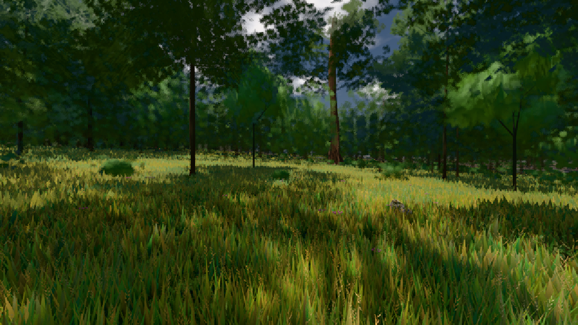
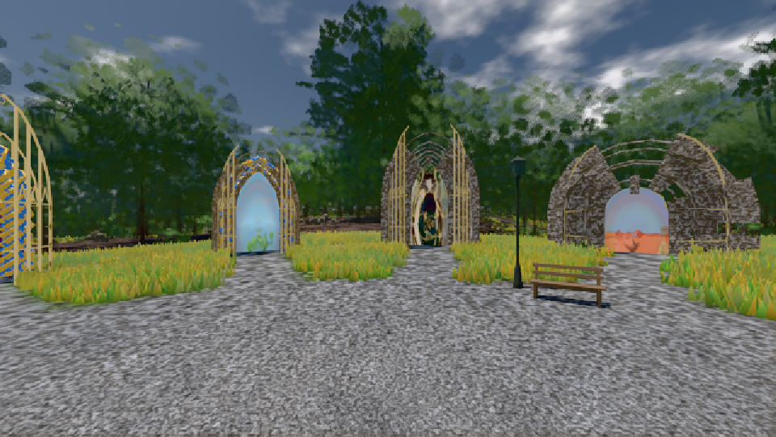

# GPU-PROBE 0e89db00 — GRÜN

Zweig `w27-horizont-kosten` · Kopf 0e89db007a009c8d208a673d3e66e1514b6e3c80 · Läufer gtx1050-desktop + radeon-890m (Band-Gerät) · 10.11. 10:49 · Wanduhr ab Push 227 s · Lauf https://github.com/MiguellD/AnazhRealm/actions/runs/42793408401

Ruf: `bild:wiese@0.5 bild:genesis@0.5 zeit:gate:pop`

## Läufer gtx1050-desktop — GRÜN

GPU NVIDIA GeForce GTX 1050 · node_modules bleiben (package-lock a8738d68)
Schloss /c/Users/User/AppData/Local/Temp/claude/gpu-schloss hält „ci-runner 42793408401/1 probe“
- Hook 2026-11-10 10:46:02 start ci-runner 42793408401/1 probe: Schloss genommen (refs/heads/w27-horizont-kosten 0e89db007a009c8d208a673d3e66e1514b6e3c80 ws=C:\actions-runner\_work\AnazhRealm\AnazhRealm)

### bild:wiese@0.5 — GRÜN · 97 s · Läufer gtx1050-desktop

Adapter: [linse-gpu] nvidia/pascal

```text
Kamera des Spiels → Blick (10.0 m): -280.40 29.71 -1045.60 -289.61 29.71 -1049.50
 "abnahme": "ABNAHME GRÜN · beweis · Sicht 0.0 % · Ziel Blickziel im Bild frei 10 m · Luma 56.5 σ 32.9 schwarz 0.0 % weiß 0.0 % · Stand 18.546.244 · Bühne summer sunny 0.50 · Gerät WebGPU nvidia pascal",
```



### bild:genesis@0.5 — GRÜN · 85 s · Läufer gtx1050-desktop

Adapter: [linse-gpu] nvidia/pascal

```text
Kamera des Spiels → Blick (10.0 m): 0.00 92.40 0.00 -10.00 92.40 0.00
 "abnahme": "ABNAHME GRÜN · beweis · Sicht 0.0 % · Ziel Blickziel im Bild frei 10 m · Luma 105.2 σ 37.9 schwarz 0.0 % weiß 0.0 % · Stand 18.546.244 · Bühne summer sunny 0.50 · Gerät WebGPU nvidia pascal",
```



## Läufer radeon-890m (Band-Gerät) — GRÜN

GPU AMD Radeon(TM) 890M Graphics · node_modules bleiben (package-lock a8738d68)
Schloss /c/Users/micha/AppData/Local/Temp/claude/gpu-schloss hält „ci-runner 42793408401/1 probe“
- Hook 2026-11-10 10:46:05 start ci-runner 42793408401/1 probe: Schloss genommen (refs/heads/w27-horizont-kosten 0e89db007a009c8d208a673d3e66e1514b6e3c80 ws=C:\actions-runner\_work\AnazhRealm\AnazhRealm)

### zeit:gate:pop — GRÜN · 70 s · Läufer radeon-890m (Band-Gerät)

Adapter: ungenannt (die Probe nannte keinen Browser-Adapter)

```text
lod.K2#1 GRÜN 0.0262 % Pop-Pixel/s (543 px) · 19*+1@189/21*/287*+2@154/22*/40*/36*+2@192/66*+3@155/52*+1@189 · Laub 216 · dc, Dreiecke 80,440612 · GPU 28.54 ms, CPU 5.36 ms je Bild
BLOCK-TREUE GRÜN 179 Blöcke treu · Selbsttest nennt MeshStandardNodeMaterial · nahWiese:L1:0:0 · instanzFarbe: 1/888 Instanzen fremd
```
