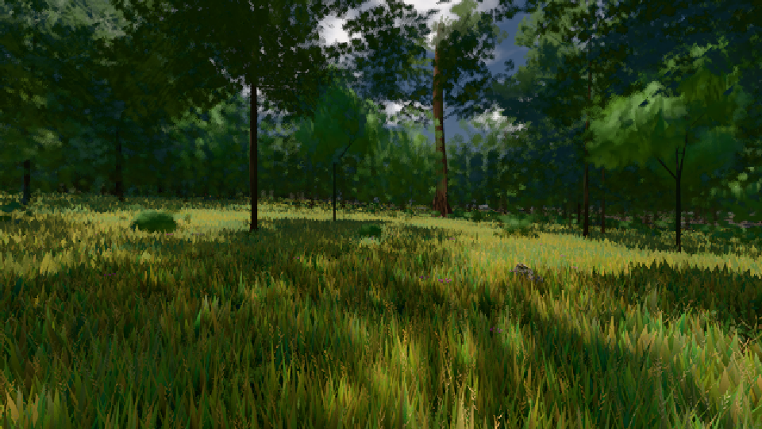

# GPU-PROBE 1f6e4050 — GRÜN

Zweig `w27-lod-baum` · Kopf 1f6e4050c415522d436958f7804fe621883e4d1e · Läufer gtx1050-desktop · 10.11. 07:59 · Wanduhr ab Push 455 s · Lauf https://github.com/MiguellD/AnazhRealm/actions/runs/42771327650

Ruf: `gate:foundry-impostor gate:pop bild:wiese@0.5`

## Läufer gtx1050-desktop — GRÜN

GPU NVIDIA GeForce GTX 1050 · npm ci 52 s (package-lock 36a8682d)
Schloss /c/Users/User/AppData/Local/Temp/claude/gpu-schloss hält „ci-runner 42771327650/1 probe“
- Hook 2026-11-10 07:52:06 start ci-runner 42771327650/1 probe: wartet auf Schloss von 'hand w27-ort-pose naesse-maske kopf (Claude)'
- Hook 2026-11-10 07:52:21 start ci-runner 42771327650/1 probe: Schloss genommen (refs/heads/w27-lod-baum 1f6e4050c415522d436958f7804fe621883e4d1e ws=C:\actions-runner\_work\AnazhRealm\AnazhRealm)

### gate:foundry-impostor — GRÜN · 77 s · Läufer gtx1050-desktop

Adapter: [linse-gpu] webgl2/NVIDIA GeForce GTX 1050 (0x00001C81) Direct3D11 vs_5_0 ps_5_0

```text
  C5 WACHSEN: GRÜN · Selbsttest: Vorlage karte-albedo:atlas#46,Vorlage karte-normal:atlas#47,Vorlage karte-albedo:atlas#46,Vorlage karte-normal:atlas#47,Vorlage karte-albedo:atlas#46,Vorlage karte-normal:atlas#47
  C5 WACHSEN: GRÜN · Selbsttest: nur bc
✅ GRÜN — die Welt-Fernstufe liest die im Welt-Renderer gebackene Karte über EINEN Karten-Atlas (eine Gruppe, ein Material, Schicht + Rahmen je Instanz), die Karte steht richtig herum und in der Tiefe ihrer Gestalt, befreite Slots zeichnen nichts (die Gruppe verdichtet), jede Atlas-Stichprobe trägt die Gradienten der stetigen Koordinate (kein Stamm-Strich).
```

### gate:pop — GRÜN · 137 s · Läufer gtx1050-desktop

Adapter: ungenannt (die Probe nannte keinen Browser-Adapter)

```text
lod.K2#1 GRÜN 0.032 % Pop-Pixel/s (664 px) · 20*+1@189/24*/35*+2@154/355/105*/33*+2@192/28+1@155/64*+3@189 · Laub 216 · dc, Dreiecke 80,447085 · GPU 59.34 ms, CPU 7.73 ms je Bild
BLOCK-TREUE GRÜN 179 Blöcke treu · Selbsttest nennt MeshStandardNodeMaterial · nahWiese:L1:0:0 · instanzFarbe: 1/888 Instanzen fremd
```

### bild:wiese@0.5 — GRÜN · 96 s · Läufer gtx1050-desktop

Adapter: [linse-gpu] nvidia/pascal

```text
Kamera des Spiels → Blick (10.0 m): -280.40 29.71 -1045.60 -289.61 29.71 -1049.50
 "abnahme": "ABNAHME GRÜN · beweis · Sicht 0.0 % · Ziel Blickziel im Bild frei 10 m · Luma 56.5 σ 32.9 schwarz 0.0 % weiß 0.0 % · Stand 18.546.243 · Bühne summer sunny 0.50 · Gerät WebGPU nvidia pascal",
```


