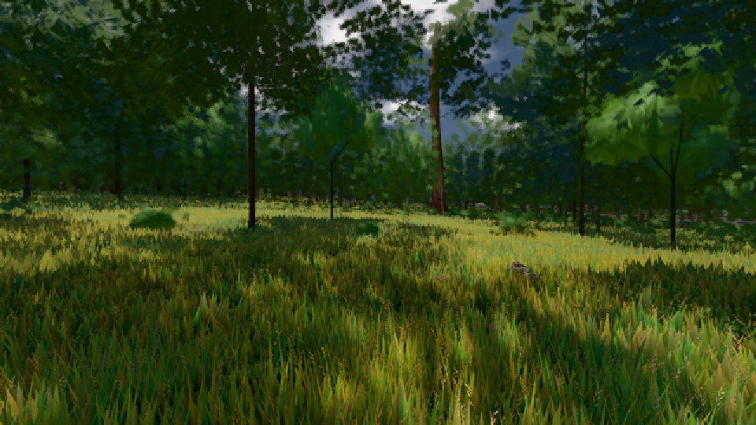

# GPU-PROBE 729af182 — GRÜN

Zweig `w27-lod-baum` · Kopf 729af182dd1965543a77e744c45ca435bee36628 · Läufer radeon-890m · 10.11. 00:53 · Wanduhr ab Push 541 s · Lauf https://github.com/MiguellD/AnazhRealm/actions/runs/42722907265

Ruf: `gate:foundry-impostor gate:pop bild:wiese@0.5`

## Läufer radeon-890m — GRÜN

GPU AMD Radeon(TM) 890M Graphics · npm ci 67 s (package-lock 8047953b)
Schloss /c/Users/micha/AppData/Local/Temp/claude/gpu-schloss hält „ci-runner 42722907265/1 probe“
- Hook 2026-11-10 00:45:05 start ci-runner 42722907265/1 probe: wartet auf Schloss von 'punkte-radeon-sitzungpid=21072'
- Hook 2026-11-10 00:47:20 start ci-runner 42722907265/1 probe: verwaistes Schloss 'punkte-radeon-sitzungpid=21072' geloest - Halter pid=21072 lebt nicht
- Hook 2026-11-10 00:47:23 start ci-runner 42722907265/1 probe: Schloss genommen (refs/heads/w27-lod-baum 729af182dd1965543a77e744c45ca435bee36628 ws=C:\actions-runner\_work\AnazhRealm\AnazhRealm)

### gate:foundry-impostor — GRÜN · 55 s · Läufer radeon-890m

Adapter: [linse-gpu] webgl2/AMD Radeon(TM) 890M Graphics (0x0000150E) Direct3D11 vs_5_0 ps_5_0

```text
  C5 WACHSEN: GRÜN · Selbsttest: Vorlage karte-albedo:atlas#46,Vorlage karte-normal:atlas#47
  C5 WACHSEN: GRÜN · Selbsttest: nur bc
✅ GRÜN — die Welt-Fernstufe liest die im Welt-Renderer gebackene Karte über EINEN Karten-Atlas (eine Gruppe, ein Material, Schicht + Rahmen je Instanz), die Karte steht richtig herum und in der Tiefe ihrer Gestalt, befreite Slots zeichnen nichts (die Gruppe verdichtet), jede Atlas-Stichprobe trägt die Gradienten der stetigen Koordinate (kein Stamm-Strich).
```

### gate:pop — GRÜN · 98 s · Läufer radeon-890m

Adapter: ungenannt (die Probe nannte keinen Browser-Adapter)

```text
lod.K2#1 GRÜN 0.0387 % Pop-Pixel/s (803 px) · 20*+1@189/22*/25*+2@154/340/67*/34*+2@192/53*+3@155/242*+1@189 · Laub 216 · dc, Dreiecke 33,370028 · GPU 46.68 ms, CPU 3.38 ms je Bild
```

### bild:wiese@0.5 — GRÜN · 54 s · Läufer radeon-890m

Adapter: [linse-gpu] amd/rdna-3

```text
Kamera des Spiels → Blick (10.0 m): -280.40 29.71 -1045.60 -289.61 29.71 -1049.50
 "abnahme": "ABNAHME GRÜN · beweis · Sicht 0.0 % · Ziel Blickziel im Bild frei 10 m · Luma 57.3 σ 33.2 schwarz 0.0 % weiß 0.0 % · Stand 18.546.237 · Bühne summer sunny 0.50 · Gerät WebGPU amd rdna-3",
```


