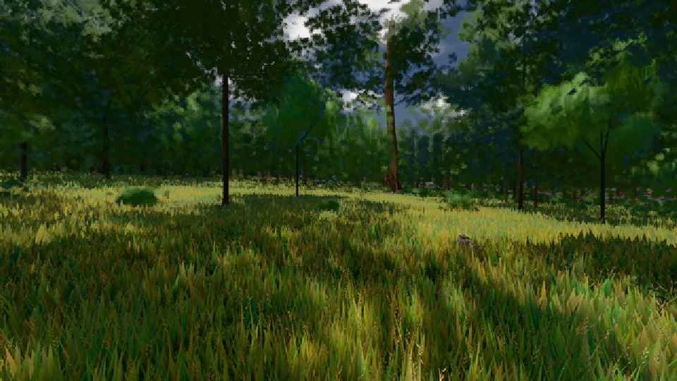

# GPU-PROBE 86fd4ae2 — GRÜN

Zweig `w27-lod-baum` · Kopf 86fd4ae2c239daf339c372df5e368f4f50981c76 · Läufer gtx1050-desktop · 10.11. 08:53 · Wanduhr ab Push 581 s · Lauf https://github.com/MiguellD/AnazhRealm/actions/runs/42777324702

Ruf: `gate:foundry-impostor gate:pop bild:wiese@0.5`

## Läufer gtx1050-desktop — GRÜN

GPU NVIDIA GeForce GTX 1050 · npm ci 46 s (package-lock a8738d68)
Schloss /c/Users/User/AppData/Local/Temp/claude/gpu-schloss hält „ci-runner 42777324702/1 probe“
- Hook 2026-11-10 08:44:11 start ci-runner 42777324702/1 probe: Schloss genommen (refs/heads/w27-lod-baum 86fd4ae2c239daf339c372df5e368f4f50981c76 ws=C:\actions-runner\_work\AnazhRealm\AnazhRealm)

### gate:foundry-impostor — GRÜN · 80 s · Läufer gtx1050-desktop

Adapter: [linse-gpu] webgl2/NVIDIA GeForce GTX 1050 (0x00001C81) Direct3D11 vs_5_0 ps_5_0

```text
  C5 WACHSEN: GRÜN · Selbsttest: Vorlage karte-albedo:atlas#46,Vorlage karte-normal:atlas#47,Vorlage karte-albedo:atlas#46,Vorlage karte-normal:atlas#47,Vorlage karte-albedo:atlas#46,Vorlage karte-normal:atlas#47
  C5 WACHSEN: GRÜN · Selbsttest: nur bc
✅ GRÜN — die Welt-Fernstufe liest die im Welt-Renderer gebackene Karte über EINEN Karten-Atlas (eine Gruppe, ein Material, Schicht + Rahmen je Instanz), die Karte steht richtig herum und in der Tiefe ihrer Gestalt, befreite Slots zeichnen nichts (die Gruppe verdichtet), jede Atlas-Stichprobe trägt die Gradienten der stetigen Koordinate (kein Stamm-Strich).
```

### gate:pop — GRÜN · 136 s · Läufer gtx1050-desktop

Adapter: ungenannt (die Probe nannte keinen Browser-Adapter)

```text
lod.K2#1 GRÜN 0.0326 % Pop-Pixel/s (675 px) · 24*+1@189/28*/41*+2@154/342/87*/24*+2@192/56+3@155/73*+1@189 · Laub 216 · dc, Dreiecke 80,455433 · GPU 55.78 ms, CPU 4.49 ms je Bild
BLOCK-TREUE GRÜN 179 Blöcke treu · Selbsttest nennt MeshStandardNodeMaterial · 5d8408dd · instanzFarbe: 1/3 Instanzen fremd
```

### bild:wiese@0.5 — GRÜN · 95 s · Läufer gtx1050-desktop

Adapter: [linse-gpu] nvidia/pascal

```text
Kamera des Spiels → Blick (10.0 m): -280.40 29.71 -1045.60 -289.61 29.71 -1049.50
 "abnahme": "ABNAHME GRÜN · beweis · Sicht 0.0 % · Ziel Blickziel im Bild frei 10 m · Luma 56.5 σ 32.9 schwarz 0.0 % weiß 0.0 % · Stand 18.546.244 · Bühne summer sunny 0.50 · Gerät WebGPU nvidia pascal",
```


