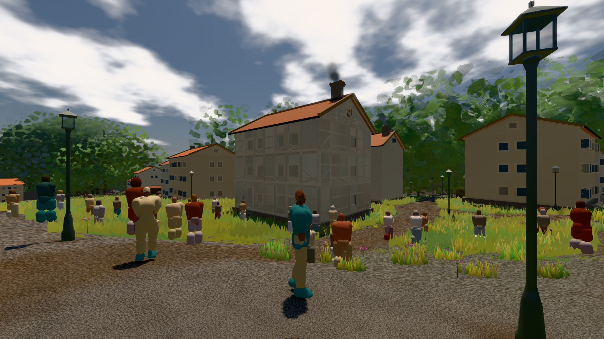
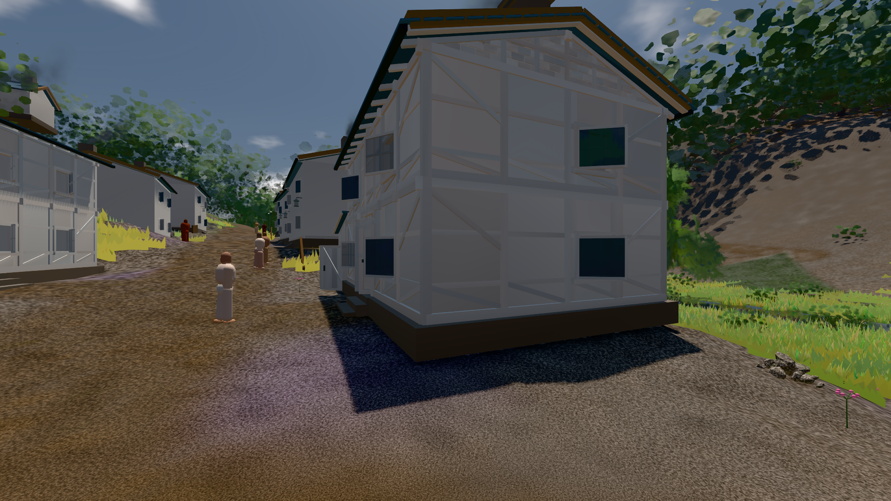
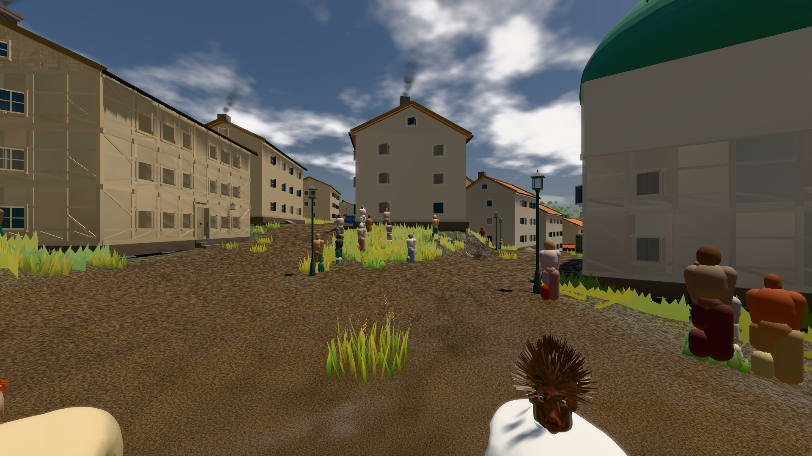

# GPU-PROBE 55108482 — GRÜN

Zweig `w27-ort-pose-voll` · Kopf 55108482d18fef3f4b2324bab216829dbec16284 · Läufer radeon-890m · 11.11. 01:47 · Wanduhr ab Push 548 s · Lauf https://github.com/MiguellD/AnazhRealm/actions/runs/42932952129

Ruf: `bild:stadt-voll@0.5 bild:dorf@0.5 bild:stadt@0.5`

## Läufer radeon-890m — GRÜN

GPU AMD Radeon(TM) 890M Graphics · node_modules bleiben (package-lock df29564e)
Schloss /c/Users/micha/AppData/Local/Temp/claude/gpu-schloss hält „ci-runner 42932952129/1 probe“
- Hook 2026-11-11 01:41:07 start ci-runner 42932952129/1 probe: Schloss genommen (refs/heads/w27-ort-pose-voll 55108482d18fef3f4b2324bab216829dbec16284 ws=C:\actions-runner\_work\AnazhRealm\AnazhRealm)

### bild:stadt-voll@0.5 — GRÜN · 134 s · Läufer radeon-890m

Adapter: [linse-gpu] amd/rdna-3

```text
Kamera des Spiels → Blick (14.6 m): 837.84 58.51 445.42 842.31 58.51 459.32
 "abnahme": "ABNAHME GRÜN · beweis · Sicht 0.0 % · Ziel Blickziel im Bild frei 14.6 m, verdeckt nur von Leibern: 1 Punkt, nächster 3.7 m (Leib bewohner) · Luma 105.1 σ 59 schwarz 0.1 % weiß 0.0 % · Stand 18.546.249 · Bühne summer sunny 0.50 · Gerät WebGPU amd rdna-3",
```



### bild:dorf@0.5 — GRÜN · 83 s · Läufer radeon-890m

Adapter: [linse-gpu] amd/rdna-3

```text
Kamera des Spiels → Blick (5.2 m): -704.22 39.69 -880.02 -703.03 39.69 -874.96
 "abnahme": "ABNAHME GRÜN · beweis · Sicht 0.0 % · Ziel Blickziel im Bild frei 5.2 m · Luma 79 σ 30.6 schwarz 0.2 % weiß 0.0 % · Stand 18.546.249 · Bühne summer sunny 0.50 · Gerät WebGPU amd rdna-3",
```



### bild:stadt@0.5 — GRÜN · 109 s · Läufer radeon-890m

Adapter: [linse-gpu] amd/rdna-3

```text
Kamera des Spiels → Blick (23.9 m): 662.72 63.28 429.48 686.59 63.28 428.39
 "abnahme": "ABNAHME GRÜN · beweis · Sicht 0.0 % · Ziel Blickziel im Bild frei 23.89 m · Luma 89.5 σ 42.7 schwarz 0.0 % weiß 0.0 % · Stand 18.546.249 · Bühne summer sunny 0.50 · Gerät WebGPU amd rdna-3",
```


